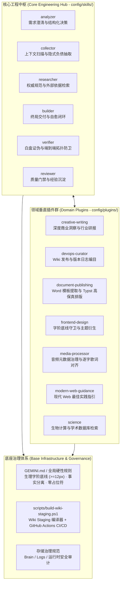
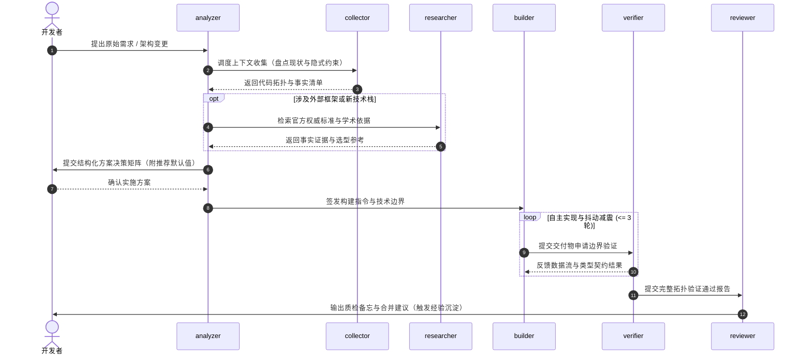
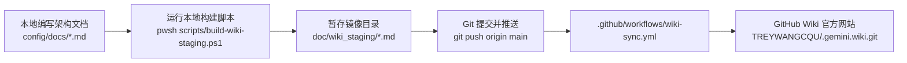

<!-- README.md -->
# .gemini 个人高阶 AI 工程资产与多智能体系统底座

[](file:///c:/Users/Reaticle/.gemini/CHANGELOG.md)
[](file:///c:/Users/Reaticle/.gemini/doc/wiki_staging/Home.md)
[](file:///c:/Users/Reaticle/.gemini/.github/workflows/wiki-sync.yml)

本项目作为个人高阶 AI 辅助软件工程、深度研报创作及多智能体系统（MAS）的全局基础设施，聚合了工程中枢、垂直领域插件、底座治理规范与持续集成流水线，为跨工作区复杂任务提供确定性交付保障。

---

## 1. 系统定位与资产拓扑全景

仓库承载从离散 Prompt 调用向体系化多智能体工程协同的演进。整体架构由**核心工程中枢**、**领域垂直插件群**与**底座治理体系**三层组成，通过明确的接口契约与数据流向消除各子系统间的协作损耗。



---

## 2. 核心工程中枢协作机制与控制闭环

核心工程中枢位于 [`config/skills/`](file:///c:/Users/Reaticle/.gemini/config/skills)，通过分工明确的六大智能体节点构建从需求输入到代码交付的闭环控制链路。

| 中枢模块 | 核心能力与职责 | 关键设计机制 | 产出成果与交付物 |
| :--- | :--- | :--- | :--- |
| **`analyzer`** | 业务需求解构、方案澄清与架构推演 | **低心智磨损向上通信契约**：复杂分支展开为结构化选择题（附推荐项与默认值），非 UI 环境自动降级 | 架构方案规格书、决策矩阵与模块分工 |
| **`collector`** | 项目代码拓扑盘点、环境基准与依赖勘测 | **上下文护城河机制**：显性化提取未文档化的胶水代码与历史负债，动态锁定 Token 消耗预算 | 结构化代码预览、资产清单与环境事实报告 |
| **`researcher`** | 外部官方文档、行业标准与学术论文验证 | **双重信源交叉核验**：限定权威公开源，杜绝未经证实的臆测与幻觉扩散 | 事实证据清单、技术选型依据与合规比对表 |
| **`builder`** | 依据核准方案执行高标准代码、配置与工程实现 | **系统抖动减震器**：模块内部吸收瞬态抖动，自愈重试次数硬性设限（$\le 3$ 轮），致命物理错误快速穿透 | 可执行源代码、补丁集与系统配置 |
| **`verifier`** | 逻辑证伪、类型契约验证与数学几何边界校验 | **端到端拓扑闭环防卫**：摆脱孤立单点断言，穿透模块间数据流死锁与局部最优陷阱 | 自动化测试套件、形式化验证日志与边界反例 |
| **`reviewer`** | 宏观需求对齐、变更范围审查与代码味道门禁 | **质量守卫与经验沉淀**：审查非必要变更与 AI 痕迹，触发技术避坑经验归档 | 评审审查备忘、整改建议与 `/learn` 规则资产 |

### 协作控制流与降级策略



---

## 3. 领域垂直插件群能力编目

垂直插件位于 [`config/plugins/`](file:///c:/Users/Reaticle/.gemini/config/plugins)，面向特定专业任务场景提供标准化工具链与专业知识资产：

### 3.1 深度写作与智库研报 (`creative-writing`)
- **`chinese-insight-writer`**：商业专栏、技术架构评论与战役复盘，遵循“结构优先于修辞、微观机制落地”原则。
- **`industry-report-writer`**：面向基础设施、数字化转型与政企业务的行业研究与战略咨询报告。
- **`chinese-reflective-writer` / `english-reflective-writer`**：深度随笔、心智反思与个人学术交流书信。
- **`research-paper-writer`**：工程技术、数据科学与跨学科研究学术论文撰写与同行评议。

### 3.2 研发运维与版本编目 (`devops-curator`)
- **`release-curator`**：跨技术栈版本变更探测，自动解析 `[BaseRef..TargetRef]` 差异并生成规范 Release Notes 与 CHANGELOG。
- **`wiki-curator`**：GitHub Wiki 自动化部署与目录编目治理，保障文档与代码同步。

### 3.3 文档出版与排版引擎 (`document-publishing`)
- **`docx-template-sync`**：逆向解析业务部门标杆 Word 文档样式指纹，聚类生成规范化 `reference.docx`。
- **`typst-publisher` / `Typst Writer`**：Typst 现代化排版编译、样式注水引擎与跨格式高保真发布。
- **`typst-archiver`**：逆向双阶段清洗历史 Word 文件，安全合流至源码工程。
- **`office-parser`**：现代 Office 文档（.docx, .xlsx）与矢量 PDF 的低 Token 高精度切片解析。

### 3.4 前端设计与字阶治理 (`frontend-design`)
- **`svg-designer`**：矢量图表与视觉架构图设计，内置硬性生理字阶安全门禁（$\text{font-size} \ge 12\text{px}$）与几何折行计算。
- **`web-theme-curator`**：从自然语言诉求推导 `design-tokens.json`，解耦派生 CSS 变量与图表主题。
- **`svg-skill-curator`**：项目专属 SVG 生成技能脚手架与版本漂移监测。

### 3.5 多媒体数据治理 (`media-processor`)
- **`audio-metadata-manager`**：跨格式（MP3, FLAC, WAV, M4A, OGG）无损元数据与封面批量嵌入。
- **`ai-lyrics-aligner`**：从 AI 音乐提示词与人声音轨中提取、清洗并生成逐词/逐句高精度 LRC、SRT 与 DAW 标记轨。

### 3.6 现代 Web 与科学计算 (`modern-web-guidance` & `science`)
- **`modern-web-guidance-plugin`**：现代化 Web 应用工程架构、视觉美学与技术选型准则。
- **`science`**：结构生物学与药物研发接口套件，直连 AlphaFold、ChEMBL、UniProt、Ensembl、PubChem 等专业数据库。

---

## 4. 底座治理体系与工程防护网

为了杜绝工程熵增与代码退化，系统在 [`GEMINI.md`](file:///c:/Users/Reaticle/.gemini/GEMINI.md) 及全局规则中确立了防线：

1. **生理字阶硬性底线**：
   - 所有生成的 CSS、HTML、SVG、Canvas 或图表配置中，渲染文字必须满足 $\text{font-size} \ge 12\text{px}$（或 $\ge 0.75\text{rem}$）。
   - 严禁通过 `transform: scale(<1.0)` 或 `zoom` 绕过字阶检查；文本碰撞优先采用旋转（$30^\circ / 45^\circ$）、间隔采样或截断 Tooltip 空间代偿策略。
2. **事实分离三元律**：
   - 严格分离事实（Fact）、判断（Judgment）与推测（Speculation）。未经验证的前提假设标注为待求证项。
3. **交付物零占位符规则**：
   - 严禁输出包含 `TODO`、省略逻辑、未实现 Mock 或伪代码的交付内容。
4. **文件路径首行自解释规约**：
   - 所有生成的代码块或补丁块必须在首行以对应语言注释标注相对文件路径（如 `<!-- relative/path/file.html -->`、`// relative/path/file.ts`）。
5. **存储安全与运行环境审计**：
   - 针对 `antigravity-ide/brain/`、`logs/` 与临时多媒体目录建立定期清理策略，严禁向工作区根目录溢出无序运行产物。

---

## 5. 持续交付与 Wiki 镜像流水线

本项目架构文档依托自动化编译脚本与 GitHub Actions 实现双向同步闭环：



- **源文档沉淀路径**：[`config/docs/`](file:///c:/Users/Reaticle/.gemini/config/docs/)。
- **本地编译器**：[`scripts/build-wiki-staging.ps1`](file:///c:/Users/Reaticle/.gemini/scripts/build-wiki-staging.ps1)，负责自动将 Windows 本地绝对路径规整为 GitHub Blob 永久链接与 Wiki 内部链接。
- **自动化同步流水线**：[`.github/workflows/wiki-sync.yml`](file:///c:/Users/Reaticle/.gemini/.github/workflows/wiki-sync.yml)，在 `main` 分支发生更新时自动化部署至 GitHub Wiki 网页端。

---

## 6. 协同操作指南与演进路线

### 6.1 常用协同指令与调用示例

```bash
# 1. 业务方案设计与交互式澄清
/analyzer 梳理个人技能体系重构方案并展开为结构化决策项

# 2. 外部权威标准与前沿事实查证
/researcher 检索 Web 字体渲染生理极限与主流设计系统字阶规范

# 3. 终局代码交付与闭环执行
/builder 实现 Wiki 暂存区自动化链接编译脚本，处理 Windows 路径兼容

# 4. 交付质量独立证伪与数据流核验
/verifier 白盒核验 build-wiki-staging.ps1 边界正则表达式并运行冒烟测试

# 5. 编译并同步 Wiki 知识库
pwsh scripts/build-wiki-staging.ps1
git commit -am "docs: update architecture specifications"
git push origin main
```

### 6.2 下一步演进路线

- **多智能体通信协议优化**：探索通过轻量级二进制/结构化 RPC 协议替代部分长文本上下文传递，进一步压缩认知带宽消耗。
- **跨平台脚本对齐**：补充 `scripts/build-wiki-staging.sh` 以实现 Linux/macOS 开发机环境下的零依赖原生编译能力。
- **领域插件动态注册中心**：完善各插件 `plugin.json` 元数据校验钩子，支持一键热插拔与环境兼容性探测。
