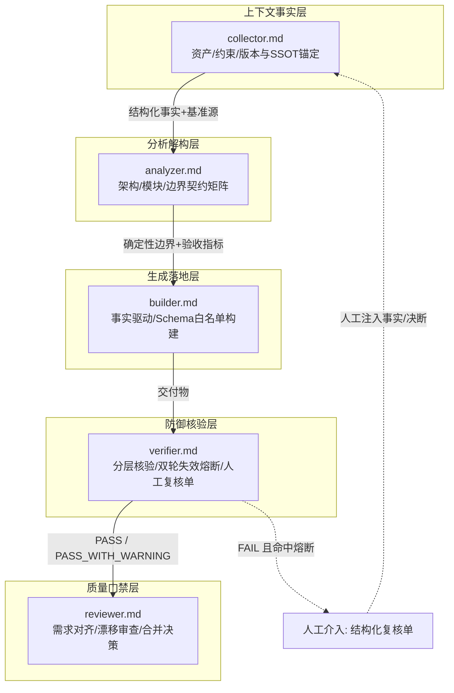
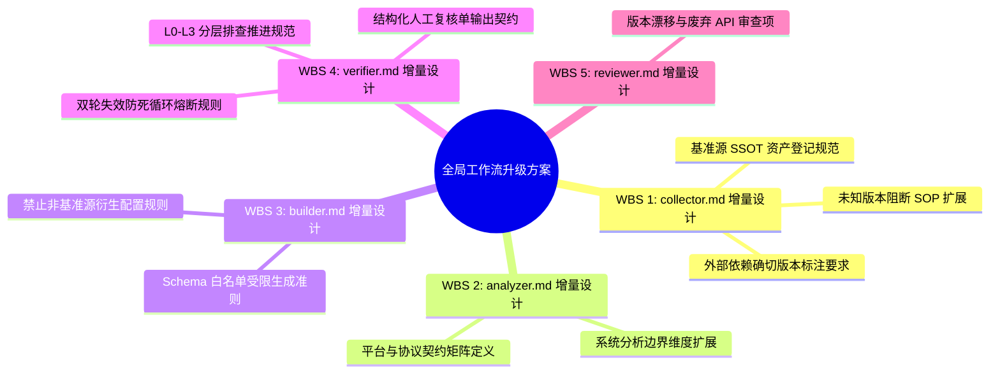

<!-- config/global_workflows/doc/20260903_global_workflows_upgrade_proposal.md -->
# 全局工作流架构增强方案：版本锚定、分层防御与熔断协议

- **文档状态**：PROPOSAL / BASELINE ARCHITECTURE
- **生效日期**：2026-09-03
- **目标组件**：`collector.md`, `analyzer.md`, `builder.md`, `verifier.md`, `reviewer.md`

---

## Objectives

1. **版本漂移与契约脱节防御**：在工作流上游建立“版本锚定（Version Anchoring）”与“官方单一可信源（SSOT）”注入机制，阻断过时语料在下游生成中的概率放大。
2. **阻断核验死循环（Anti-Looping Defense）**：为核验与排障环节建立分层诊断路径与“双轮失效熔断机制（2-Fail Circuit Breaker）”，防止假说未清零导致的重复错误分析。
3. **确定性人工复核协议（Actionable Human Review SOP）**：规范人工介入的触发阈值与输出格式，提供“单一验证动作 + 确切采集指令”，禁止模糊提示。
4. **通用适配性全面保全（Universal Adaptability Preservation）**：所有强化机制采用“条件触发/正交扩展”模式，确保在通用软件开发、文档编排、算法模型或脚本维护任务中零负荷、不产生逻辑破坏。

---

## Constraints

1. **通用兼容约束**：严禁将任何特定技术栈（如 Headscale、Docker、Linux/Windows 网络栈）硬编码为全局流程的强制阻断项；规则须抽象为工程通用的“运行时依赖与平台边界契约”。
2. **契约接口保持**：完整保留既有工作流的主结构与输出格式标记（如 `### Unknown Information` 任务列表、`## ASSUMPTION MATRIX`、`## STATUS`），仅做增量条款注入。
3. **分权隔离约束**：
   - `collector` 仅收集版本事实与基准源，严禁做设计推演；
   - `analyzer` 仅解构约束与边界矩阵，严禁编写具体配置；
   - `builder` 仅依据白名单事实与 Schema 落地，严禁发明参数；
   - `verifier` 独立审计并执行熔断，严禁直接改动业务代码。
4. **最小变更与无代码约束**：本阶段输出系统分析与更新架构设计，不直接修改目标文件，不生成最终实施代码。

---

## Architecture

### 1. 全局工作流控制闭环拓扑

---

### 2. 核心架构机制设计（正交解耦）

#### 机制 1：条件触发型版本与基准源锚定（Version & SSOT Grounding）
- **触发条件**：当任务涉及外部运行时、第三方中间件、依赖框架或底层网络系统时激活；纯算法或内部自闭环代码自动跳过。
- **作用节点**：`collector.md` 与 `builder.md`。
- **架构行为**：
  - `collector` 采集目标组件的确切 SemVer/Tag，并将官方基准配置（Official Example Config/Spec）纳入资产上下文。
  - `builder` 将生成范围严格限制在采集到的基准 Schema 之内，杜绝无事实来源的参数拼装。

#### 机制 2：跨系统/平台边界契约矩阵（Boundary Contract Matrix）
- **触发条件**：当交付物存在异构系统交互、跨平台调用或网络/系统调用时激活。
- **作用节点**：`analyzer.md`。
- **架构行为**：
  - 将分析从单一服务内部逻辑，扩展至“接入端平台（Windows/macOS/iOS/Linux）协议规范与底层机制（如命名规范、RFC、系统服务拦截）”的硬边界解构。

#### 机制 3：分层核验与双轮失效熔断（Layered Verification & 2-Fail Circuit Breaker）
- **触发条件**：在 `verifier.md` 中执行缺陷分析、配置校验或排障排查时激活。
- **架构行为**：
  - **分层推进法则（自底向上 L0 -> L1 -> L2 -> L3）**：
    - **系统/基础设施任务**：
      - **L0 基准层**：版本与配置 Schema 吻合度（是否存在废弃/私造字段）。
      - **L1 运行层**：进程状态与标准输出/错误日志。
      - **L2 契约层**：操作系统及网络协议栈刚性规范（RFC/底层机制）。
      - **L3 业务层**：应用参数与业务逻辑流。
    - **通用代码/文档任务同构映射**：
      - **L0 基准层**：语法规范与模式定义（Syntax / Document Schema）。
      - **L1 运行层**：编译器/渲染引擎输出与解析日志（Build / Engine Diagnostics）。
      - **L2 契约层**：宿主环境/输出格式标准规范（Format / Target Platform Spec）。
      - **L3 业务层**：领域模型与正文语义逻辑（Domain Logic / Content Semantics）。
  - **防死循环熔断器**：
    - **计数与判定判据**：在当前交互会话中，若针对同一故障现象连续 2 轮核验状态为 `FAIL` 且原因未收敛，状态显式升级为 `FAIL (Circuit Breaker Tripped)`，强制触发“假设清零（Ground Zero Reset）”，终止 AI 盲目微调。

#### 机制 4：确定性人工复核升级协议（Deterministic Human Escalation Protocol）
- **触发条件**：触发熔断、版本源缺失或涉及宿主机物理环境不可探测。
- **架构行为**：
  - 统一在 `verifier.md` 的 `## POTENTIAL LOCAL OPTIMA & INQUIRIES` 章节下输出标准化《排障熔断复核单》，包含“阻断现象、已否决假设、可疑冲突点、单一单步探测命令、明确预期判定标准”，杜绝“请检查你的环境”等无物理依据的模糊对话。

---

## Work Breakdown Structure

### WBS 1: [collector.md](file:///C:/Users/Reaticle/.gemini/config/global_workflows/collector.md) 增量设计
- **位置**：`# Responsibilities` 下针对软件/系统项目，以及 `### Constraints`。
- **设计增量**：
  1. **版本精确性采集**：对于外部服务、框架与中间件，强制采集具体版本（SemVer/Docker Tag/Git Commit），禁止将无版本标记的抽象技术项记为已确认事实。
  2. **基准源（SSOT）挂载**：在 `### Existing Assets` 下增加基准定义（如官方样例文件、规范文档切片），作为后续生成的强约束源。
  3. **未知信息风险流转**：若关键组件版本未知，在 `### Unknown Information` 列表中标为高风险，通过 SOP 路由用户确认或通过 `/researcher` 检索官方 Tag。

### WBS 2: [analyzer.md](file:///C:/Users/Reaticle/.gemini/config/global_workflows/analyzer.md) 增量设计
- **位置**：`# Responsibilities` 下软件任务与 `## Constraints` 输出。
- **设计增量**：
  1. **边界解构规范**：将系统边界明确区分为“内部业务边界”与“宿主/协议层物理边界”。
  2. **契约矩阵引入**：在分析阶段必须声明跨端协议规范（如 RFC 约定、操作系统底层解析与网络拦截特性），定义非功能性硬约束。

### WBS 3: [builder.md](file:///C:/Users/Reaticle/.gemini/config/global_workflows/builder.md) 增量设计
- **位置**：`# Additional Rules` 的 `Code:` 分支。
- **设计增量**：
  1. **Schema 白名单约束**：针对配置文件与系统调用，生成内容必须可追溯到 `collector` 或 `analyzer` 提供的基准 Schema，严禁由模型统计概率自创或混入历史不同大版本的语法。
  2. **配置最小化增量**：优先在基准配置上做就地差异打补丁，不凭空生成全量复杂配置文件。

### WBS 4: [verifier.md](file:///C:/Users/Reaticle/.gemini/config/global_workflows/verifier.md) 增量设计（核心防线）
- **位置**：`# Verification Areas`、`# Local Optimization & Context Audit Rules` 及 `# Output Format`。
- **设计增量**：
  1. **分层核验逻辑（L0~L3）**：定义排查与核验必须自底向上分层递进（系统任务与代码/文档同构映射），严禁在 L0（版本/Schema 对齐）未通过前调整 L3（业务逻辑参数）。
  2. **2-Fail 排障熔断准则**：同一故障连续 2 轮排查/修复未恢复时，强制执行假设清零（Ground Zero Reset），在 `## STATUS` 标注 `FAIL (Circuit Breaker Tripped)` 并停止盲目微调。
  3. **标准人工复核升级契约**：在熔断或环境不可探测时，统一在 `## POTENTIAL LOCAL OPTIMA & INQUIRIES` 章节输出《排障熔断复核单》（包含已否决假说、物理验证单步命令与明确预期输出），确保人工介入具备确切依据。

### WBS 5: [reviewer.md](file:///C:/Users/Reaticle/.gemini/config/global_workflows/reviewer.md) 增量设计
- **位置**：`## Architecture Compliance` 与 `## Quality Compliance`。
- **设计增量**：
  1. **版本漂移审查（Version Drift Audit）**：增加审查维度，检查交付物中是否含有已在目标版本中废弃的遗留实体、字段或 CLI 语法。

---

## Acceptance Criteria

### 1. 通用适配性合规门禁（Generic Adaptability Gate）
- [ ] 所有新加入的规则均为**条件性/领域自适应触发**（即：仅当涉及外部系统依赖、网络/基础设施或排障核验时生效）。
- [ ] 纯文档编写（如 Typst、Markdown）、通用业务代码编写或单体算法任务调用上述工作流时，无额外强制参数依赖，运行路径完全兼容。

### 2. 局部优化与死循环防御门禁（Anti-Looping Gate）
- [ ] 在 `verifier` 规范中具有明确的 2 轮失效计数器和强制熔断阻断指令，杜绝连续第 3 次无事实依据的表层推测。
- [ ] 核验流程强制要求自下而上（L0 语法/Schema -> L1 运行/日志诊断 -> L2 协议/平台规范 -> L3 业务/内容逻辑）分层推进。

### 3. 人工复核规范门禁（Human-in-the-Loop Gate）
- [ ] 复核提示必须具备标准化结构，包含：阻断现象、已推翻假设、当前可疑冲突、单一可执行排查指令（含宿主机/客户端平台指令）、预期判定标准。
- [ ] 杜绝任何“请检查你的配置/环境”等无具体操作的模糊提问。

### 4. 架构一致性门禁（Architectural Integrity Gate）
- [ ] 全局工作流各角色的职责边界无越权（Collector 不设计、Analyzer 不编码、Builder 不发明、Verifier 不直接改代码）。
- [ ] 各工作流 Markdown 的 YAML Frontmatter 与固有 Heading 命名保持不变。
