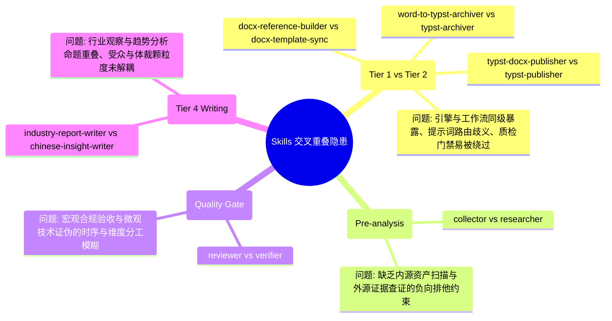

<!-- config/docs/20260917_skills_boundary_reconciliation_and_evolution_proposal.md -->
# 全局技能边界调和与架构演进方案 (Skills Boundary Reconciliation & Evolution Proposal)

- **文档状态**：EXECUTED / BASELINE ESTABLISHED
- **发布日期**：2026-09-17
- **分析主体**：`/analyzer` (System Analyst) 联合 `/verifier` (Verification Specialist)
- **实现交付**：`/builder` (Production Builder)
- **目标对象**：`config/skills/` 全量技能体系
- **归属目录**：`config/docs/`

---

## 1. 现状解构与问题定义 (Problem Statement & Diagnostic)

### 1.1 核心研发技能的操作语义与爆炸半径冲突
在日常高频人机协同工程（如智慧路桥大屏、中枢系统方案设计与代码研发）中，针对核心研发工作流存在两项现实诉求：
1. **Collector 事实补遗与增量更新**：在方案编写或迭代过程中，若发现遗漏事实、新增接口或漂移资产，希望直接调用 `/collector` 快速收集并就地更新方案中的事实基准。
2. **Reviewer 轻量文档审查即修复（Review & In-place Update）**：对于简单的任务文档、轻量设计或配置说明，`/reviewer` 审查发现细微错漏（如拼写错误、标点符号、规范注释缺失、格式对齐）后，希望具备类似代码 Linter `--fix` 的能力直接就地修正，避免“审计挑刺 -> 手动切换 Builder -> 重复 Prompt 修正”的高摩擦断层。

在传统静态分工视角下，写操作若被 Collector 和 Reviewer 无边界获取，将破坏 `/builder` 垄断交付物生成的质量防腐层。因此需要基于“操作语义与爆炸半径分级（Blast Radius Tiering）”实现无缝解耦。

### 1.2 全局技能交叉重叠审计发现（`/verifier` 审查结论）
根据 `/verifier` 针对 `config\skills` 下全部 23 项技能资产的自底向上核验，除核心研发体系外，系统还存在以下 **4 类深层次交叉重叠与架构冗余**：

---

## 2. 核心治理哲学与三大处置准则

### 准则一：基于爆炸半径的“三权分立与快速通道”（针对 Collector / Reviewer / Builder）
- **Builder 垄断创作与全量实现**：凡涉及系统架构正文起草、业务功能实现、跨文件结构性重构及实质性逻辑变更，严格归属于 `/builder`。
- **Collector 开放受限事实锚点对齐权（Fact-Sync Reconcile）**：仅允许修改目标文档的 `### Verified Facts` 或 `<!-- FACTS_START --> ... <!-- FACTS_END -->` 区域，严禁修改业务逻辑与架构推论；发现冲突时触发 `Drift Alert`。
- **Reviewer 开放 L0/L1 级原地快修权（Fast-Path Auto-Fix）**：允许直接修复单文件、无逻辑影响的语法格式（L0）与模板章节空缺（L1）；涉及 L2+ 逻辑与架构偏差必须阻断并签发整改单。

### 准则二：“工作流吸收引擎”与顶层暴露面收缩（针对 Tier 1 引擎 vs Tier 2 工作流）
- **根因剖析**：在 Antigravity 体系中，`config/skills/` 下的每个子目录均作为独立一级技能直接注册至系统提示词。将纯底层 CLI 脚本（Tier 1 引擎）与上层带质检编排的流程（Tier 2 工作流）同级暴露，直接导致 Agent 路由混淆，且用户/Agent 容易直接调用底层引擎而跳过上层工作流的大纲与网格质检门禁。
- **处置方案**：**将底层脚本收编入上层工作流的 `scripts/` 子目录，退役底层同名引擎技能**。对外统一收敛为单一工作流入口：
  - `docx-reference-builder` 脚本并入 `docx-template-sync/scripts/`，退役独立 `docx-reference-builder` 技能；
  - `word-to-typst-archiver` 脚本并入 `typst-archiver/scripts/`，退役独立 `word-to-typst-archiver` 技能；
  - `typst-docx-publisher` 脚本并入 `typst-publisher/scripts/`，退役独立 `typst-docx-publisher` 技能。

### 准则三：刚性负向排他约束与受众颗粒度解耦
- **内源盘点 vs 外源查证**：
  - `/collector`：专属管辖工作区本地代码树、本地工程资产与依赖清单；**严禁执行公网文献、学术论文与外部标准查证**。
  - `/researcher`：专属管辖公网技术文档、行业政策、学术论文与官方 RFC 标准；**严禁扫描本地工作区工程目录与代码资产**。
- **微观技术证伪 vs 宏观规范门禁**：
  - `/verifier`：定位为“白盒/深度技术证伪者”，负责 L0~L3 分层核验、拓扑/时序/数学/类型契约边界排查与清零未验证假设（防局部最优）；运行于研发/分析关键节点。
  - `/reviewer`：定位为“黑盒/顶层合规裁判员”，负责需求对齐、范围防腐、AI 痕迹与格式一致性门禁；运行于阶段性交付与合并前验收。
- **宏观智库研报 vs 中微观专业洞察**：
  - `industry-report-writer`：专属面向公建基建、数字政府、国企转型的宏观战略研报（事实 → 机制 → 趋势 → 机会 → 路径）。
  - `chinese-insight-writer`：剥离宏观行业趋势，专属聚焦企业管理实操、战役复盘、技术方案评论与商业专栏写作（现象 → 原因 → 机制 → 行动）。

---

## 3. 全局技能解耦规范与责任矩阵

### 3.1 跨技能责任与操作矩阵 (Unified Skills Matrix)

| 技能标识 | 核心定位与角色 | 允许读取范围 | 允许写入范围（Blast Radius） | 互斥/调用协作契约 |
| :--- | :--- | :--- | :--- | :--- |
| **`/collector`** | 本地资产盘点与受限事实对齐 | 本地工作区全域、本地已挂载资产 | **仅限文档内 Facts Anchor 区域** | 严禁公网文献与外部标准查证（移交 Researcher）；发现事实冲突触发 Drift Alert 移交 Analyzer |
| **`/researcher`** | 外部证据检索与事实查证 | 外部网络、官方文档、学术论文、行业标准 | **只读（仅输出分析/调研报告）** | 严禁扫描本地工作区代码与资产结构（移交 Collector） |
| **`/analyzer`** | 架构与结构解构者 | 本地事实、调研结论、需求原案 | **仅限系统分析/架构设计/WBS方案文档** | 接收 Collector 漂移告警重构架构；指导 Builder 实现；不编写业务代码 |
| **`/builder`** | 生产交付物唯一实现引擎 | 分析成果、全量事实、审查整改单 | **全工作区生产级文件（代码、配置、整套方案文档、补丁）** | 唯一合法创作与生产主体；承接 Reviewer L2+ 整改单与 Analyzer 架构设计 |
| **`/verifier`** | 深度技术证伪与局部最优防卫 | 目标代码、算法公式、接口定义、上下文 | **只读（仅输出核验报告与最小修复建议）** | 聚焦微观数学/拓扑/契约/时序底座证伪；双轮失败触发熔断；不替代宏观门禁 |
| **`/reviewer`** | 交付物质量门禁与快修者 | 交付产物、原始需求、架构规范 | **仅限单文件轻量文档的 L0/L1 机械性原地 Patch** | 聚焦宏观需求对齐、范围防腐与 AI 痕迹；L2+ 缺陷熔断交由 Builder |
| **`docx-template-sync`** | Word 标杆模板逆向提取与同步工作流 | 标杆 Word 文档 OpenXML | 目标 `reference.docx` 与全局模板目录 | 内嵌解包与指纹提取核心脚本；吸收退役 `docx-reference-builder` |
| **`typst-archiver`** | Word-to-Typst 两阶段逆向清洗与合流工作流 | 待合流/历史 DOCX 文档 | 暂存区 `.staging/` 及受控合流目标 `main.typ` | 内嵌四层清洗与 AST 比对脚本；吸收退役 `word-to-typst-archiver` |
| **`typst-publisher`** | Typst 正向编译质检与基线交付工作流 | Typst 源文件、reference.docx 模板 | 导出的 Word/PDF 及编译交付基线 | 内嵌 Pandoc 转换与 AST 注水脚本，集成大纲网格质检；吸收退役 `typst-docx-publisher` |
| **`industry-report-writer`** | 宏观产业研究与战略咨询报告撰写 | 政策文件、宏观经济数据、行业调研 | 战略研究报告、可行性研究文档 | 专注宏观政企与基建产业研报；不承接中微观战役复盘与技术评论 |
| **`chinese-insight-writer`** | 中微观硬核商业专栏与管理实操洞察 | 项目记录、管理案例、技术架构文档 | 分析评论文章、战役复盘、专栏稿件 | 专注机制拆解与微观行动落地；不承接宏观行业战略智库研报 |

---

## 4. 演化实施任务分解 (Work Breakdown Structure)

### Phase 1: 规范定义与基线确立 (已完成)
- [x] **Task 1.1**: 完成核心研发技能（Analyzer/Collector/Reviewer/Builder）边界调和方案。
- [x] **Task 1.2**: 运行 `/verifier` 完成 `config\skills` 全量 23 项资产的重叠核验与隐患定位。
- [x] **Task 1.3**: 扩充本治理提案至全域技能体系，建立统一技能责任矩阵。

### Phase 2: Tier 1 引擎收编与顶层暴露面收敛 (工作流吸收引擎 - 已完成)
- [x] **Task 2.1 (DOCX 模板体系收敛)**:
  - 将 `docx-reference-builder/scripts/` 资产迁移至 `docx-template-sync/scripts/`；
  - 更新 `docx-template-sync/SKILL.md`，将调用由跨技能调用改为内部脚本自包含调用；
  - 归档并移除 `config/skills/docx-reference-builder/` 技能目录。
- [x] **Task 2.2 (Word 逆向归档体系收敛)**:
  - 将 `word-to-typst-archiver/scripts/` 资产迁移至 `typst-archiver/scripts/`；
  - 更新 `typst-archiver/SKILL.md`，内嵌 Stage 1 与 Stage 2 完整脚本调用路径；
  - 归档并移除 `config/skills/word-to-typst-archiver/` 技能目录。
- [x] **Task 2.3 (Typst 编译发布体系收敛)**:
  - 将 `typst-docx-publisher/scripts/` 资产迁移至 `typst-publisher/scripts/`；
  - 更新 `typst-publisher/SKILL.md`，将 Pandoc AST 注水引擎作为内置编译内核；
  - 归档并移除 `config/skills/typst-docx-publisher/` 技能目录。

### Phase 3: 认知与门禁技能负向排他约束注入 (已完成)
- [x] **Task 3.1 (`collector/SKILL.md`)**:
  - 新增 Fact-Sync 模式与受限锚点写入规约；
  - 注入负向约束：严禁执行公网技术调研、论文检索与外部标准查证（明确指引至 `/researcher`）。
- [x] **Task 3.2 (`researcher/SKILL.md`)**:
  - 注入负向约束：严禁扫描本地工作区代码结构与提取工程文件资产（明确指引至 `/collector`）。
- [x] **Task 3.3 (`reviewer/SKILL.md`)**:
  - 新增 Fast-Path Auto-Fix 机制与 L0~L3 缺陷分级处置；
  - 明确与 `/verifier` 的时序边界：聚焦交付期需求对齐与规范验收，将深层算法与数学边界验证交由 `/verifier`。
- [x] **Task 3.4 (`verifier/SKILL.md`)**:
  - 声明其白盒证伪定位，明确不参与最终交付物的业务验收与排版门禁。

### Phase 4: Tier 4 写作技能定位精准剥离 (已完成)
- [x] **Task 4.1 (`industry-report-writer/SKILL.md`)**:
  - 强化宏观产业、数字政府、公建基建战略研报定位，声明不承接微观管理与个人专栏。
- [x] **Task 4.2 (`chinese-insight-writer/SKILL.md`)**:
  - 剥离“宏观行业趋势研究”描述，重构适用场景为：管理思考、战役/项目复盘、技术架构评论与硬核商业专栏。

---

## 5. 验收标准 (Acceptance Criteria)

1. **顶级暴露面精简确定性 (Surface Cleanliness)**：
   - 移除 3 个 Tier 1 冗余技能后，`config/skills/` 顶级技能数由 23 项收敛至 20 项，消除双胞胎技能带来的路由混淆与上下文冗余。
2. **零越权与负向排他生效 (Negative Constraint Enforcement)**：
   - Collector、Researcher、Reviewer、Builder、Verifier 各自包含显式负向约束清单，在提示词中能实现 100% 确定性的职责路由，无推诿无越界。
3. **原地快修与事实同步安全 (Safe Fast-Paths)**：
   - Collector Fact-Sync 模式不污染方案推论；Reviewer Fast-Path 仅修 L0/L1 机械缺陷且保留完整修复日志。
4. **资产自包含与脚本可执行性 (Execution Integrity)**：
   - 收编至 `scripts/` 的所有 Python 脚本路径均更新为工作流内部相对/绝对路径，保证端到端调用 100% 可行，无失效死链。

