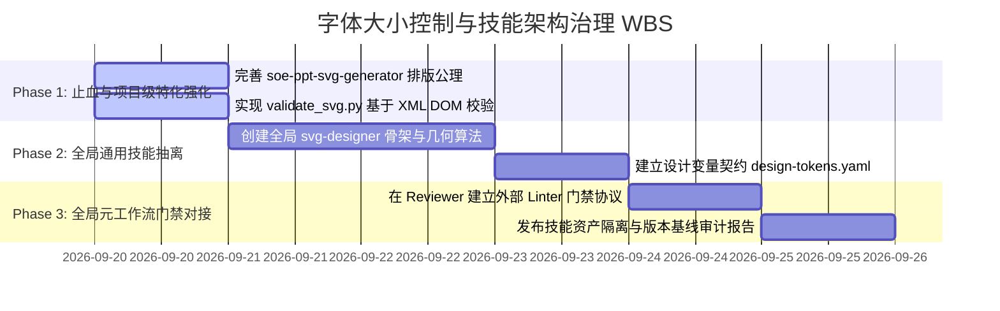
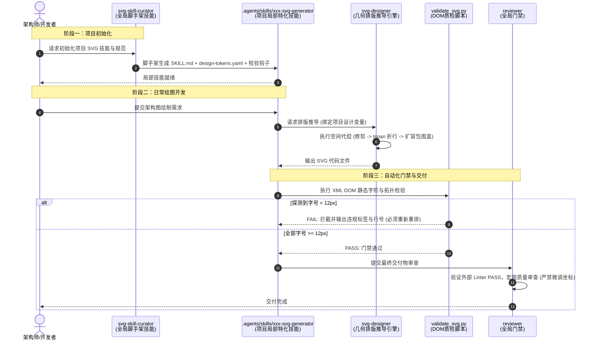

<!-- config/docs/20260920_typography_scale_control_and_skills_boundary_specification.md -->
# 字体大小控制与矢量排版技能边界架构规范
# (Typography Scale Control & Skills Boundary Architecture Specification)

- **文档状态**：PROPOSED / ARCHITECTURAL BASELINE
- **编制日期**：2026-09-20
- **分析主体**：`/analyzer` (System Analyst)
- **复核输入**：`/verifier` 风险审查结论 (PASS_WITH_WARNING 微观几何与算法边界核查，已闭环)
- **目标目录**：`C:\Users\Reaticle\.gemini\config\docs\`

---

## 1. Objectives (目标解构)

### 1.1 业务与体验痛点
大语言模型在生成 SVG 架构图、技术流程图及前端组件时，普遍存在**“空间代偿本能”**：当文字内容超出容器几何宽度时，模型倾向于通过压缩字号（如缩减至 `8px~10px`）来避免视觉溢出，导致生成的图形在实际屏幕或投影中出现严重的可读性坍塌。

### 1.2 系统治理核心目标
1. **根治字号过小顽疾**：确立正向排版几何推导模型，将 `font-size ≥ 12px` 确立为常规可读性生理底线，杜绝缩字号代偿。
2. **防范元架构污染风险**：严格隔离**“全局通用工程工作流（Global Meta-Workflows）”**与**“领域/项目级矢量排版技能（Domain/Project SVG Skills）”**，防止将特定排版规则（如 `<tspan dy="...">`、`12px`）硬编码到全局通用的 `builder`、`reviewer`、`verifier` 中。
3. **消除次生几何重排崩溃**：确立质量门禁的原子边界，严禁 Reviewer 越权执行涉及几何级联重排的“字号升级与坐标微调 Auto-Fix”，确保几何排版责任内聚在生成器引擎中。
4. **建立确定性质检底座**：基于真实 XML DOM 计算树建立确定性验证工具（`validate_svg.py`），替代不可靠的单行正则匹配。

---

## 2. Constraints (边界契约矩阵)

为彻底阻断跨层级污染与职责击穿，建立如下**四维边界契约矩阵（Four-Tier Boundary Contract Matrix）**：

| 层级维度 | 归属主体 | 核心职责 | 绝对禁止（Negative Constraints） | 准入交付物 |
| :--- | :--- | :--- | :--- | :--- |
| **Tier 0<br>全局元工作流** | `builder`<br>`reviewer`<br>`verifier` | - 通用代码与文档构建<br>- 宏观质量验收与范围防腐<br>- 微观数学/时序/逻辑契约证伪 | - **严禁硬编码**特定技术栈语法标签（如 SVG `<tspan>`、CSS 像素阈值）<br>- **严禁 Reviewer 执行几何重排与坐标微调**<br>- **严禁 Verifier 承接静态样式 Lint** | 全语言通用代码、标准工程文档、宏观门禁报告 |
| **Tier 1<br>领域设计中枢<br>(双全局 Skill)** | `svg-designer`<br>*(矢量排版与质检核心)*<br><br>`svg-skill-curator`<br>*(局部技能脚手架与编目)* | - **`svg-designer`**：规范矢量骨架与字阶生理底线（$\ge 12\text{px}$）、提供通用文字占宽与折行几何推导算法、内置确定性 XML DOM 质检脚本（`validate_svg.py`）<br>- **`svg-skill-curator`**：指导与自动化初始化独立项目局部 SVG Skill（如 `.agents/skills/<project>-svg-generator`）、生成 `design-tokens.yaml`、管理局部技能版本升级与跨项目同步 | - 严禁在 `svg-designer` 中硬编码具体项目的业务色板与品牌私有资产<br>- 严禁绕过 DOM 校验直接输出不可读字号<br>- 严禁在脚手架阶段混入不可控的动态计算逻辑 | 标准 SVG 代码、通用矢量模版、`scripts/validate_svg.py`、项目局部技能脚手架模版 |
| **Tier 2<br>项目特化工作流** | `soe-ppt-svg-generator`<br>*(项目定制技能原型)* | - 绑定具体项目设计规范（如国企稳健风格、16:9 画幅、特定业务配色）<br>- 特化业务组件封装（标头、徽章、双栏容器） | - 严禁脱离 Tier 1 基础几何规范自造非标准 XML 结构<br>- 严禁将字号设为低于 12px 的静态常数 | 业务架构图、汇报 PPT 配图、项目特化 SVG 资产 |
| **Tier 3<br>外部参数契约** | `design-tokens.yaml`<br>*(项目数据资产)* | - 静态声明色板、边距、字阶规范与特殊场景豁免名单（如 Sparkline 豁免） | - 严禁包含可执行脚本或动态计算逻辑 | 纯数据配置文件 (JSON/YAML) |

### 2.1 审查者与验证者排他性契约 (Reviewer & Verifier Contract)
- **Reviewer 契约**：Reviewer 发现 `font-size < 12px` 时，必须判定为 `L2 逻辑/几何层缺陷`，签发 `FAIL` 阻断单并打回生成器，**绝对不允许在 Reviewer 阶段就地将 9px 强改至 12px 并“微调坐标”**。因为字号从 9px 放大至 12px，文本宽度物理膨胀超过 33%，必须由生成器重新求解容器包围盒（Bounding Box）。
- **Verifier 契约**：坚决贯彻 [verifier/SKILL.md](file:///C:/Users/Reaticle/.gemini/config/skills/verifier/SKILL.md) 负向约束，不参与静态字号的正则扫描；Verifier 仅在涉及复杂矢量几何算法、非线性路径计算、坐标空间拓扑防重叠推导时提供数学与逻辑求证。

---

## 3. Architecture (系统架构与数据流模型)

### 3.1 总体拓扑与流转模型
系统解耦为“元工作流调度”、“领域排版求解”、“数据配置驱动”与“确定性门禁拦截”四层结构：

```mermaid
graph TD
    UserReq[用户设计/绘图/工程请求] --> Dispatcher{任务类型分流}
    
    subgraph GlobalMeta[全局元工作流层 (纯净通用)]
        B[builder: 调度实现]
        R[reviewer: 门禁判定]
        V[verifier: 拓扑证伪]
    end

    subgraph GlobalDomain[Tier 1 全局领域设计与编目层 (双全局 Skill)]
        Curator[svg-skill-curator: 局部技能脚手架与同步编目]
        subgraph SvgDesigner[svg-designer: 矢量排版核心中枢]
            GeoEngine[几何与折行计算引擎: 空间代偿三原则]
            Validator[scripts/validate_svg.py: XML DOM 确定性质检]
        end
    end

    subgraph ProjectSkill[Tier 2 项目特化层: .agents/skills/xxx-svg-generator]
        Tokens[(design-tokens.yaml: 项目色阶/比例/字号/豁免)]
        Templates[业务卡片与拓扑模版库]
    end

    Dispatcher -->|通用工程代码/文档| B
    Dispatcher -->|初始化/升级项目矢量技能| Curator
    Dispatcher -->|项目矢量图绘制需求| ProjectSkill
    
    Curator -->|脚手架初始化/模板同步| ProjectSkill
    Curator -->|注入基线规范与校验入口| Tokens
    
    ProjectSkill -->|读取设计变量| Tokens
    ProjectSkill -->|继承排版几何算法| GeoEngine
    
    GeoEngine -->|空间不足时触发三代偿| MultiLine[1. 文本精炼<br>2. 显式折行 tspan<br>3. 容器几何外扩]
    MultiLine --> RenderSVG[输出 SVG 交付物]
    
    RenderSVG --> Validator
    Validator -->|解析计算样式与继承树| CheckResult{DOM 检验}
    
    CheckResult -->|"存在字号 < 12px"| FailGate[拦截失败: 报错且禁止渲染]
    FailGate -->|打回重排| GeoEngine
    
    CheckResult -->|通过硬门禁| R
    R -->|读取验证器状态 PASS| FinalPass[正式交付]
```

### 3.2 空间代偿排版推导算法 (Spatial Compensation Model)
针对矢量图形中文本容纳问题，确立严格的数学推导优先级，杜绝“降字号代偿”：

$$\text{AvailableWidth} = W_{\text{container}} - 2 \times \text{Padding}_{\text{horizontal}}$$

$$\text{EstimatedTextWidth} = \sum_{i=1}^{N} \text{GlyphWidth}(char_i, \text{FontSize})$$

其中对于混合字符宽度估算：
$$\text{GlyphWidth}(char_i, \text{FontSize}) \approx \begin{cases} \text{FontSize}, & char_i \in \text{CJK / 全角字符} \\ 0.55 \times \text{FontSize}, & char_i \in \text{ASCII / 半角英数} \end{cases}$$

**空间不足决策流（按严密顺序执行）：**
1. **决策 1（文案修剪与精炼）**：在不损失核心术语语义的前提下，移除冗余助词或缩短标签。
2. **决策 2（显式折行分行）**：当 $\text{EstimatedTextWidth} > \text{AvailableWidth}$ 时，基于累计物理字宽动态分词分行（$\sum_{k=1}^m \text{GlyphWidth}(char_k) \le \text{AvailableWidth}$），将单行 `<text>` 转换为多行 `<tspan x="..." dy="1.35em">`（首行锚定基线或 `dy="0"`，后续行以相对字阶行高 `dy="1.35em"` 递增，严禁硬编码固定像素值）。
3. **决策 3（容器几何外扩与画布级联）**：若折行后总行高 $\sum H_{\text{line}} > \text{AvailableHeight}$，必须同步递增容器外框（`<rect>`）的高度 $H \leftarrow H + \Delta H$ 与纵向位移 $Y$，重新计算下游图元拓扑锚点；同时级联刷新顶层 `<svg viewBox="0 0 W_canvas H_canvas">` 画布尺寸 $H_{\text{canvas}} \leftarrow \max(H_{\text{canvas}}, \max_i(Y_i + H_i + \text{Padding}_{\text{bottom}}))$，杜绝画布视野截断。
4. **硬性底线（Hard Floor）**：$\text{FontSize} \ge 12\text{px}$ 恒成立，严禁通过调小字号来适配固定容器。

---

## 4. Work Breakdown Structure (工作分解结构与演进计划)



### 4.1 Phase 1：项目级排版防御强化（立即可行，零全局破坏）
- **Task 1.1**：在项目级特化技能原型（如 `soe-ppt-svg-generator/SKILL.md`）中强化负向约束：
  - 明确写入：`禁止任何形式的 font-size < 12px 声明`；
  - 注入空间代偿三原则（精简 -> 折行 -> 扩容器）。
- **Task 1.2**：编写高可靠性 `validate_svg.py`：
  - 使用 Python 内置 `xml.etree.ElementTree` 解析 SVG 树；
  - 递归解析 `<g font-size="...">` 继承属性与内联 `style="font-size: ..."`；
  - 严格捕获并拒绝任何低于 12px 的数值；对特殊豁免元素（如具备 `data-allow-micro-font="true"` 属性的密集趋势曲线刻度）提供白名单机制。

### 4.2 Phase 2：全局通用矢量中枢与脚手架沉淀（双全局解耦）
- **Task 2.1**：在 `config/skills/svg-designer/` 建立通用矢量排版技能：
  - 收敛纯净的 SVG 骨架模版、标准 defs 渐变与阴影、字阶底线（$\ge 12\text{px}$）与网格对齐计算器；
  - 移植并固化 `scripts/validate_svg.py` 为全局通用质检工具。
- **Task 2.2**：在 `config/skills/svg-skill-curator/` 建立项目局部技能编目与脚手架：
  - 制定标准 `design-tokens.schema.json`，分离色板、比例与字阶契约；
  - 实现 `/svg-skill-curator scaffold` 一键脚手架功能，向目标工作区 `.agents/skills/<project>-svg-generator` 快速装配标准化模版与校验脚本；
  - 实现 `/svg-skill-curator audit/sync` 跨项目版本漂移探测与升级更新机制。

### 4.3 Phase 3：全局元工作流挂接与防护锁定
- **Task 3.1**：在全局 [reviewer/SKILL.md](file:///C:/Users/Reaticle/.gemini/config/skills/reviewer/SKILL.md) 中增加通用外部门禁挂接规范（External Quality Gate Protocol）：
  - 保持规则正文通用纯净；增加声明：“当交付物存在绑定的静态质检脚本（如 `validate_svg.py`）时，Reviewer 以该脚本的执行返回值作为门禁前置判定；执行失败直接判定为 FAIL 并阻断，禁止擅自修改布局文件”。
- **Task 3.2**：对 [verifier/SKILL.md](file:///C:/Users/Reaticle/.gemini/config/skills/verifier/SKILL.md) 保持完全不修改，维护其微观证伪排他的最高纯度。

---

## 5. Acceptance Criteria (验收指标体系)

| 验收维度 | 指标项 | 验证方式 | 合格阈值 | 失败动作 |
| :--- | :--- | :--- | :--- | :--- |
| **可读性保底** | 最小渲染字号 | `python validate_svg.py <file.svg>` | 全部文本节点 $\ge 12\text{px}$ (非豁免) | 阻断交付，构建器必须执行折行或扩容重排 |
| **排版完整性** | 容器文字溢出率 | 几何包围盒比对 ($W_{\text{text}} \le W_{\text{box}}$) | 文本超出包围盒像素 $= 0\text{px}$ | 判定为几何拓扑穿透缺陷 |
| **元工作流纯度** | 全局技能无污染 | 检查 `builder`, `reviewer`, `verifier` 源码 | 包含 SVG / CSS / px 专有规则数 $= 0$ | 判定为元架构退化，必须撤销改动 |
| **权限合规性** | Reviewer 越权检测 | 审查 Reviewer 的修复日志 (`AUTO_REMEDIATION_LOG`) | 涉及几何坐标 (`x`, `y`, `cx`, `cy`, `d`) 修改量 $= 0$ | 判定为严重越权，撤回审查结果 |
| **脚本确证性** | DOM 解析覆盖度 | 校验脚本针对内联 style、节点继承及 CSS 类选择器 | 复杂嵌套继承测试用例通过率 $= 100\%$ | 禁止使用粗糙单行正则替代 |

---

## 6. Operations & Implementation Guide (工程落地与使用指南)

### 6.1 全局技能拓扑选型与架构决策：建 1 个还是 2 个全局 Skill？

在系统落地实践中，针对“全局约束 SVG/CSS 字体大小”与“指导独立项目局部 SVG 技能的初始化和更新”的分工，存在两种架构拓扑形态：

| 拓扑架构 | 模式定义 | 职责划分 | 优势 | 劣势与潜在风险 | 决策结论 |
| :--- | :--- | :--- | :--- | :--- | :--- |
| **模式 A<br>单全局 Skill<br>(单体聚合型)** | 将排版设计、几何折行算法、质检脚本与脚手架生成全部封装在单一 `svg-designer` 中 | `svg-designer` 同时承接：<br>1. 矢量/CSS 字阶基线与几何推导<br>2. 项目脚手架生成与版本同步 | 全局技能目录项数少，单点维护 | **职责混淆 (违反单一职责原则 SRP)**：<br>- 日常高频绘图上下文被低频脚手架规则稀释；<br>- LLM 在执行普通图表渲染时容易误解析脚手架元提示词，引发模型指令漂移与响应退化。 | **不推荐** |
| **模式 B<br>双全局 Skill<br>(关注点分离型)** | 拆分为**运行时矢量排版引擎**与**生命周期编目管理中枢**双技能 | 1. `svg-designer` (生产与质检)<br>2. `svg-skill-curator` (脚手架与编目维护) | **架构纯净、提示词高内聚**：<br>- 绘图归绘图，运维归运维；<br>- 完全契合 Antigravity 生态既有标杆模式（如 `typst` 与 `typst-archiver`，`wiki-curator`，`release-curator`）。 | 全局技能数量增加 1 个（通过清晰命名空间完全隔离） | **官方推荐架构<br>(Recommended)** |

#### 6.1.1 推荐方案：双全局 Skill 分工契约

1. **全局技能 1：`svg-designer` (运行时矢量排版引擎与质检中枢)**
   - **定位**：Tier 1 领域中枢（负责**“怎么画、怎么算、怎么查”**）。
   - **核心职责**：
     - **字阶物理底线**：硬性约束常规文本 $\text{font-size} \ge 12\text{px}$，确立标准字阶表（12px 辅助说明 / 14px 正文 / 16px 强调正文 / 18px 小标题 / 24px 主标题 / 32px 封面巨标）。
     - **空间代偿几何算法**：当容器空间受限时，严格遵循“文本精炼 $\to$ `<tspan>` 显式折行 $\to$ 外框 `<rect>` 几何下延扩容”的计算逻辑。
     - **确定性 DOM 质检底座**：内置并维护 `scripts/validate_svg.py`，供各项目与 CI 流水线直接调用。
   - **适用场景**：日常任何需要生成高保真、可读性达标的 SVG 图表、架构图、流程图或前端矢量组件的开发任务。

2. **全局技能 2：`svg-skill-curator` (项目局部技能脚手架与生命周期编目器)**
   - **定位**：Tier 1 管理类技能（负责**“怎么建、怎么管、怎么迁”**，遵循 Antigravity 生态的 `*-curator` 模式）。
   - **核心职责**：
     - **一键脚手架（Scaffold）**：在目标项目工作区根目录下自动创建 `.agents/skills/<project>-svg-generator/`，生成标准化 `SKILL.md`。
     - **契约资产注入**：自动为项目生成符合规范的 `design-tokens.yaml`（抽取色板、卡片风格、宽高比、豁免白名单等），并软链或挂接全局 `validate_svg.py` 质检入口。
     - **跨项目审计与同步（Audit & Sync）**：当全局 `svg-designer` 规则演进或修复时，扫描已部署的项目局部技能，生成 Diff 报告并执行安全合流更新，防止局部规则腐化。
   - **适用场景**：新项目立项、需要定制团队特化图形风格（如国企汇报 PPT 模版、特定大屏看板风格）、或者对老旧项目进行矢量技能合规升级。

---

### 6.2 SVG 与 CSS/Web 字体大小控制的边界联动与差异辨析

在跨媒介开发中，必须准确理解 SVG 与 CSS 的渲染机制差异，避免生搬硬套：

```mermaid
graph LR
    subgraph SharedContract[通用人眼舒适生理底线 (Shared Ergonomics)]
        Floor["font-size >= 12px (常规可读文本绝对底线)"]
    end

    subgraph CSSWorld[CSS / Web 渲染范式]
        BoxFlow["流式布局与盒模型 (Flexbox / Grid)"]
        BrowserWrap["浏览器原生自动折行 (word-break / flex-wrap)"]
        RelUnits["相对尺寸单位 (rem / em / clamp)"]
    end

    subgraph SVGWorld[SVG 矢量渲染范式]
        FixedCoord["绝对坐标系统 (viewBox 坐标空间)"]
        NoAutoWrap["缺少原生自动折行 (需手动计算 tspan x, dy)"]
        ScaleDistort["图形缩放引起视觉字号物理塌陷"]
    end

    Floor --> CSSWorld
    Floor --> SVGWorld
```

1. **机制共性（生理底线完全相同）**：
   - 无论是 CSS 还是 SVG，均不得将常规正文或注释字号缩小至 `8px~10px`。低于 12px 的文本在常规显示设备上均会引发阅读生理疲劳与模糊（Chrome 渲染引擎原生对 `<12px` 的 CSS 文字进行防小字号干预）。
2. **机制差异（排版求解完全不同）**：
   - **CSS 场景**：容器宽度不足时，浏览器具有原生排版流机制（Layout Reflow），文字会自动换行扩撑容器高度；
   - **SVG 场景**：SVG `<text>` 属于绝对坐标定位，不存在原生换行容器。**“空间代偿”在 SVG 中是几何推导的刚需**：必须由 `svg-designer` 依据字宽估算公式，计算单行字符容量，显式生成 `<tspan x="..." dy="...">` 并重算容器矩形几何包围盒。

---

### 6.3 完整端到端操作工作流与实操 SOP (Step-by-Step Workflow)



#### 步骤 1：新建独立项目局部 SVG 技能 (Project Initialization)
在全新业务项目（例如：新建智慧交通平台前端工程）中，若需要统一出图规范：
1. 启动 `svg-skill-curator`：
   ```bash
   # 指令触发示例
   /svg-skill-curator scaffold --name traffic-arch-svg-generator --aspect-ratio 16:9
   ```
2. 技能将在当前工作区生成如下目录结构：
   ```text
   .agents/skills/traffic-arch-svg-generator/
   ├── SKILL.md                 # 注入空间代偿三原则与项目特化提示词
   ├── design-tokens.yaml       # 声明交通科技蓝主色系、标准字阶、卡片内边距
   ├── templates/               # 预置三层架构、数据流向、事件状态卡片模板
   └── scripts/
       └── validate.py          # 挂接全局 validate_svg.py 的本地调用入口
   ```

#### 步骤 2：日常矢量图生成 (Vector Rendering)
在项目开发过程中，用户要求绘制架构图：
1. 调度 `.agents/skills/traffic-arch-svg-generator`；
2. 技能读取 `design-tokens.yaml` 中的色值与比例；
3. 执行排版推导算法：遇到较长说明文字时，**坚决不缩字号**，主动精炼文本并拆解为 `<tspan x="..." dy="1.35em">` 多行文本（首行 `dy="0"` 或锚定基线，后续行以相对字阶行高 `dy="1.35em"` 递增），外层 `<rect>` 高度与顶层 `viewBox` 画布尺寸联动级联外扩；
4. 输出目标文件 `docs/architecture.svg`。

#### 步骤 3：确定性质检门禁判定 (Deterministic Quality Gate)
生成器渲染完毕后，必须自动或手动调用确定性验证器：
```bash
python .agents/skills/traffic-arch-svg-generator/scripts/validate.py docs/architecture.svg
```
- **门禁未通过**（如探测到某第三方图标附带了 `font-size: 10px`）：
  - 验证器精确输出违规行号、元素标签及父节点继承链路；
  - 生成器必须原地修正，重新求解几何布局，禁止交付；
- **门禁通过**（输出 `VALIDATION SUCCESS: All fonts >= 12px`）：
  - 流转至 `/reviewer` 进行宏观质量验收。

#### 步骤 4：Reviewer 宏观门禁与范围防腐 (Review & Merge)
1. `/reviewer` 读取外部验证器返回值 `PASS`；
2. Reviewer 依据宏观准则校验技术栈一致性与 AI 痕迹；
3. **特别约束**：若 Reviewer 发现微小排版不协调，**严禁自行在 Diff 中微调 `x`, `y` 坐标**，必须打回由生成器依据几何算法重新求解导出。

#### 步骤 5：项目技能与全局基线同步 (Maintenance & Evolution)
当全局 `svg-designer` 更新了折行支持（例如增加对 emoji 或全角标点的字宽补偿算法）时：
1. 调度 `svg-skill-curator`：
   ```bash
   /svg-skill-curator audit
   ```
2. Curator 自动扫描本地 `.agents/skills/*/`，识别版本漂移（Version Drift）；
3. 执行 `sync` 命令平滑升级本地验证脚本与模板逻辑，保护项目特有的 `design-tokens.yaml` 业务参数不被覆盖。
