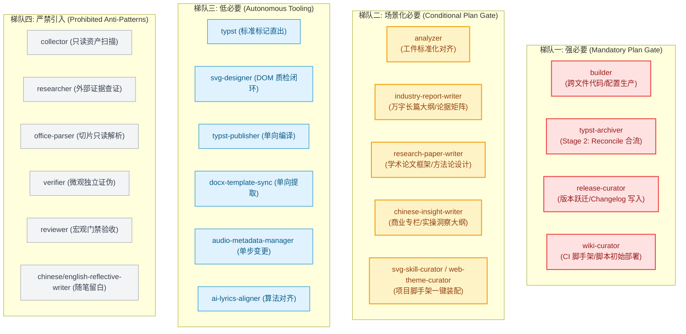
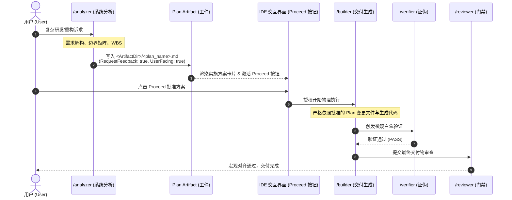
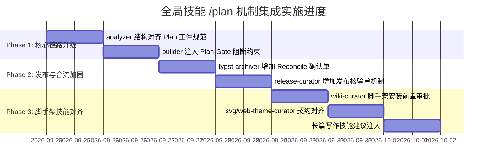

<!-- config/docs/20260924_global_skills_plan_mechanism_integration_architecture.md -->
# 全局技能集成 /plan 交互门禁机制架构方案 (Global Skills Plan Mechanism Integration Architecture)

- **文档状态**：IMPLEMENTED / ACTIVE
- **制定日期**：2026-09-24
- **分析主体**：`/analyzer` (System Analyst)
- **输入依据**：`/researcher` 全局技能审计与 Antigravity 原生 Planning Mode 契约分析
- **目标对象**：`config/skills/` 23 项自研全局技能体系
- **归属目录**：`config/docs/`

---

## 1. 背景与问题定义 (Context & Diagnostic)

### 1.1 核心痛点与工程失控隐患
在当前的个人全局技能架构中，各专业技能已实现高水平的职责正交分离（如 Collector 只读、Researcher 查证、Verifier 微观证伪、Reviewer 宏观验收）。然而在涉及**实体资产变更、跨文件代码重构、脏数据合流及工程脚手架注入**的场景下，仍存在严重的工程失控隐患：

1. **`builder` 的无缓冲物理写穿透**：
   - 现行 `builder/SKILL.md` 的约束仅声明“遵循 analyzer 结果或已验证事实”，但在实际会话中，当用户提出中大型需求并直接触发 `builder` 时，模型往往直接跳过顶层推演，迅速向工作区生成或修改多个源文件。缺少一次**结构化的前置方案审批与爆炸半径锁定**。
2. **`typst-archiver` (Reconcile) 的逆向合流风险**：
   - Stage 2 会签合流操作需要解析“脏 Word”文档并通过 AST 替换 `main.typ` 中的对应章节。若语义分级或标题正则出现微小偏差，会导致主工程源码发生不可逆的内容覆盖或结构错位。
3. **`release-curator` 与 `wiki-curator` 的基础设施副作用**：
   - `release-curator` 会向项目 `CHANGELOG.md` 注入发布段落、生成 Release 文档并在宿主环境提示执行 `gh release create` / `git tag`。
   - `wiki-curator` 在冷启动检测时，会自动向根目录创建 `.github/workflows/wiki-sync.yml` 与本地构建脚本。
   - 这类具备宿主环境/CI/Git 历史副作用的行为，若在未呈现方案的情况下静默执行，极易污染工程基线。
4. **`analyzer` 与 Antigravity 原生 `/plan` 的契约断层**：
   - `analyzer` 目前输出为对话内的离散章节，未与 Antigravity IDE 的原生 **Planning Mode 工件协议（`RequestFeedback: true`, `UserFacing: true`）**及图形化“Proceed / Approve”交互按钮打通，导致分析成果难以直接转化为受控的执行门禁。

---

## 2. 核心治理哲学与分类矩阵 (Governance & Classification)

引入 `/plan` 机制的绝对准则是：**只对“产生物理变更、具备多解性或具有高爆炸半径”的操作施加门禁；坚决杜绝在只读探针、事后质检或感性写作中滥用计划**。

### 四级处置分类表

| 梯队 | 归属技能 | 引入策略 | 核心理由 |
| :--- | :--- | :--- | :--- |
| **Tier 1 (强必要)** | `builder`, `typst-archiver` (Reconcile), `release-curator`, `wiki-curator` (Scaffold) | **强制前置门禁** | 涉及物理写操作、Git 历史变更、CI 工作流注入或源码覆盖，必须经由用户审批 Plan 后方可落地。 |
| **Tier 2 (场景化必要)** | `analyzer`, `industry-report-writer`, `research-paper-writer`, `chinese-insight-writer`, `svg-skill-curator`, `web-theme-curator` | **大体量/初始化推荐** | `analyzer` 结构化转化为 Plan 工件；长篇巨著/专栏在起草前锁定论据与大纲；脚手架在初始化时锁定目录结构。 |
| **Tier 3 (低必要)** | `typst`, `svg-designer`, `typst-publisher`, `docx-template-sync`, `audio-metadata-manager`, `ai-lyrics-aligner` | **保持免审批直出** | 单向流管道、纯净标记生成、轻量单文件产出或工具内已包含确定性质检与代偿算法，无需增加审批摩擦。 |
| **Tier 4 (严禁引入)** | `collector`, `researcher`, `office-parser`, `verifier`, `reviewer`, `chinese/english-reflective-writer` | **绝对禁止 (反模式)** | 只读雷达前置计划会导致认知死锁；质检门禁在事后运行无需预先计划；随笔写作强加工程计划会彻底破坏文学留白与呼吸感。 |

---

## 3. 架构设计与边界契约矩阵 (Architectural Design & Contract Matrix)

### 3.1 核心流转机制：Analyzer 与 IDE 原生 `/plan` 的同构融合

为消除 `analyzer` 与 `/plan` 的二元割裂，将 `analyzer` 定位为 **Plan Artifact 的专业生成引擎**，形成如下闭环数据流：

### 3.2 技能边界契约矩阵 (Boundary Contract Matrix)

| 技能名称 | 前置触发条件 (Trigger Condition) | Plan 交互载体 (Artifact Carrier) | 阻断边界 (Hard Boundary) | 降级/豁免路径 (Bypass/Fast-Path) |
| :--- | :--- | :--- | :--- | :--- |
| **`builder`** | 涉及修改文件 $\ge 2$、接口契约变更或系统重构 | `<ArtifactDir>/implementation_plan.md` | 严禁在未获批准前调用 `replace_file_content` / `write_to_file` 修改业务源码 | 单文件轻量局部微调（如修复单一拼写或注释）允许直接执行 |
| **`typst-archiver`** | 调用 `--mode reconcile` 准备合流回 `main.typ` | 预合流变更计划 (AST Diff Reconcile Plan) | 严禁在未呈现章节 Diff 前直接覆盖主文档 `main.typ` | `--mode archive`（全新单向归档至新目录）无需阻断 |
| **`release-curator`** | 判定完成 `[BaseRef..TargetRef]` 准备落盘 | 发布确认核验单 (Release Candidate Plan) | 严禁直接修改根目录 `CHANGELOG.md` 或执行破坏性 Git 打标 | 用户在命令中显式附带 `--force` 或明确指定全部版本参数 |
| **`wiki-curator`** | 首次探测到缺少 `.github/workflows/` 等前置脚手架 | 脚手架初始化方案 (Scaffold Setup Plan) | 严禁静默创建或覆盖根目录 `.github/workflows/wiki-sync.yml` | 仓库已具备完整 CI 脚手架，仅执行常规内容更新时直通 |

---

## 4. 工作分解结构 (Work Breakdown Structure - WBS)

本方案的实施改造完全限制在 `config/skills/` 目录中，不破坏已有业务资产：

### Phase 1: 核心中枢改造（Analyzer & Builder）
- [x] **Task 1.1**：改造 [`config/skills/analyzer/SKILL.md`](file:///C:/Users/Reaticle/.gemini/config/skills/analyzer/SKILL.md)
  - 在 Output Format 中显式对齐 Antigravity Implementation Plan 标准结构（`## Goal Description`、`## Proposed Changes`、`## Verification Plan`）。
  - 规定分析成果优先以带交互反馈的 Artifact 形式输出，使其天然承接 `/plan` 指令。
- [x] **Task 1.2**：改造 [`config/skills/builder/SKILL.md`](file:///C:/Users/Reaticle/.gemini/config/skills/builder/SKILL.md)
  - 在 Constraints 中新增 **Plan-Gate 硬性防线**：凡涉及跨文件逻辑变更，必须验证当前上下文是否存在用户已批准的 Plan 工件；若无，必须主动提示触发 `/plan` 或 `/analyzer`。

### Phase 2: 高危发布与逆向合流技能防御（Archiver & Curator）
- [x] **Task 2.1**：加固 [`config/skills/typst-archiver/SKILL.md`](file:///C:/Users/Reaticle/.gemini/config/skills/typst-archiver/SKILL.md)
  - 在 Stage 2（Reconcile）增加显式审核卡点：必须先打印待合流 AST 章节的对比清单与 Diff 预览，等待用户确认为“无破坏性冲突”后方可写入主文件。
- [x] **Task 2.2**：加固 [`config/skills/release-curator/SKILL.md`](file:///C:/Users/Reaticle/.gemini/config/skills/release-curator/SKILL.md)
  - 在 Step 4 前增设 `Release Verification Plan` 步骤，在对话中清晰呈现拟定版本、CHANGELOG 增量 Diff、拟创建的文件路径，阻断静默落盘。

### Phase 3: 脚手架初始化与长文创作技能完善（Wiki & Curators & Writers）
- [x] **Task 3.1**：规范 [`config/skills/wiki-curator/SKILL.md`](file:///C:/Users/Reaticle/.gemini/config/skills/wiki-curator/SKILL.md)
  - 在 Step 2 增加脚手架确认机制：若检测到需注入 `.github/workflows/`，向用户输出完整的装配清单及 Token 申请指引后，方可创建文件。
- [x] **Task 3.2**：对齐 [`config/skills/svg-skill-curator/SKILL.md`](file:///C:/Users/Reaticle/.gemini/config/skills/svg-skill-curator/SKILL.md) 与 [`config/skills/web-theme-curator/SKILL.md`](file:///C:/Users/Reaticle/.gemini/config/skills/web-theme-curator/SKILL.md)
  - 在装配本地工程矢量或主题变量脚手架前，向用户呈现目录变更预览并取得确认。
- [x] **Task 3.3**：长篇写作技能建议注入
  - 在 [`industry-report-writer/SKILL.md`](file:///C:/Users/Reaticle/.gemini/config/skills/industry-report-writer/SKILL.md)、[`research-paper-writer/SKILL.md`](file:///C:/Users/Reaticle/.gemini/config/skills/research-paper-writer/SKILL.md) 与 [`chinese-insight-writer/SKILL.md`](file:///C:/Users/Reaticle/.gemini/config/skills/chinese-insight-writer/SKILL.md) 中增加“长篇大纲规划前置建议（Outline Plan Recommended）”。

---

## 5. 验收指标与质量门禁 (Acceptance Criteria & Quality Gate)

### 5.1 刚性验收指标 (Hard Acceptance Criteria)
1. **零破坏性写穿透（Zero Blind-Write Incidents）**：
   - 在复杂编码任务（涉及修改 $\ge 2$ 个代码文件）中，未经用户批准 Plan 工件，`builder` 不得直接调用工具修改代码。
2. **零合流脏数据污染（Zero Dirty Reconciliation）**：
   - `typst-archiver` 执行 Reconcile 时，必须具备明确的章节 Diff 对比回显，原 `main.typ` 宏定义与头部配置受损率为 0。
3. **只读探针零官僚化（Zero Read-Only Bureaucracy）**：
   - `collector`、`researcher`、`office-parser` 保持极速响应，严禁出现“收集信息前要求做计划”的逻辑死锁。
4. **文学呼吸感零污染（Zero Reflective Prose Corruption）**：
   - `chinese-reflective-writer` 与 `english-reflective-writer` 维持纯净随笔文体，严格隔离实施方案、测试用例与工业指标。

### 5.2 架构合规门禁检查表 (Reviewer Gate Checklist)
- [x] 所有修改后的 SKILL.md 保持现有命名与路径完全一致，未引入未注册的新依赖。
- [x] 所有针对 `builder` 的约束均明确了“轻量单文件局部修复”的豁免路径（Fast-path），避免过度仪式感导致研发体验劣化。
- [x] 文档完全落地于 `config/docs/` 并与 `20260917_skills_boundary_reconciliation_and_evolution_proposal.md` 保持版本演进一致性。
