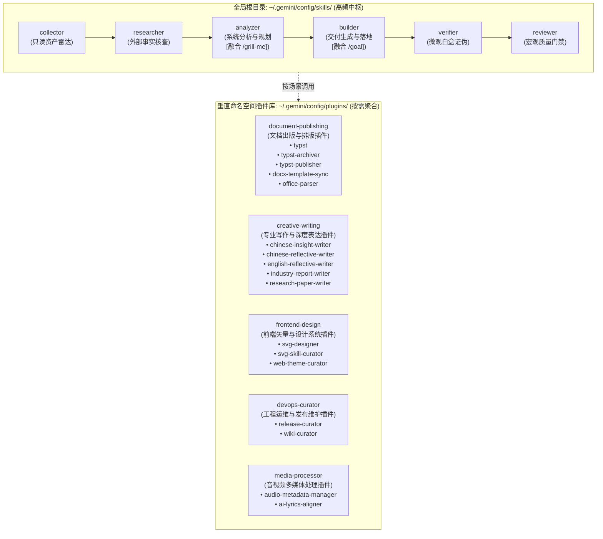
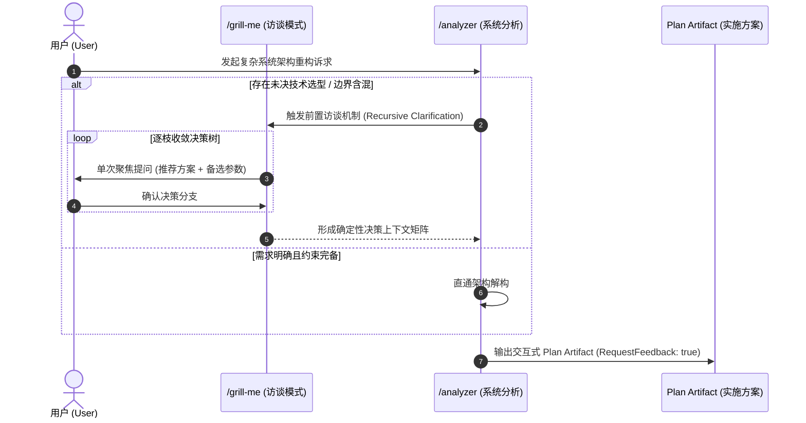
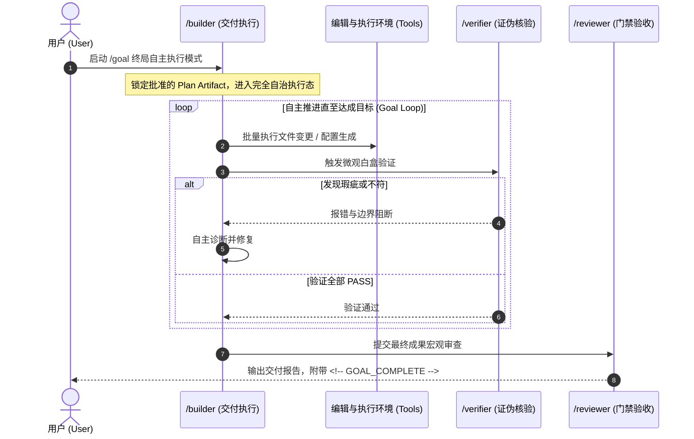
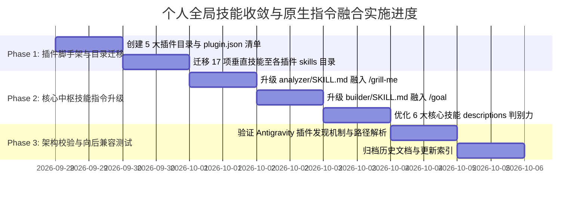

<!-- config/docs/20260928_global_skills_asset_convergence_and_command_integration_architecture.md -->
# 全局技能资产打包收敛与原生指令融合架构方案 (Global Skills Asset Convergence & Native Commands Integration Architecture)

- **文档状态**：PROPOSED / READY FOR EXECUTION
- **制定日期**：2026-09-28
- **分析主体**：`/analyzer` (System Analyst)
- **输入依据**：`/researcher` 全局技能审计与 Antigravity 2.0 / Gemini 3.8 原生契约分析
- **目标对象**：`config/skills/` 23 项自研全局技能体系及 `config/plugins/` 架构
- **归属目录**：`config/docs/`

---

## 1. 背景与问题定义 (Context & Diagnostic)

### 1.1 资产分布现状与调用频度断层
当前在 `~/.gemini/config/skills/` 目录下共平铺维护了 23 项自研全局技能。在实际高频研发与辅助交互中，技能的调用频次呈现出极端的分化断层：

1. **核心研发链路（Core Hexagon Pipeline）的高频吞吐**：
   - `collector`（本地资产扫描） $\rightarrow$ `researcher`（外部事实查证） $\rightarrow$ `analyzer`（系统解构与规划） $\rightarrow$ `builder`（交付实现） $\rightarrow$ `verifier`（独立证伪） $\rightarrow$ `reviewer`（质量验收）。
   - 这 6 项通用工程中枢技能几乎覆盖了 85% 以上的核心编程、方案重构与质量验收生命周期，属于最高优先级的基础设施。
2. **垂直领域工具的低频闲置与上下文噪声**：
   - 剩余 17 项技能属于高度特化、垂直场景的专用工具（如 Word 模板逆向提取、音频元数据标签注入、特定文体创作、Wiki 同步等）。
   - 在 Antigravity 的渐进式披露机制（Progressive Disclosure）下，尽管 `SKILL.md` 的详细内容按需加载，但**所有 23 项技能的 `name` 与 `description` 元数据在每次会话启动时均会被注入 System Prompt**。
   - 平铺 23 项不仅增加了首轮对话的无谓 Token 消耗，且随着语义描述的增加，极易引发模型在进行意图路由时的语义漂移与误唤醒。

### 1.2 原生高阶命令的契约断层
Antigravity 平台深度演化并标准化了原生 Slash 命令生态：
- **`/grill-me`**：交互式多轮访谈（Interview），用于在复杂方案确定前穷尽分支决策树。
- **`/goal`**：免人工值守的终局自主迭代模式，要求代理自主闭环直到目标彻底达成。
- **`/schedule`**：定时器与周期巡检任务调度。

目前自研技能体系虽然在 2026-09-24 成功融合了 `/plan` 门禁，但在面对模糊需求、长周期交付时，尚未与 `/grill-me` 及 `/goal` 形成确定性的契约联动，导致用户在发起高阶命令时无法自然调动自研的 `analyzer` 与 `builder`。

---

## 2. 核心治理架构与收敛矩阵 (Convergence Architecture)

### 2.1 拓扑设计：核心高频中枢保留 + 垂直插件化收敛

采用 **“1个核心中枢基线 (Global Core Hub) + 5大垂直命名空间插件 (Domain Plugin Bundles)”** 的解耦架构：

### 2.2 打包收敛映射清单 (17 项垂直技能归属)

| 目标插件目录 (`config/plugins/`) | 包含技能 (`skills/`) | 插件职能定位与核心边界 |
| :--- | :--- | :--- |
| **`document-publishing`** | `docx-template-sync` `office-parser` `typst` `typst-archiver` `typst-publisher` | 专注于 Word/Docx 逆向指纹提取、结构化切片解析、Typst 高保真排版、编译出版与差分合流归档。 |
| **`creative-writing`** | `chinese-insight-writer` `chinese-reflective-writer` `english-reflective-writer` `industry-report-writer` `research-paper-writer` | 专注于深度中文/英文随笔、商业洞察评论、行业研报与学术论文的框架构建与正文创作。 |
| **`frontend-design`** | `svg-designer` `svg-skill-curator` `web-theme-curator` | 专注于矢量 SVG 绘制、设计变量契约（`design-tokens.json`）、前端字阶生理底线质检与脚手架搭建。 |
| **`devops-curator`** | `release-curator` `wiki-curator` | 专注于 Git 版本跃迁、Changelog 增量生成、Release 发布文案编目及 GitHub Wiki CI 流水线部署。 |
| **`media-processor`** | `ai-lyrics-aligner` `audio-metadata-manager` | 专注于音频无损元数据标签读写、封面嵌入及 AI 歌词毫秒级时间轴对齐。 |

---

## 3. 原生高级命令与自研体系深度融合 (Native Commands Integration)

### 3.1 `/grill-me` 融入：需求澄清与方案访谈门禁 (`analyzer` 增强)

**契约注入规则**：
- 在 `analyzer/SKILL.md` 中增加 **Pre-Analysis Clarification Protocol**：
  若检测到需求涉及 2 种以上异构方案选型或关键参数缺失，显式激活 `/grill-me` 规范，利用交互式提问（`ask_question` 或单点聚焦追问）逐枝锁定设计决策，避免基于推测生成虚假架构。

### 3.2 `/goal` 融入：终局自主交付闭环 (`builder` 增强)

**契约注入规则**：
- 在 `builder/SKILL.md` 中增加 **Goal-Mode Autonomous Contract**：
  当上下文标记有 `/goal` 时：
  1. 必须以已批准的 Plan Artifact 为唯一基准，严禁偏离目标；
  2. 遇到测试或验证失败时，自主执行“定位-修复-复验”循环，严禁在未穷尽排查手段前中断并向用户抛出半成品；
  3. 交付完成且经由 `verifier` 及 `reviewer` 验收后，显式在最终响应中输出 `<!-- GOAL_COMPLETE -->`。

---

## 4. 实施工作分解结构 (Work Breakdown Structure - WBS)

### Phase 1: 插件体系构建与资产无损迁移
- [ ] **Task 1.1**：在 `~/.gemini/config/plugins/` 下创建 5 个插件目录并写入 `plugin.json`：
  - `document-publishing/plugin.json`
  - `creative-writing/plugin.json`
  - `frontend-design/plugin.json`
  - `devops-curator/plugin.json`
  - `media-processor/plugin.json`
- [ ] **Task 1.2**：将对应的 17 项技能目录安全平移至各插件的 `skills/` 下，确保各技能内部的 `references/`, `scripts/` 等资源完整迁移。

### Phase 2: 核心中枢技能升级与指令深度绑定
- [ ] **Task 2.1**：改造 [`config/skills/analyzer/SKILL.md`](file:///C:/Users/Reaticle/.gemini/config/skills/analyzer/SKILL.md)：
  - 注入 `/grill-me` 协同规则：在需求含混、多架构选型分歧时，强制先进行结构化决策收敛。
- [ ] **Task 2.2**：改造 [`config/skills/builder/SKILL.md`](file:///C:/Users/Reaticle/.gemini/config/skills/builder/SKILL.md)：
  - 注入 `/goal` 自主执行闭环契约：支持免打扰自驱修复与 `<!-- GOAL_COMPLETE -->` 完结标识。
- [ ] **Task 2.3**：精修保留的 6 项核心技能（`collector`, `researcher`, `analyzer`, `builder`, `verifier`, `reviewer`）的 YAML Frontmatter Description，确保路由高度正交、零误唤醒。

### Phase 3: 插件发现与系统验证
- [ ] **Task 3.1**：在全新对话窗口中验证插件内技能是否能被正常发现并激活（例如调用 `@typst` 或 `@chinese-insight-writer`）。
- [ ] **Task 3.2**：检查全局技能列表 Token 占用量变化，确保首轮系统提示词干净利落。

---

## 5. 验收门禁与验证方案 (Verification & Acceptance Criteria)

### 5.1 刚性验收指标 (Hard Criteria)
1. **全局首屏轻量化（Zero Root Clutter）**：
   - `config/skills/` 根目录下严格仅保留 6 个高频工程技能目录，平铺项压缩率达 74%（从 23 项降至 6 项）。
2. **能力资产零损耗（Zero Asset Loss）**：
   - 迁移至各插件的 17 项技能，其内部实现、模板文件、测试用例 100% 保持可用，YAML 元数据规范完全符合 Antigravity 插件发现规范。
3. **指令联动零摩擦（Native Commands Seamlessness）**：
   - 触发 `/grill-me` 时能被 `analyzer` 顺畅承接为决策上下文；
   - 触发 `/goal` 时能被 `builder` 严格约束为闭环自检交付，严禁盲目中途抛出异常。

### 5.2 质量门禁检查表 (Reviewer Gate Checklist)
- [ ] 每个 `plugin.json` 包含标准 `name`, `version`, `description` 字段。
- [ ] 核心技能不存在指向已移动路径的硬编码相对路径失效问题。
- [ ] 文档沉淀于 `config/docs/` 规范目录，版本号与演进脉络连续。
