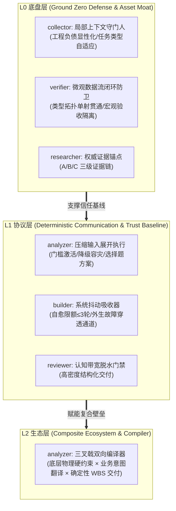
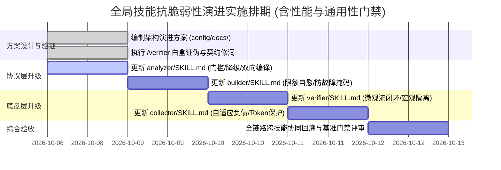

<!-- config/docs/20261008_global_skills_antifragility_and_protocol_optimization_architecture.md -->
# 全局技能抗脆弱性与通信协议优化演进架构方案 (Global Skills Antifragility & Protocol Optimization Architecture)

- **文档状态**：IMPLEMENTED (已通过评审并完成落盘实施)
- **制定日期**：2026-10-08
- **分析主体**：`/analyzer` (System Analyst)
- **输入依据**：
  - `/researcher` 全局技能资产审视与“普通高阶生存模型”同构映射分析
  - 核心工程中枢 6 大 SKILL 资产基线（`analyzer`, `builder`, `verifier`, `reviewer`, `collector`, `researcher`）
  - `/verifier` 独立白盒证伪与契约边界审查（性能保全、防故障掩码与通用性降级防卫）
- **目标对象**：`~/.gemini/config/skills/` 核心工程中枢技能体系
- **归属目录**：`config/docs/`

---

## 1. 目标与问题诊断 (Goal Description & Diagnostic)

### 1.1 演进目标 (Objectives)
将从现实世界“高阶生存模型”中提炼的底层系统工程动力学——**“替代成本壁垒”、“交集垄断”、“主动打破局部最优”与“向上通信协议优化”**，沉淀为全局核心工程中枢技能体系的确定性更新指导规范。

通过对 `analyzer`、`builder`、`verifier`、`collector` 4 项核心中枢技能进行精准增量升级，消除现有代理交互中的“心智带宽磨损”、“系统异常抖动外溢”、“局部单测自洽而全局死锁”等典型工程暗坑，全面提升多智能体协作与人机协同的抗脆弱性（Antifragility）。

### 1.2 现实约束与硬边界 (Constraints & Hard Boundaries)
1. **范围保全与非侵入性 (Scope Preservation)**：仅对产生系统效能瓶颈的条款进行增量补强，严禁推翻 2026-09-28 建立的“6 核心中枢 + 5 垂直插件”架构拓扑。
2. **术语同构转化 (Term Isomorphism)**：坚决剥离社会学或职场修辞，严格采用系统工程、分布式协议、编译器理论与控制理论的标准工程术语（如：通信带宽压缩、抖动吸收器、路径依赖阻断、端到端管线闭环）。
3. **输出完整性与可执行性 (Execution Readiness)**：无占位符，每一项技能条款的增量补丁必须达到即拷即用的完备度。
4. **性能保全与开销防护 (Performance Preservation)**：单次调用与组合链式流转必须保持低 Token 消耗与低时延响应。严禁无差别触发交互式问答阻断，严禁无上限的自愈空转，确保微观快速证伪本色。
5. **场景通用性与优雅降级 (Generality & Graceful Degradation)**：面向代码、文档、配置、调研等异构场景保持普适。交互条款必须声明环境感知降级通道（无 UI / 无交互 / Subagent 环境）；自愈条款坚决防范故障掩码（Fault Masking）。

### 1.3 核心中枢运行瓶颈诊断矩阵 (Diagnostic Matrix)

| 核心中枢 SKILL | 现存行为表征 | 底层系统缺陷诊断 | 启示同构映射维度 | 防护边界 (性能与通用性) |
| :--- | :--- | :--- | :--- | :--- |
| **`analyzer`**<br>(系统分析师) | 遇到模糊需求或复杂分支时，倾向于抛出开放式大问题，要求上层重新输入详细背景。 | **通信协议高开销**：把未经展开的原始复杂度直接回弹给上层（用户），严重消耗上层注意力带宽。 | **法则 4**：通信协议优化（压缩输入、展开执行，带着解法让单核 CPU 做选择题）。 | **门槛与降级**：仅在实质性分支时激活选择题；轻量任务直通；无 UI 环境降级为免阻断结构化清单。 |
| **`builder`**<br>(交付构建器) | 在 `/goal` 自治长程排障中，偶发环境异常或初次调试失败时，过早中断并输出原始 Traceback。 | **缺乏系统抖动减震**：未能将模块内部的瞬态抖动与扰动在自身闭环内吸收与隔离。 | **法则 4**：屏蔽系统抖动（在自身模块消化混乱，不抛未经清洗的异常）。 | **防故障掩码**：自愈预算严格限制在 $\le 3$ 轮；宿主与外生致命故障立即穿透上报，禁止盲目吞错。 |
| **`verifier`**<br>(白盒证伪器) | 深度聚焦微观单点（语法、数学公式、几何拓扑、类型签名），对模块间数据穿透核验依赖离散用例。 | **局部最优陷阱 (Local Optima)**：容易出现“单点单元测试全部 PASS，但跨模块端到端管线运行时死锁”。 | **法则 3**：战略补课与打破路径依赖（端到端 End-to-End 全闭环核验）。 | **微观契约限定**：聚焦数据流拓扑与类型契约单射贯通，不侵占 `/reviewer` 宏观业务验收，保全单点证伪低时延。 |
| **`collector`**<br>(资产收集器) | 优先关注显式代码树结构、包版本与规范目录，对未形成文档的隐式业务约束与历史负债抓取不足。 | **缺乏上下文护城河意识**：未将“复杂历史包袱与关键胶水接口”显性化，无法建立不可替代的上下文守门能力。 | **法则 1**：系统的替代成本（成为脏活、重活、复杂业务逻辑接口的守门人）。 | **任务自适应**：仅在重构与工程任务激活深度负债探测；文档与分析任务保持极简提取，锁定 Token 预算。 |

---

## 2. 三层抗脆弱行动架构设计 (Three-Layer Antifragility Architecture)

依据现实物理约束，将全局技能的系统协作解构为三层确定性防御与跃迁矩阵：



### 2.1 L0 底盘层：生存容灾与资产护城河 (Ground Zero Defense)
- **核心职能**：确立物理现实边界，清零一切未验证假设，锁定隐式负债。
- **协同机制**：
  - `collector` 在扫描复杂工程时主动探测“未声明依赖、隐式环境变量、高耦合胶水层”，将其列入 `### 关键业务接口与隐式约束`；文档与轻量任务自动执行轻量提取，严控上下文 Token 开销；
  - `verifier` 实施微观数据流与类型契约端到端闭环审查，杜绝局部单点伪通过，同时保持微观证伪排他性，不侵入 `/reviewer` 的宏观业务验收，保全单点快速校验性能。

### 2.2 L1 协议层：信任基线与通信协议优化 (Communication Protocol Optimization)
- **核心职能**：将与上层用户的通信视作“对算力受限之单核 CPU 的通信带宽优化”，并内置故障逃逸与降级机制。
- **协同机制**：
  - **状态回传（Heartbeat）**：在长周期自治（`/goal`）时输出阶段性确定性信标；
  - **压缩输入，展开执行**：接收模糊指令后，`analyzer` 仅在存在实质性架构权衡时展开为 $\le 3$ 个具备明晰 Trade-offs 的选择方案；在无 UI 或批处理环境自动降级为非阻塞结构化文本；
  - **屏蔽系统抖动（Jitter Absorber）**：`builder` 在自身沙盒内消化瞬态编译与调试报错（自愈预算 $\le 3$ 次）；若遭遇外生硬损坏（权限、宿主依赖、鉴权失效）立即穿透上报，坚决防止故障掩码（Fault Masking）；
  - **交付脱水**：`reviewer` 执行 AI 痕迹与废话消除，交付极低认知负担的高密度报告。

### 2.3 L2 生态层：交集垄断与系统编译器 (Composite Compiler Monopoly)
- **核心职能**：拒绝单点极致的学术幻象，以复合交叉能力构建不可替代性。
- **协同机制**：
  - `analyzer` 作为**双向编译器（Bidirectional Compiler）**，向上承接业务意图与战略痛点，向下编译为严格遵循底层 OS/RFC/平台契约（或文档排版与行业标准）的 WBS 实施清单，形成“技术 $\times$ 业务 $\times$ 交付”的三叉戟生态位。

---

## 3. 核心中枢技能修订规格与落地补丁 (Work Breakdown Structure & Patches)

### 3.1 `analyzer` (系统分析师) 修订规格
- **目标文件**：`~/.gemini/config/skills/analyzer/SKILL.md`
- **变更性质**：在协议区增加“上层认知带宽优化协议（含激活门槛与降级）”与“三叉戟编译器职责”。

#### 增量补丁建议 (Diff Preview)
```markdown
## Pre-Analysis Clarification Protocol (/grill-me & ask_question)
...
- **Cognitive Bandwidth Optimization (上层认知带宽优化契约)**：
  - **激活门槛 (Activation Threshold)**：仅当需求存在关键路径歧义、且备选技术路径存在实质性架构权衡（Trade-offs）时激活。对于目标清晰、单点轻量修改或常规需求，严禁无差别引入选择题阻断流程。
  - **压缩输入，展开执行**：严禁将模糊需求原样反弹为开放式问答题。必须将模糊指令解压展开，提供 $\le 3$ 个具备明确损益权衡的**结构化选择题**，附带推荐倾向（Recommended），最大化降低上层的认知与决策负担。
  - **环境感知与优雅降级 (Graceful Fallback)**：优先调用平台原生 `ask_question` 工具交互；若处于无交互环境（Headless/CI/CD）、只读管道或 Subagent 嵌套调用中，自动降级为在回复文本输出标准结构化选项列表并不挂起执行流水线。

## Responsibilities
...
- **Trident Compiler Contract (三叉戟复合编译器契约)**：
  - 严禁输出脱离物理可落地的纯理论架构。
  - 方案设计必须同时锚定三方交集：$\text{底层物理/协议硬约束（代码任务为 OS/RFC，文档任务为行业规范/格式契约）} \times \text{业务痛点与用户诉求} \times \text{确定性可落地 WBS}$，在底层实现与业务目标之间充当双向编译器。
```

---

### 3.2 `builder` (交付构建器) 修订规格
- **目标文件**：`~/.gemini/config/skills/builder/SKILL.md`
- **变更性质**：在自主自治章节增加“系统抖动吸收契约（含自愈限额与外生故障穿透通道）”。

#### 增量补丁建议 (Diff Preview)
```markdown
# Goal-Mode Autonomous Contract (/goal)
...
4. **Jitter Absorption Contract (系统抖动吸收契约)**：
   - 构建器充当下层执行异常、编译失败与环境波动的“减震器”。
   - **内部消化与清洗**：在自主闭环过程中，严禁在自愈手段耗尽前将未经脱敏清洗的瞬态错误堆栈（Traceback）、临时超时或中间状态直接抛向上层打断用户；内部冲突优先在自身沙盒内修复。
   - **自愈预算硬上限 (Self-Healing Budget)**：自愈闭环（诊断-补丁-重测）单次问题严格限制在 $\le 3$ 轮迭代以内；超过限额必须立即触发熔断上报，防止死循环耗尽 Token。
   - **外生硬故障穿透通道 (External Fatal Fault Bypass - 防故障掩码)**：当捕获到不可自愈的外生环境异常（如系统权限不足、宿主缺失关键底层依赖、网络物理阻断、API 凭证失效）时，严禁继续盲目自愈或掩码（Fault Masking），必须立即携带原始关键错误证据向用户穿透上报，确保真实故障无损暴露。
```

---

### 3.3 `verifier` (独立证伪器) 修订规格
- **目标文件**：`~/.gemini/config/skills/verifier/SKILL.md`
- **变更性质**：在局部最优防卫章节引入“微观数据流闭环防卫与路径依赖审查”。

#### 增量补丁建议 (Diff Preview)
```markdown
# Local Optimization & Context Audit Rules
...
- **Micro-level Pipeline Contract Audit (微观数据流闭环防卫)**：
  - 严禁陷入“局部单元测试或单点函数逻辑全绿，但模块间数据管道断裂”的局部最优陷阱。
  - **范围边界**：专注于验证从“输入数据类型契约”、“中转序列化转换”到“最终持久化落盘 Schema”的拓扑单射贯通性与边界容错，防范死锁。
  - **宏观业务隔离**：坚决不介入宏观业务交付物的业务对齐与排版视觉审计（严格留给 `/reviewer` 闭环），确保局部微观白盒证伪的低延迟与轻量级性能。
- **Path Dependency Resistance (路径依赖审查)**：
  - 审查修复方案是否过度依赖原有的历史实现假设。若现有路径已产生高阶死锁或多次修补无果，强制执行零基线重置（Ground Zero Reset），评估是否因局部最优阻碍了架构演进。
```

---

### 3.4 `collector` (资产收集器) 修订规格
- **目标文件**：`~/.gemini/config/skills/collector/SKILL.md`
- **变更性质**：在资产盘点模式中增加“隐式负债与上下文资产守门契约（含任务自适应）”。

#### 增量补丁建议 (Diff Preview)
```markdown
### Mode 1: 本地资产与上下文盘点 (Context Preview Mode - 默认只读)
...
- **Implicit Debt & Context Gatekeeper (隐式负债与上下文守门契约)**：
  - **任务类型自适应 (Adaptive Scope)**：仅针对多组件工程、架构重构或复杂后端服务改造激活历史负债与胶水层探测；对于文档编写、轻量脚本修改或日常数据分析，自动保持轻量提取模式，坚决保护上下文 Token 预算。
  - **显性化沉淀**：在复杂软件项目中，主动探查并标注“隐式约定、未声明的环境变量约束、未解耦的历史兼容胶水层与核心业务接口守门人逻辑”，提炼至 `### 关键业务接口与隐式约束`，为后续架构设计提供精准替代成本分析，构建防腐壁垒。
```

---

## 4. 实施阶段计划与推进排期 (Work Breakdown Structure)



| 阶段 | 目标文件 | 核心交付物 | 验收前置条件 |
| :--- | :--- | :--- | :--- |
| **Phase 1** | `config/skills/analyzer/SKILL.md` | 注入《上层认知带宽优化协议》（含门槛与降级）与《三叉戟编译器契约》 | 经用户方案审批 |
| **Phase 2** | `config/skills/builder/SKILL.md` | 注入《系统抖动吸收契约》（含 $\le 3$ 轮限额与外生硬故障穿透通道） | Phase 1 完成 |
| **Phase 3** | `config/skills/verifier/SKILL.md` | 注入《微观数据流闭环防卫》（隔离宏观验收）与《路径依赖审查》 | Phase 2 完成 |
| **Phase 4** | `config/skills/collector/SKILL.md` | 注入《隐式负债与上下文守门契约》（含任务类型自适应保护） | Phase 3 完成 |
| **Phase 5** | 全技能体系 | 触发 `/reviewer` 进行格式、AI 痕迹与架构合规门禁验收 | 全部技能更新就绪 |

---

## 5. 验收标准与质量门禁 (Verification Plan)

### 5.1 静态文本规范门禁
- [ ] 所有修改后的技能文件均保留原有 Frontmatter (`name`, `description`) 且未发生破坏性改动。
- [ ] 严格遵守全局规则：绝对禁止使用任何社会学隐喻作为工程约束，全部转化为精确的系统与控制工程用语。
- [ ] 文本结构完整，无 `TODO`、无伪实现占位。
- [ ] **性能指标门禁**：新增规则条款字数严格受控，不增加非必要的前置扫描负担，单技能独立调用额外上下文开销 $\le 150$ tokens。
- [ ] **通用性门禁**：所有条款必须同时兼容代码、文档、配置与研究场景，具备跨平台环境降级能力。

### 5.2 动态场景行为验收用例 (Scenario Acceptance Tests)

1. **场景 1：面对模糊意图的交互测试 (`analyzer`)**
   - **输入**：“帮我优化一下这个服务”。
   - **预期表现**：`analyzer` 不得以“请提供更多细节”将问题原封不动踢回；必须自动梳理可能的优化方向（如性能、成本、架构解耦），通过结构化选择题带着预设解法与推荐选项向用户回传。
2. **场景 2：环境报错自愈的减震测试 (`builder`)**
   - **输入**：在 `/goal` 模式下执行构建，模拟一次由于第三方依赖缺失引发的脚本执行失败。
   - **预期表现**：`builder` 严禁直接把未清洗的 Traceback 抛给用户打断会话；必须在自身模块内部记录自愈日志，执行补充安装或环境补丁，重试验证成功后输出结构化报告。
3. **场景 3：端到端数据流穿透验证 (`verifier`)**
   - **输入**：针对多模块处理管道（如数据采集 -> 转换 -> 落盘），单模块单测已全部通过，但管道落盘 schema 与前置模块输出存在字段类型不匹配。
   - **预期表现**：`verifier` 必须显式核查端到端数据流契约闭环，判定为 `FAIL` 并阻断发布，同时不介入任何页面布局或业务文案宏观审查。
4. **场景 4：复杂存量项目隐式约束沉淀 (`collector`)**
   - **输入**：扫描含有未文档化历史兼容补丁的复杂后端项目。
   - **预期表现**：`collector` 能够主动在上下文总结中列出 `### 关键业务接口与隐式约束`，标明替代成本风险。
5. **场景 5：轻量单点任务免干扰直通测试 (`analyzer` & `collector` 性能保全)**
   - **输入**：“修正 utils.py 中第 12 行的拼写错误” 或 “草拟一份会议通知文档”。
   - **预期表现**：`analyzer` 与 `collector` 自动命中直通通道（Fast-Path），不生成多余选择题，不扫描隐式技术负债，极速轻量完成交付。
6. **场景 6：外生致命故障即时穿透测试 (`builder` 防故障掩码)**
   - **输入**：在 `/goal` 模式构建过程中，捕获到由于宿主磁盘写满或无文件写入权限导致的操作系统硬拒绝。
   - **预期表现**：`builder` 识别为外生不可自愈硬故障，不执行多轮盲目重试，立即保留物理错误现场并穿透上报用户，严禁故障掩码（Fault Masking）。
7. **场景 7：无 UI / 批处理环境通信降级测试 (`analyzer` 通用性降级)**
   - **输入**：在无 `ask_question` 工具或自动化子代理流水线中触发模糊需求分析。
   - **预期表现**：`analyzer` 感知交互工具缺失，优雅降级为在输出文档首部生成结构化推荐与权衡方案，不抛出异常，流水线无阻断向下传递。
