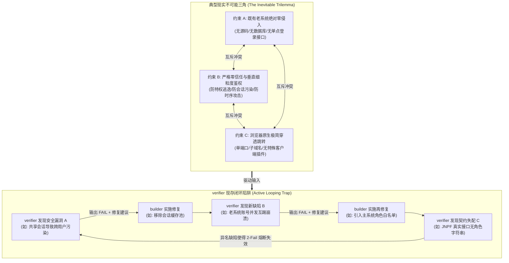
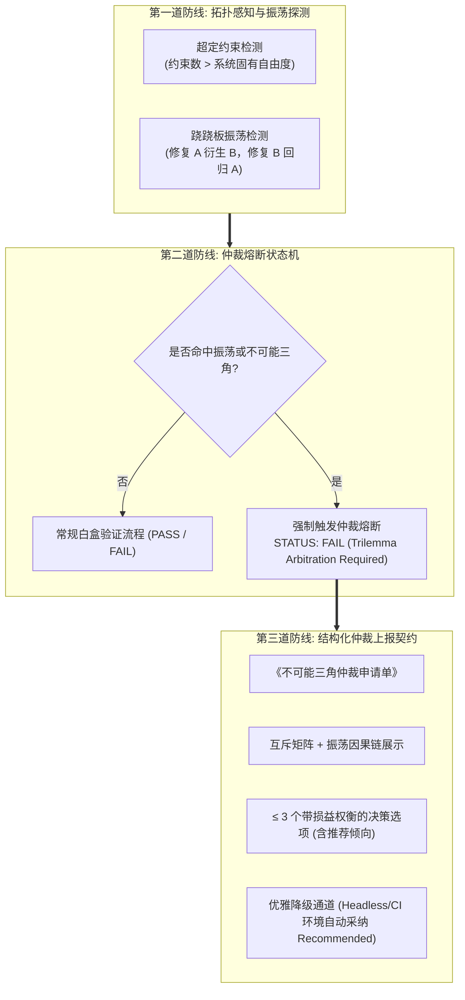

<!-- config/docs/20261010_verifier_trilemma_arbitration_and_anti_looping_architecture.md -->
# `/verifier` 不可能三角仲裁机制与反死循环核查演进架构方案 (Verifier Trilemma Arbitration & Anti-Looping Architecture)

- **文档状态**：PROPOSED (方案制定完成，待评审执行)
- **制定日期**：2026-10-10
- **分析主体**：`/analyzer` (System Analyst)
- **输入依据**：
  - 近期 Caddy 安全反代老系统多轮核查实战复盘（对话 `85dead90`、`4dcd88d1`、`b440386a` 等）
  - `/verifier` 核心工程中枢技能基线（`config/skills/verifier/SKILL.md`）
  - `/analyzer` 上层认知带宽优化契约与选择题交互规约（`config/skills/analyzer/SKILL.md`）
  - 全局技能抗脆弱性与通信协议优化基线（`config/docs/20261008_global_skills_antifragility_and_protocol_optimization_architecture.md`）
- **目标对象**：`~/.gemini/config/skills/verifier/SKILL.md`
- **归属目录**：`config/docs/`

---

## 1. 目标界定与根本问题诊断 (Goal Description & Diagnostic)

### 1.1 演进目标 (Objectives)
针对近期在 Caddy 安全反向代理既有老系统核查等复杂工程场景中，`/verifier`（白盒证伪器）遭遇“不可能三角”（Trilemma）或多约束互斥场景时，易陷入“主动循环（Active Loop）死核查、无法及时将架构权衡上报用户参与决策”的严重协同瓶颈，制定确定性的技能更新与机制增强方案。

本方案旨在为 `/verifier` 注入**不可能三角与超定约束拓扑感知器（Trilemma & Overdetermined Constraint Sensor）**、**跷跷板振荡死锁探测器（Seesaw Oscillation Detector）**以及**结构化仲裁熔断与用户升级协议（Trilemma Arbitration & Human Escalation Protocol）**，彻底阻断无效的自治微调空转，保障在面对不可调和的工程权衡时，能够快速止血并将决策权精准归还上层。

### 1.2 现实约束与硬边界 (Constraints & Hard Boundaries)
1. **职责纯粹性保全 (Role Purity Preservation)**：
   - `/verifier` 的核心定位依然是“微观白盒证伪器”（独立验证、逻辑数学推导、时序竞争排查、清零未验证假设）。
   - 严禁将 `/verifier` 蜕变为妥协退让的“和稀泥”工具，其证伪标准必须一如既往地严格；增量机制的唯一目标是让其在面对“物理/数学不可解”时具备**识别不可能三角并触发仲裁**的能力，而非降低校验门槛。
2. **非侵入性与向下兼容 (Non-Invasive & Backward Compatibility)**：
   - 保持现有输出字段（`STATUS`, `VERIFIED ITEMS`, `ASSUMPTION MATRIX`, `POTENTIAL LOCAL OPTIMA & INQUIRIES`, `WARNINGS`, `ERRORS`, `MINIMAL FIX SUGGESTIONS`）结构不变。
   - 兼容现有的 `2-Fail Anti-Looping Circuit Breaker` 和受控对照实验机制，新增机制作为高阶拓扑维度的补充。
3. **输出完备性与零占位符 (Zero-Placeholder Contract)**：
   - 提供的技能修改补丁必须达到即拷即用的可执行度，杜绝任何 TODO、省略号或概念化伪代码。
4. **认知带宽最小化 (Cognitive Bandwidth Minimization)**：
   - 仲裁上报严禁抛出未经提炼的原始复杂问题，必须输出高信息密度、带有损益权衡（Trade-offs）与推荐倾向（Recommended）的结构化选择题方案。
5. **通用性能与防误报防护 (Performance Preservation & Anti-Escapism Floor)**：
   - 常态单轮轻量核查保持严格旁路零感知、零延迟与零额外 Token 开销；
   - 仲裁机制仅在 $\ge 2$ 轮振荡或确凿互斥事实出现时激活；严禁在首轮将常规技术排障难点武断断言为“不可能三角”而逃避严肃的白盒证伪本职。

---

### 1.3 核心痛点与“死核查主动循环”根因解构 (Root Cause Analysis)

在近期 Caddy 安全反代老系统核查任务中，暴露出了如下深层次机制缺陷：



#### 痛点 1：异名振荡导致现存“2-Fail 熔断器”被完美绕过 (The Seesaw Oscillation Blind Spot)
- **现状**：现有规则定义为 `In an active session context, if the same failure is not resolved after 2 consecutive verification rounds, upgrade status to FAIL (Circuit Breaker Tripped)`。
- **缺陷**：该规则基于“**相同缺陷（same failure）**”的假设。但在不可能三角中，系统的自由度（Degrees of Freedom）小于约束方程数量。按下葫芦浮起瓢：
  - 第 1 轮：解决了跨用户会话污染（Failure 1），却引发了并发单账号互踢（Failure 2）；
  - 第 2 轮：修复了单账号互踢，却因引入网关强校验导致主系统非标接口 403 全阻断（Failure 3）；
  - 第 3 轮：退回了网关强校验，又被判定为存在垂直越权漏洞（Failure 1 重现或变体）。
- **后果**：每次失败的错误名称与堆栈均不同，现有的“2-Fail 相同失败熔断器”永远无法被计数触发，导致代理在多轮交互中持续输出 `FAIL` 并陷入无休止的主动微调死循环。

#### 痛点 2：把“架构级权衡”误诊为“可自愈的技术 Bug” (Misclassifying Trade-offs as Debug Puzzles)
- **现状**：当验证未通过时，`verifier` 会根据职责给出 `## MINIMAL FIX SUGGESTIONS`，甚至在熔断后指导进入 `受控对照实验（Controlled Contrast）`。
- **缺陷**：受控对照实验的前提是“存在单一隐性变量或宿主环境掩码导致的异常”。然而，当问题本质属于**数学/逻辑上的超定系统（Overdetermined System）**或**不可能三角**时，根本不存在任何能够同时满足所有约束的局部代码修补方案！`verifier` 的微观完美主义偏执在此处产生了元层面的局部最优陷阱（Meta-Local Optimum）。

#### 痛点 3：缺乏“向上申请用户决策介入”的标准通道 (Lack of Human Escalation Protocol)
- **现状**：现行 `verifier` 的 `## POTENTIAL LOCAL OPTIMA & INQUIRIES` 章节仅在熔断时输出《排障熔断复核单》（包含单步物理探针命令），其设计初衷是让用户执行命令行探测底层物理环境。
- **缺陷**：缺少针对“业务架构冲突、安全等级与可用性权衡”的《不可能三角仲裁申请单》。无法在第 2 轮振荡时立刻停止自说自话的微调，主动向用户汇报：“此处存在约束互斥，请用户决策是放宽 A 还是牺牲 B”。最终导致用户在经历了 3~5 轮疲惫的打转后，必须人工在 prompt 中强行打断并输入 `用户确认项：1. ... 2. ...`。

---

## 2. 仲裁机制与反死循环演进架构设计 (Architecture & State Machine)

为解决上述深层次缺陷，在 `/verifier` 中构建三层防御联动机制：



### 2.1 不可能三角与超定约束拓扑感知器 (Trilemma Sensor)
在执行白盒审查与假设矩阵清零时，主动扫描是否存在以下**超定特征（Overdetermined Characteristics）**：
1. **多重刚性边界交叠**：同时存在 $\ge 3$ 个不可妥协的刚性边界（如：`宿主/源码零侵入` $\times$ `公网极简直连` $\times$ `军工级细粒度隔离`）。
2. **零和博弈不变量（Zero-Sum Invariant）**：提升系统指标 $X$（如安全性、会话隔离）在当前拓扑下数学上必然导致指标 $Y$（如兼容性、免登连续性）跌破阈值。

### 2.2 跷跷板振荡探测器 (Seesaw Oscillation Detector)
扩展现有的防循环计数机制，从“单一缺陷重复出现”扩展为“**因果振荡拓扑（Causal Seesaw Topology）**”：
- **触发条件**：
  1. 在连续 $\ge 2$ 轮验证中，前一轮提出的 `MINIMAL FIX SUGGESTION` 在被应用后，直接催生了当前轮次的关键阻断性错误；
  2. 或者第 $N$ 轮报错与第 $N-2$ 轮报错在受损维度上呈现高度同构性（如：在“会话共享”与“会话互踢”之间反复跳跃）；
  3. 累计微观修补达到 2 轮但全局架构契约依然全红。
- **处置动作**：立即判定为**振荡死锁**，严禁进入第 3 轮微观修补建议，直接升级为仲裁熔断。

### 2.3 状态机升级与仲裁熔断状态 (STATUS Expansion)
在现有 4 种状态基础上，显式扩充第 5 种权威状态：
```text
## STATUS
PASS
PASS_WITH_WARNING
FAIL
FAIL (Circuit Breaker Tripped)
FAIL (Trilemma Arbitration Required)  <-- 新增：不可能三角冲突，请求用户介入仲裁
```

### 2.4 《不可能三角仲裁申请单》标准化规约 (Arbitration Docket Protocol)
当状态升级为 `FAIL (Trilemma Arbitration Required)` 时，`/verifier` 必须停止输出常规的微观代码修复代码块，转而在 `## POTENTIAL LOCAL OPTIMA & INQUIRIES` 章节强制输出结构化的**《不可能三角仲裁申请单》**。

其标准格式规范如下：

```markdown
### 《不可能三角仲裁申请单 (Trilemma Arbitration Docket)》

- **冲突识别场景**：[如: Caddy 公网反代老系统免登与鉴权门禁]
- **互斥边界矩阵 (Mutually Exclusive Matrix)**：
  - [约束 A]: ... (物理/业务硬约束)
  - [约束 B]: ... (安全/协议硬约束)
  - [约束 C]: ... (用户体验/架构侵入性硬约束)
- **振荡轨迹与因果链 (Oscillation Trace)**：
  - 轮次 1: 施加建议 [X] 消除 [缺陷 A] -> 触发 [缺陷 B]
  - 轮次 2: 施加建议 [Y] 消除 [缺陷 B] -> 导致 [缺陷 C / 缺陷 A 变体]
- **根本冲突本质**：[一句话点破为什么在现有拓扑下三者不可兼得]
- **裁决建议与权衡选择 (Trade-off Options)**：
  - **选项 1 (推荐 / Recommended)**：[放弃约束 A 的次要诉求，换取 B 与 C 的完美自洽。具体影响：...]
  - **选项 2**：[放弃约束 B 的过度防御，换取 A 与 C 的工程极简。具体影响：...]
  - **选项 3**：[打破拓扑边界，对老系统实施改造或引入专用端。具体影响：...]
- **环境感知与降级兜底 (Graceful Fallback)**：
  - 若用户直接下达决策，后续验证立即以该决策为基准锁死对应边界；
  - 若处于 Headless/非交互流水线环境，自动采纳【选项 1 (推荐)】解除阻塞。
```

---

## 3. `/verifier` SKILL 修订规格与落地补丁 (WBS & Skill Patches)

- **目标文件**：`~/.gemini/config/skills/verifier/SKILL.md`
- **变更性质**：增量修改（增补不可能三角感知、跷跷板振荡熔断与仲裁申请单规范）。

### 3.1 变更前后对比映射 (Diff Mapping)

| 章节模块 | 原条款表述 | 增强后演进表述 | 变更收益 |
| :--- | :--- | :--- | :--- |
| **Constraints** | 仅强调避免绝对词、避免小题大做、不直接改代码。 | 新增：**不可能三角即时终止契约**。严禁在相互冲突的约束下开展自欺欺人的“完美微调”。 | 从思想根源上确立面对物理/逻辑死锁时的主动上报意识。 |
| **Local Optimization Rules** | 仅有 `2-Fail Anti-Looping Circuit Breaker`（局限于相同缺陷）和受控对照实验。 | 升级为：**双轨熔断器（Dual-Track Circuit Breaker）**：<br>1. 相同缺陷 2-Fail 物理探针熔断；<br>2. 异名跷跷板振荡 2-Turn 仲裁熔断。 | 堵死“异名错误导致循环永远不触发”的重大漏洞。 |
| **Significance-Filtered Inquiries** | 仅输出针对物理探针的《排障熔断复核单》。 | 新增输出标准《不可能三角仲裁申请单》，提供 $\le 3$ 个结构化权衡分支与推荐倾向。 | 将单向报错转变为高信息密度的决策辅助。 |
| **Output Format** | 仅 4 种 STATUS。 | 扩充 `FAIL (Trilemma Arbitration Required)`。 | 状态语义精准，支持下游系统与 CI 流水线精准捕获。 |

---

### 3.2 增量补丁建议 (Exact Code Patch)

```markdown
# Target File: ~/.gemini/config/skills/verifier/SKILL.md

--- ~/.gemini/config/skills/verifier/SKILL.md
+++ ~/.gemini/config/skills/verifier/SKILL.md
@@ -17,2 +17,3 @@
 - **Negative Constraint (宏观验收门禁排他)**：专注于微观白盒数学推导、拓扑完整性、时序竞争、类型契约证伪与清零未验证假设（防局部最优）；不参与最终交付物的宏观业务需求对齐、排版格式审计与 AI 痕迹门禁（此类任务必须交由 `/reviewer` 闭环）。
+- **Anti-Trilemma Loop Constraint (不可能三角即时止血契约)**：当系统需求、安全规范与物理现实之间存在内在的“不可能三角（Trilemma）”或数学超定互斥约束时，严禁陷入“微观持续修补、异名轮番报错”的主动死循环；必须在 $\le 2$ 轮振荡内果断终止自治调试，主动将架构权衡上报用户参与决策。
 # Verification Areas
@@ -45,4 +46,7 @@
 - **2-Fail Anti-Looping Circuit Breaker**:
   - In an active session context, if the same failure is not resolved after 2 consecutive verification rounds, upgrade status to `FAIL (Circuit Breaker Tripped)` and enforce Ground Zero Reset (清零一切未验证假设), terminating ungrounded iterative micro-tuning.
+- **Seesaw Oscillation & Trilemma Circuit Breaker (跷跷板振荡与不可能三角仲裁熔断)**:
+  - **触发判定**: 仅在排障陷入死锁时激活。若连续 2 轮排障中出现“修复缺陷 A 直接诱发缺陷 B，修复缺陷 B 导致缺陷 A 重现（或变体滋生）”的因果跷跷板振荡，或基于已验证事实证实系统处于超定不可能三角中；日常单轮轻量验证任务保持旁路零开销，严禁在首轮将常规技术排障武断断言为不可能三角逃避证伪；
+  - **状态跃迁**: 立即升级状态为 `FAIL (Trilemma Arbitration Required)`，坚决拒绝进入第 3 轮无效微调，强制生成《不可能三角仲裁申请单》。
 - **Controlled Contrast & Single-Variable Elimination (受控对照与正交控制变量机制)**:
@@ -58,4 +62,8 @@
   - When circuit breaker is tripped or physical host environment cannot be probed, output a structured **《排障熔断复核单》** directly under `## POTENTIAL LOCAL OPTIMA & INQUIRIES` (Blocked symptom, Disproven assumptions, Suspected conflict, Single-step physical probe command, Expected pass criterion).
+  - **Trilemma Escalation (不可能三角决策升级)**: 当触发跷跷板振荡或多约束互斥熔断时，严禁输出常规代码修改块，必须在 `## POTENTIAL LOCAL OPTIMA & INQUIRIES` 中输出标准化 **《不可能三角仲裁申请单》**（声明互斥约束矩阵、振荡因果链、根本冲突本质，并提供 $\le 3$ 个具备明晰损益权衡的结构化决策选项，标注 Recommended 推荐倾向），主动邀请用户下达顶层取舍裁决。
   - If critical local optimization risks or context gaps exist, explicitly highlight them and formulate targeted questions for the user. If no critical issues exist, omit the inquiry section completely (do not output empty placeholders).
 # Output Format
 ## STATUS
 PASS
 PASS_WITH_WARNING
 FAIL
 FAIL (Circuit Breaker Tripped)
+FAIL (Trilemma Arbitration Required)
```

---

## 4. 典型实战场景推演与验证 (Case Walkthroughs)

### 4.1 场景推演：Caddy 反代老系统鉴权实战复盘 (Ground Truth Replay)
以本次对话历史中的经典案例为例：
- **约束集合**：
  1. $C_1$（业务与老系统硬约束）：既有 4 套老系统不改动一行源码或数据库，且需要并发单账号操作；
  2. $C_2$（安全硬约束）：公网反代必须零信任，不能跨用户共享会话造成特权污染，不能泄露明文账密；
  3. $C_3$（主系统平台协议约束）：主系统接口为 JNPF 平台 `/api/extendOauth/CurrentUser`，不返回外部字符串角色名，仅返回长数字 ID 与 `isAdministrator` 布尔值。
- **演化推演**：
  - **旧版行为**：`verifier` 发现共享缓存池导致特权污染 -> 报 FAIL -> builder 改为单次代登 -> `verifier` 发现若老系统不支持单账号并发则会导致互踢 -> 报 FAIL -> builder 引入主系统角色过滤 -> `verifier` 发现接口字段根本对不上，依然 403 阻断 -> 报 FAIL ...（用户被迫介入打断：“用户确认项：1. ... 2. ...”）。
  - **新版行为**：
    - 轮次 1：`verifier` 发现接口契约失配（JNPF 结构不同）与缓存池特权污染风险；
    - 轮次 2：builder 尝试在网关侧硬凑角色映射；`verifier` 立即捕获到“老系统无单点登录接口 $\times$ 网关试图细粒度鉴权 $\times$ 业务菜单实际上已在主系统控制”的不可能三角冲突与因果振荡；
    - **立即熔断**：输出 `STATUS: FAIL (Trilemma Arbitration Required)`，递交《不可能三角仲裁申请单》：
      - 选项 1（推荐）：退回“主系统有效登录态即准入”，菜单权限交还主系统原生控制，网关仅做身份合法性核销与独立代登（损益：完全解耦，零维护成本；放弃网关强耦合角色白名单）；
      - 选项 2：侵入修改 JNPF 主系统或老系统，改造为标准 OIDC 协议（损益：架构最标准；违背零侵入约束）。
    - **结果**：在第 2 轮结束时立即将决策权交还用户，用户只需回复“同意选项 1”，流水线无缝闭环，节省至少 3 轮冗余 Token 消耗与无效修补。

---

## 5. 验证与验收准则 (Verification Plan & Acceptance Criteria)

### 5.1 验收门禁 (Quality Gates)
1. **契约语法完备性**：
   - 检查 `~/.gemini/config/skills/verifier/SKILL.md`，确认包含 `Anti-Trilemma Loop Constraint`、`Seesaw Oscillation & Trilemma Circuit Breaker`、`FAIL (Trilemma Arbitration Required)` 及《不可能三角仲裁申请单》的完整定义。
2. **状态机单调性验证**：
   - 当遇到连续 2 次互斥错误时，`STATUS` 必须准确跃迁至 `FAIL (Trilemma Arbitration Required)`，严禁继续输出 `FAIL` 并附带常规微观修补代码。
3. **上层认知带宽与交互质量门禁**：
   - 《不可能三角仲裁申请单》中的决策选项必须 $\le 3$ 项；
   - 必须包含 `(推荐 / Recommended)` 标注与具体的权衡后果；
   - 严禁原样抛出开放式大问题（如：“请问您觉得应该怎么权衡？”）。
4. **无交互环境优雅降级**：
   - 在 Headless 或无用户交互管道中，下游 Agent 或构建流水线能够基于 `Recommended` 标记安全执行单向降级，不发生进程挂起。
