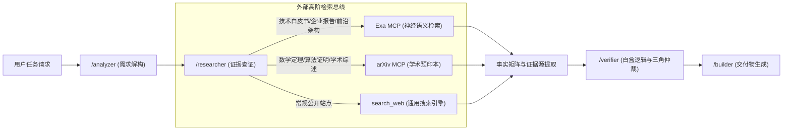

<!-- config/docs/20261013_mcp_asset_expansion_and_deep_retrieval_integration_guide.md -->
# 全局 MCP 资产扩充与深度检索源接入规范指南 (MCP Asset Expansion & Deep Retrieval Integration Guide)

- **文档状态**：DELIVERED (工程基线交付完成，可执行)
- **制定日期**：2026-10-13
- **构建主体**：`/builder` (Production Builder)
- **输入依据**：
  - 全局工程六大核心中枢资产（`config/skills/collector`, `analyzer`, `researcher`, `verifier`, `builder`, `reviewer`）
  - 宿主环境实时探针事实（Node.js `v24.15.0`, Python `3.14.4`, Windows `pwsh`, `uv` 缺位）
  - 现有全局 MCP 基准（`config/mcp_config.json`）
  - 工程抗脆弱与 Token 优化规约（`config/docs/20261008_global_skills_antifragility_and_protocol_optimization_architecture.md`）
- **目标对象**：`~/.gemini/config/mcp_config.json` 及外部检索工具链
- **归属目录**：`config/docs/`

---

## 1. 架构目标与选型准则 (Architecture Goals & Principles)

### 1.1 演进背景与能力断层
在当前全局体系中，工程资产呈现出“重型本地闭环与轻量外部检索”的不对称格局：
- **本地工程底座极度完备**：拥有 Typst 编译流水线、Word 模板逆向引擎、SVG 矢量几何排版与 12px 字阶质检、音视频元数据管理以及基于 `chrome-devtools-mcp` 的端到端浏览器调试能力。
- **外部事实检索存在结构性断层**：`/researcher` 承担 Level A（官方规范/白皮书）与 Level B（学术论文/权威研报）的证据查证使命。然而当前底层仅依赖通用 `search_web`，在面对学术预印本、前沿系统技术白皮书和深度商业研报时，信噪比不足，受 SEO 聚合站干扰严重，亟需引入**神经语义检索（Neural Search）**与**学术垂直索引（Academic Index）**。

### 1.2 MCP 准入硬约束 (Hard Admission Constraints)
为避免工具链恶性膨胀与系统抖动，全局 MCP 的引入必须恪守四项工程红线：
1. **零功能冗余原则 (Zero Redundancy)**：凡能通过原生命令（`run_command` + `git`/`gh`/`ffmpeg`/`typst`）高效调用的，严禁封装为 MCP。
2. **Token 与上下文净空底线 (Context Footprint Control)**：MCP 的 Tool Schema 即使处于延迟加载模式，其元数据依然常驻系统上下文。严禁引入无实质业务价值的通用占位 MCP。
3. **Windows 宿主管道安全性 (Windows Pipeline Safety)**：运行于 Windows `pwsh` 环境下的 Stdio MCP 必须严格验证字符编码（UTF-8）与进程退出机制，防范管道挂起与死锁。
4. **架构边界不漂移 (Architectural Boundary Preservation)**：
   - 严禁外部检索工具越权侵入本地工作区资产扫描（本地工程只读资产盘点专属归属于 `/collector`）。
   - 检索工具只服务于 `/researcher` 的外部证据求证与 `/analyzer` 的技术选型论证。

---

## 2. 候选 MCP 评估与准入决策矩阵 (MCP Evaluation Matrix)

| MCP 服务名称 | 定位与能力 | 评估结论 | 裁定依据与替代方案 |
| :--- | :--- | :---: | :--- |
| **`exa-mcp-server`** | 基于神经语义的全网深度技术/研报检索 | **准入 (基准首选)** | 填补 `/researcher` 对技术规范、企业白皮书与全网（含 arXiv 网页）深挖需求；依托 Node.js 零配置开箱即用。单源即可覆盖绝大多数工程查证场景。 |
| **`arxiv-mcp-server`** | arXiv 学术预印本结构化查询与摘要提取 | **按需冷备 (非必选)** | **非必要与 Exa 同时安装**（二者存在检索冗余且增加 Token 开销）。仅在重度依赖 arXiv ID 结构化元数据提取且愿补装 `uv` 时按需选配。 |
| **`@modelcontextprotocol/server-github`** | GitHub 远程 Issues/PR/Code 结构化 API | **按需观察** | 若本地已配置 `gh` CLI，直接调用命令行开销更小；仅当频繁涉及未 Clone 仓库的复杂跨项目漫游时再行引入。 |
| **`@modelcontextprotocol/server-filesystem`** | 本地文件系统读写 | **剔除 (禁止)** | 与 Antigravity 原生 `view_file`、`write_to_file` 及 `/collector` 规约严重冲突，带来双重抽象与权限混淆。 |
| **`@modelcontextprotocol/server-memory`** | 外部图谱与键值记忆存储 | **剔除 (禁止)** | 破坏现有的 Markdown 知识体系（`config/docs/*.md`）与 Antigravity KI 知识机制，增加状态不一致风险。 |
| **`puppeteer` / `playwright`** | 浏览器自动化 | **剔除 (禁止)** | 与当前已部署的 `chrome-devtools-mcp` 重复建设。 |

---

## 3. 宿主环境事实基线 (Runtime Environment Baseline)

在执行任何安装与配置变更前，必须确认以下宿主环境探针事实：

```powershell
# 环境事实基线检测命令
node --version    # 实测：v24.15.0 (符合 npx 即开即用标准)
python --version  # 实测：Python 3.14.4 (原生 Python 环境就绪)
uv --version      # 实测：未安装 (运行 uvx 服务前必须补齐)
```

---

## 4. 深度检索源安装与配置实施规约 (Implementation Guide)

> [!TIP]
> **双源安装决策结论**：**非必要同时安装**。Exa 具备全网神经语义搜索与域名过滤能力（含 `arxiv.org`），已能满足 Level A/B 深度查证需求。建议优先且仅配置方案 A（Exa）；方案 B（arXiv）保持冷备，避免冗余 Tool Schema 挤占上下文 Token 与引入额外的 `uv` 运行时维护。

### 4.1 方案 A：Exa 神经语义检索配置（基线标准，推荐）

#### 步骤 1：凭证准备
1. 访问 [Exa Dashboard](https://dashboard.exa.ai/) 注册账号。
2. 创建 API Key，获取格式类似 `xxxx-xxxx-xxxx` 的字符串。

#### 步骤 2：更新全局配置补丁
在 [mcp_config.json](file:///C:/Users/Reaticle/.gemini/config/mcp_config.json) 中打入配置补丁：

```json
// mcp_config.json
{
  "mcpServers": {
    "chrome-devtools-mcp": {
      "command": "npx",
      "args": [
        "-y",
        "chrome-devtools-mcp@latest"
      ]
    },
    "exa-search": {
      "command": "npx",
      "args": [
        "-y",
        "exa-mcp-server"
      ],
      "env": {
        "EXA_API_KEY": "YOUR_EXA_API_KEY_HERE"
      }
    }
  }
}
```

#### 步骤 3：命令行连通性冒烟测试
在 Windows PowerShell 终端中执行验证：

```powershell
# scripts/verify_exa.ps1
$env:EXA_API_KEY = "YOUR_EXA_API_KEY_HERE"
npx -y exa-mcp-server --help
```
*预期输出*：显示 `exa-mcp-server` 命令行帮助参数与支持工具清单。

---

### 4.2 方案 B：arXiv 学术预印本检索配置（可选冷备，重度学术场景）

#### 步骤 1：补装 `uv` 运行时
由于宿主系统未安装 `uv`，且直接通过全局 pip 安装易破坏 Python 3.14 的全局虚拟环境隔离，必须执行官方安装脚本：

```powershell
# scripts/install_uv.ps1
powershell -ExecutionPolicy ByPass -c "irm https://astral.sh/uv/install.ps1 | iex"
```

重新打开 PowerShell 确认：
```powershell
uv --version
# 预期输出: uv 0.x.x
```

#### 步骤 2：更新全局配置补丁
在 [mcp_config.json](file:///C:/Users/Reaticle/.gemini/config/mcp_config.json) 中追加服务：

```json
// mcp_config.json
{
  "mcpServers": {
    "chrome-devtools-mcp": {
      "command": "npx",
      "args": [
        "-y",
        "chrome-devtools-mcp@latest"
      ]
    },
    "arxiv": {
      "command": "uvx",
      "args": [
        "arxiv-mcp-server"
      ]
    }
  }
}
```

---

## 5. 工作流协同契约与证据分级 (Workflow Orchestration Contract)

引入深度检索 MCP 后，核心工程中枢与写作技能必须遵守以下交互契约：



### 5.1 证据归类执行规约
1. **Level A (最高确定性)**：
   - 官方标准文档、RFC 规范、框架官方迁移指南。
   - 使用 Exa 指定域名限制检索（如 `includeDomains: ["rfc-editor.org", "w3.org"]`）。
2. **Level B (学术与产业基准)**：
   - 经同行评议或已上线的 arXiv 技术报告、权威行业研究。
   - 提取 DOI 或 arXiv ID 附注于交付物末尾。
3. **Level C (社区与推测事实)**：
   - 论坛讨论、未经验证的博客观点，必须显式标注为 `[Speculation / Unverified]`。

### 5.2 运行机制与生命周期说明 (Execution Model)
1. **自动挂载握手**：MCP 服务在 `mcp_config.json` 中配置后，Antigravity 宿主进程在启动或会话初始化时会自动建立 Stdio/SSE 管道握手并注册 Tool Schema。
2. **意图驱动自发调用**：MCP 工具并非后台常驻轮询脚本，而是由 Agent 根据用户任务、Prompt 指令与上下文证据需求**自主决策发起调用**，无需人工在终端手动敲击命令触发。
3. **熔断与降级保护**：当外部 API Key 失效、网络受阻或配额耗尽时，检索应平滑回退至内置 `search_web`。

### 5.3 全局 Skill 联动与更新边界 (Skill Coupling Boundaries)
1. **框架层零入侵**：MCP 工具由宿主全局注入，所有现有非检索类 Skill（如 `/analyzer`, `/verifier`, `/builder`, `/collector`）**严禁进行任何修改**，保持职责单一性。
2. **防路径依赖之轻量指引**：由于模型默认具有调用内置 `search_web` 的历史惯性，为确保深度查证时优先启用 Exa，仅需在证据查证中枢 [config/skills/researcher/SKILL.md](file:///C:/Users/Reaticle/.gemini/config/skills/researcher/SKILL.md) 中增量追加轻量工具路由倾向说明即可（无需改造代码或重写流程）。

---

## 6. 维护与更新基线 (Maintenance & Lifecycle)

1. **凭证隔离安全**：
   - `EXA_API_KEY` 等敏感凭证严禁提交至公共 Git 仓库。
   - 建议在本地构建工作区模板时使用环境变量引用或本份受限的 `mcp_config.json`。
2. **版本漂移巡检**：
   - `chrome-devtools-mcp` 保持 `@latest` 滚动更新；
   - `exa-mcp-server` 建议固定主版本或定期执行 `npx clear-npx-cache` 避免旧包残留；
   - 更新完成后，需重启 Antigravity IDE 宿主进程以完成协议握手。
