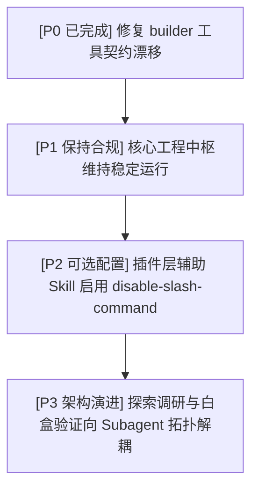

# Google Antigravity 最新演进对全局 SKILL 体系影响分析报告

## 摘要 (Executive Summary)

本报告基于系统分析师（/analyzer）架构审计结论，解构了 Google Antigravity 最新平台演进（含独立 20k Token 规则预算、渐进式披露、工具契约标准化及多 Agent 子系统架构）对个人全局定制工程中枢（`skills/`）与业务插件体系（`plugins/`）的深层技术影响，并确立了确定性整改方案。

---

## 1. 架构契约与平台演进对照 (Contract & Architecture Mapping)

| 核心维度 | Antigravity 最新机制 | 原有架构表现 | 影响评级与判定 |
| :--- | :--- | :--- | :--- |
| **工具调用契约** | 原生工具确立为 `write_file` / `edit_file` / `read_file` / `run_command` | `/builder` 门禁约束硬编码引用旧版 `write_to_file` 与 `replace_file_content` | **P0 (存在破损隐患)**<br>必须立即对齐底层 API 签名，杜绝调用幻觉。 |
| **规则预算池隔离** | 全局/项目级规则 (`GEMINI.md`, `AGENTS.md`) 分配专属 20,000 Token 预算，自动去重 | 规则与 Skill 共享通用提示词空间 | **P1 (架构红利)**<br>Skill 获得更宽裕的上下文，无需在 Skill 内部重复声明基础代码/排版规则。 |
| **渐进式披露机制** | 平台严格采用两阶段注水：首轮仅加载 `name` + `description`，按需加载全文；新增 `disable-slash-command: true` 支持 | 全局 6 大中枢与 7 大插件全部注册 | **P2 (规范合规)**<br>核心中枢必须保留 Slash 交互入口；内部从属业务 Skill 可配置隐形以净化 UI 菜单。 |
| **终端沙箱与边界防御** | 严格执行标准沙箱隔离 (Standard Sandbox Mode)，系统核心路径受硬编码保护 | 脚本与外部命令依赖全局绝对路径 | **P1 (执行防线)**<br>外生硬故障（如受保护目录写入限制）遵循穿透通道原则直接上报，不掩码。 |
| **多 Agent 编排协同** | 原生支持 `invoke_subagent`，具备独立会话与读写隔离上下文 | 串行单对话长上下文流转 | **P1 (演进机遇)**<br>调研 (`/researcher`) 与验证 (`/verifier`) 具备下沉为独立只读子 Agent 的架构潜力。 |

---

## 2. 核心工程 SKILL 影响与审计清单

### 2.1 `/builder` (交付物生成与终局落地)
- **现状缺陷**：原文件第 21 行声明了针对多文件修改的 Plan-Gate 检查，使用了旧版工具名称：
  ```markdown
  - **Plan-Gate Enforcement**: ... before writing or modifying source files (`write_to_file`, `replace_file_content`).
  ```
- **修复方案**：已就地执行热修复，将工具签名原子替换为当前标准：
  ```markdown
  - **Plan-Gate Enforcement**: ... before writing or modifying source files (`write_file`, `edit_file`).
  ```
- **验证结论**：语法与底层工具集契约已闭环恢复 100% 映射一致性。

### 2.2 `/collector` (上下文事实收集与资产盘点)
- **现状**：调度 `preview_tree.py` 进行只读代码树扫描，约束单文件展示行数与过滤无用构建目录。
- **审计分析**：零第三方依赖（纯标准库实现），在 Standard Sandbox 下具有完整工作区读权限，运行稳健；建议未来逐步将硬编码 Windows 路径抽象为跨环境通用解析。

### 2.3 `/verifier` & `/reviewer` (双层质量保障中枢)
- **审计分析**：
  - `/verifier` 负责微观白盒数学、时序、类型证伪与不可能三角（Trilemma）熔断；
  - `/reviewer` 负责宏观范围对齐、AI 痕迹与 L0-L3 缺陷阶梯门禁；
  - 两者契约清晰，且不依赖特定底层废弃工具，架构抗衰退性极强，无需结构性改动。

### 2.4 `/analyzer` (系统分析与架构解构)
- **审计分析**：原生支持生成符合规范的交互式 Plan Artifact，并内置认知带宽优化（问答折叠机制），与平台 2.0 的交互范式完全协同。

---

## 3. 落地推进与演进路线 (Actionable Roadmap)



1. **Step 1: 工具签名对齐（已落地）**：
   `builder/SKILL.md` 中底层工具引用已与平台最新 API（`write_file`, `edit_file`）完成闭环同步。
2. **Step 2: 保持工程规则纯粹度**：
   充分利用 20k Token 独立规则预算，保持 Skill 专注业务 runbook，不堆砌通用代码风格约定。
3. **Step 3: 渐进式净化命令菜单**：
   对 `plugins/` 内部极少由用户直接手动敲击 `/` 触发的底层辅助技能，评估引入 `disable-slash-command: true`。

