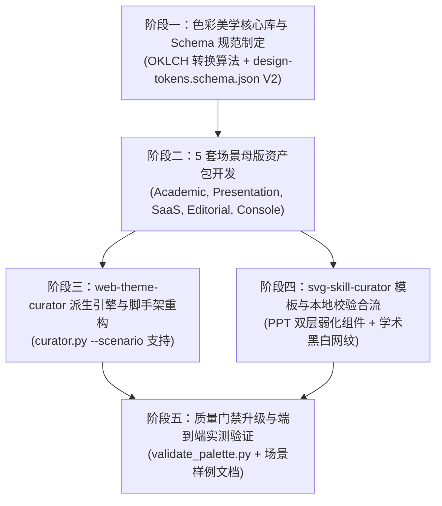

<!-- 20261030_multiscenario_color_aesthetic_system_proposal.md -->
# 多场景配色美学与色彩收敛中枢架构方案
# (Multi-Scenario Color Aesthetic & Convergence Architecture Specification for web-theme-curator and svg-skill-curator)

- **文档状态**：PROPOSED / ARCHITECTURAL SPECIFICATION
- **编制日期**：2026-10-30
- **分析主体**：`/analyzer` (System Analyst)
- **关联基线**：
  - [20260920_css_typography_control_and_theme_scaffolding_architecture.md](file:///C:/Users/Reaticle/.gemini/config/docs/20260920_css_typography_control_and_theme_scaffolding_architecture.md)
  - [20260920_typography_scale_control_and_skills_boundary_specification.md](file:///C:/Users/Reaticle/.gemini/config/docs/20260920_typography_scale_control_and_skills_boundary_specification.md)
- **落地目标**：
  - `C:\Users\Reaticle\.gemini\config\plugins\frontend-design\skills\web-theme-curator\`
  - `C:\Users\Reaticle\.gemini\config\plugins\frontend-design\skills\svg-skill-curator\`
  - `C:\Users\Reaticle\.gemini\config\plugins\frontend-design\skills\svg-designer\`

---

## 1. 痛点深度解构与设计意图 (Root Cause Analysis & Design Intent)

### 1.1 现状：“容易眼花缭乱”的物理与工程根因
在现行 `web-theme-curator` 与 `svg-skill-curator` 实践中，前端页面和 SVG 图表经常出现使用户“视觉疲劳、眼花缭乱、主次颠倒”的问题。经深度白盒解构，其根本原因不在于“颜色数量多”，而在于以下四大底层工程与美学机制缺陷：

1. **“告警色与分类色深度耦合”的圣诞树/红绿灯大杂烩（The Alert-Categorical Coupling Trap）**：
   - 现行 `design-tokens.schema.json` 强行将调色板约束为：`1 个主色 + 3 个辅助色（warning, danger, success）`，并将 `chartPalette` 默认配制为 `[primary, warning, danger, success]`；
   - 导致在多系列普通数据图表、流程架构图、分类卡片中，生成器直接将“红、橙、绿、青”作为普通分类色（Series 1, Series 2, Series 3）渲染；
   - 用户生理直觉中，红代表致命错误、橙黄代表严重预警、绿代表正常达标；常态图表全屏混排高饱和度红橙绿，瞬间诱发心理焦虑与“交通信号灯大乱炖”，造成极大的视觉干扰。

2. **RGB/Hex 色彩空间的感知非线性与彩度失控（Chroma Blindness & Glare Effect）**：
   - 现行脚手架默认预设多为高饱和度荧光色（如赛博青 `#00d2ff`、电光绿 `#00e599`、高能橙 `#ffb020`）；
   - 在 sRGB 空间中，RGB 坐标相同的明度（Luminance）在人类视网膜上的感知是高度不均匀的（例如纯绿视觉感知极亮，纯蓝视觉感知极暗）；
   - 缺乏感知均匀色彩空间（如 OKLCH / CIELAB）对彩度（Chroma $C$）的硬性天花板限制，导致元素在深色或浅色背景上产生强烈的高频光晕撕裂感。

3. **缺乏“60-30-10 空间视觉权重定律”（Absence of Spatial Weight Law）**：
   - 现行机制仅约定了“色相数量（1+3）”，未约定“色彩面积与视觉能量”；
   - 辅助色常常以纯色大色块、实心粗边框形式大面积扑洒，破坏了“中性底座 60% + 结构容器 30% + 点睛/焦点 10%”的视觉层级平衡。

4. **场景上下文严重真空（Scenario Blindness）**：
   - 当前脚手架只有一套偏向“深色科技大屏（tech-screen）”的默认设定；
   - **学术论文（Academic Paper）**：论文通常要求单色印刷安全、黑白打印不混淆、极高对比度，现行大屏彩色完全不适用；
   - **PPT 演讲演示（Presentation / Deck）**：受众处于中远距离投影环境，需要的是高雅洗练的主题色与低透明度（Tint）装饰性图元衬底，现行粗暴实色块会喧宾夺主；
   - **不同风格网页（Multi-Archetype Web）**：企业 SaaS 要求稳重中性，极简人文要求暖调米纸感，控制台要求低疲劳暗黑，单一科技青色板无法泛化。

---

## 2. 配色美学底层数学模型与收敛契约 (Mathematical Model & Convergence Contracts)

为终结“随机调色”与“视觉疲劳”，在两套 Curator 中统一注入基于物理感知的配色美学数学模型。

### 2.1 基于 OKLCH 感知色彩空间的能量参数契约
不再直接用肉眼盲选 Hex，全系统采用 **OKLCH 空间**（$L$: 感知明度, $C$: 彩度/纯度, $H$: 色相角度）进行约束转换：

$$\text{Color} = \operatorname{OKLCH}(L, C, H)$$

```text
[OKLCH 能量分布硬约束]
┌─────────────────────────────────────────────────────────────┐
│ 1. 结构与背景中性色 (Neutral Space):                          │
│    Chroma C <= 0.02 (严格冷灰/暖灰/锌灰，杜绝有色杂光)        │
│                                                             │
│ 2. 主品牌与主图元 (Primary Dominant):                        │
│    Chroma C ∈ [0.10, 0.16] (适度纯净，杜绝 C > 0.22 荧光刺激)│
│                                                             │
│ 3. 装饰性背景衬底 (Decorative Tint Fills):                   │
│    Alpha α ∈ [0.06, 0.15], Chroma C <= 0.12 (柔和弱化)      │
│                                                             │
│ 4. 业务常态分类色 (Categorical Palette):                     │
│    邻近色相环 ΔH ∈ [30°, 60°] 或 等距色阶，Chroma C 统一恒定│
│    严格与告警状态色解耦，严禁日常渲染红黄绿警讯三原色         │
│                                                             │
│ 5. 态势告警状态色 (Functional Alert Palette):                 │
│    仅在触发 threshold/alarm 事件时局部点缀，面积严格 < 5%     │
└─────────────────────────────────────────────────────────────┘
```

### 2.2 视觉面积 60-30-10 黄金分配法则
在 `tokens.css`、`chartTheme.js` 和 SVG 模版中固化面积权重层级：
- **60% 基础环境基底（Dominant / Foundation）**：
  - 由纯中性色或微色相灰阶主导（`bgBase`, `bgScreen`, `bgCard`）；
  - 承载整个界面或画布的视觉呼吸感，彩度 $C \le 0.02$。
- **30% 架构与内容结构（Structural Layer）**：
  - 容器边框（`border`）、文字主次阶梯（`textMain`, `textSecondary`, `textDim`）、次级卡片底色（`bgCardSub`）；
  - 保持黑白灰阶梯或同色系明度渐近，构建清晰阅读节奏。
- **10% 焦点点睛与装饰性图元（Focal & Decorative Accents）**：
  - 核心指标高光、主交互按钮、PPT 装饰性小图标、关键数据趋势线；
  - 严格限制单屏有彩色焦点不超过 1~2 处，严禁多焦点同时争夺视觉中枢。

### 2.3 装饰性图元“克制呼吸感”契约 (PPT & Dashboard Decorative Contract)
针对 PPT 与大屏中常用的装饰图标、徽章、分割线：
- **禁止纯实色高对比硬块**：严禁给装饰性图标填充 `#ff0000` 或高亮纯色并置于大色块上；
- **推行双层弱化渲染（Tint + Stroke）**：
  - **背景垫底**：使用主题色或辅助色的低透明度色（$8\% \sim 15\%$ Alpha）构成圆角矩形/圆形胶囊；
  - **图标笔画**：使用主题色（$80\% \sim 100\%$）或高明度文字色，笔画粗细（`stroke-width`）保持在 $1.25\text{px} \sim 1.75\text{px}$ 之间；
  - 效果：远看有结构和品牌调性，近看绝不抢夺正文与数据图表焦点。

---

## 3. 五大场景母版矩阵与色板规范 (Scenario Archetype Matrix)

为彻底解决不同项目诉求，确立 5 类标准化场景母版。两套 Curator 初始化时直接按 `--scenario` 参数装配对应的设计变量。

| 场景母版 (Scenario) | 核心气质与应用场域 | 背景与基底 (60%) | 结构与文字 (30%) | 装饰与焦点 (10%) | 图表与分类色契约 (Categorical Palette) |
| :--- | :--- | :--- | :--- | :--- | :--- |
| **`academic-paper`**<br>(学术论文/科技出版) | 严谨、高冷、客观、单色打印安全 (Print-Safe) | 纯白纸质背景<br>`#ffffff`<br>灰白隔层 `#f8f9fa` | 深炭黑正文 `#1a1a1a`<br>次级说明 `#555555`<br>精细边框 `#d0d7de` | 极淡学术深蓝点睛 `#1d4ed8`（或纯黑白灰）<br>绝对无荧光色 | **纯灰阶等距梯级**：<br>`[#1a1a1a, #555555, #8c8c8c, #c4c4c4]`<br>结合线型（实线/虚线/点划线）与网格填充（Hatching）区分 |
| **`presentation-deck`**<br>(PPT/高管汇报演示) | 高雅、克制、聚焦、中远距可读性强 | 浅色：极淡暖白 `#f9fafb`<br>深色：雅致墨黑 `#0f172a` | 结构卡片带柔和外发光/微投影<br>标题 `#0f172a` / `#f8fafc` | **微色调双层装饰**：<br>`primary-tint-10` 弱色垫底<br>搭配细线装饰性图标 | **同色系渐进梯级 (Analogous)**：<br>`[#2563eb, #3b82f6, #60a5fa, #93c5fd]`<br>优雅单色渐进，拒绝红黄绿交通灯 |
| **`saas-enterprise`**<br>(敏捷SaaS/企业后台) | 冷静、高效、清晰、低眼肌负荷 | 经典中性锌灰 (Zinc/Slate)<br>`#f4f4f5` (浅) / `#18181b` (深) | 灰度中性阶梯完善<br>卡片背景纯净，边框细致 | 精准品牌主色（如现代靛蓝 `#4f46e5` 或石墨青 `#0284c7`） | **邻近调和 4 色系**：<br>主色蓝、青绿、天蓝、板岩蓝<br>态势告警色（红黄绿）严格隔离至事件通道 |
| **`editorial-minimal`**<br>(人文极简/博客/文档) | 温暖、沉浸、纸感阅读、知性留白 | 羊皮纸/米白暖底<br>`#faf8f5`<br>温润柔和 | 暖深棕/灰黑正文 `#2d2b28`<br>次级暖灰 `#706e6b` | 沉稳琥珀金 `#d97706` 或陶土红 `#c2410c`（小面积印章感） | **大地色系与低饱和微彩色阶**：<br>`[#78716c, #a8a29e, #d97706, #44403c]` |
| **`tech-console`**<br>(控制台/监控大屏优化) | 赛博科技感、深空、低眩光暗黑治理 | 优化后的深空玄青<br>`#070d18`（消除青光撕裂） | 半透明深蓝卡片 `rgba(13,27,49,0.85)`<br>文字冷白天青 | 科技青蓝主色 `#0ea5e9`<br>辅以弱化边缘流光 | **冷色单向光谱阶梯**：<br>`[#0ea5e9, #06b6d4, #14b8a6, #3b82f6]`<br>彻底剔除默认图表调色板中的警讯红橙 |

---

## 4. 两大 Curator 改造技术方案与契约演进 (Implementation & Boundary Evolution)

### 4.1 `web-theme-curator` 演进：数据结构与派生引擎升级
#### 1. `design-tokens.schema.json` 架构演进
将原先扁平且死板的 `palette` 升级为解耦的四层色彩契约：
- `neutral`: 60% 空间环境与文本层级；
- `primary`: 10% 品牌核心交互与视觉锚点；
- `categorical`: 数据图表与业务模块分类色（4色，严格与告警解耦）；
- `functional`: 态势与异常告警色（仅限 warning/danger/success，仅在告警通道使用）；
- `decorative`: 装饰性图标与卡片垫底（自带 `fillTint` 与 `iconStroke` 派生规则）。

```json
{
  "$schema": "http://json-schema.org/draft-07/schema#",
  "title": "DesignTokensSchemaV2",
  "properties": {
    "name": { "type": "string" },
    "scenario": {
      "type": "string",
      "enum": ["academic-paper", "presentation-deck", "saas-enterprise", "editorial-minimal", "tech-console"]
    },
    "mode": { "type": "string", "enum": ["light", "dark"] },
    "palette": {
      "type": "object",
      "required": ["primary", "neutral", "categorical", "functional", "decorative"],
      "properties": {
        "primary": { "type": "string" },
        "neutral": {
          "type": "object",
          "required": ["bgBase", "bgCard", "border", "textMain", "textSecondary"]
        },
        "categorical": {
          "type": "array",
          "maxItems": 4,
          "items": { "type": "string" },
          "description": "常态图表与分类色，禁止包含红黄绿告警杂色"
        },
        "functional": {
          "type": "object",
          "required": ["warning", "danger", "success"],
          "description": "专用于态势告警与阈值事件，严禁用于常态数据 Series"
        },
        "decorative": {
          "type": "object",
          "properties": {
            "fillTint": { "type": "string", "description": "低透明度背景垫底" },
            "stroke": { "type": "string", "description": "装饰边框与细图标描边" }
          }
        }
      }
    }
  }
}
```

#### 2. `curator.py` 自动化派生能力增强
- 支持 `--scenario` 参数脚手架：
  ```bash
  python curator.py scaffold --name my-report --scenario academic-paper --mode light
  ```
- 派生 `tokens.css` 时自动生成装饰性变量与图表变量：
  ```css
  /* 自动生成的装饰性图标与徽章变量 */
  --color-deco-fill: var(--color-primary-tint, rgba(37, 99, 235, 0.08));
  --color-deco-stroke: var(--color-primary);
  /* 图表常态分类色 (解耦告警) */
  --chart-series-1: #2563eb;
  --chart-series-2: #3b82f6;
  --chart-series-3: #60a5fa;
  --chart-series-4: #93c5fd;
  ```
- 派生 `chartTheme.js` 时，ECharts 调色板数组绑定为 `categorical`，避免图表系列直接引用 red/orange/green。

---

### 4.2 `svg-skill-curator` 演进：矢量设计资产与模版注入
#### 1. `design-tokens.yaml` 场景母版扩展
在工作区 `.agents/skills/<project>-svg-generator/` 中初始化的 `design-tokens.yaml` 引入 `scenario` 与装饰性规范：
```yaml
# .agents/skills/<project>-svg-generator/design-tokens.yaml
name: academic-project-svg
scenario: academic-paper
mode: light
canvas:
  width: 1200
  height: 675
  padding: 40

palette:
  primary: "#1d4ed8"
  bgBase: "#ffffff"
  bgCard: "#f8fafc"
  borderCard: "#cbd5e1"
  textMain: "#0f172a"
  textSecondary: "#64748b"
  categorical:
    - "#0f172a" # 系列1：纯炭黑
    - "#475569" # 系列2：深石板灰
    - "#94a3b8" # 系列3：浅石板灰
    - "#cbd5e1" # 系列4：银灰
  decorative:
    badgeFill: "rgba(29, 78, 216, 0.08)"
    badgeStroke: "#1d4ed8"
    iconWeight: 1.5

patterns:
  academicHatch: true # 启用学术图表网纹/虚线填充模版
```

#### 2. SVG 模版库丰富与装饰组件解耦
在 `templates/` 下增加两套高频场景原生组件：
- **`templates/ppt-badge-card.svg` (PPT 专用组件)**：
  - 演示如何将装饰性小图标与胶囊标签通过 `<g class="deco-badge">` 渲染；
  - 规范 `<rect rx="8" fill="var(--color-deco-fill)" stroke="var(--color-deco-stroke)" stroke-width="1.25"/>`，内置居中图标矢量路径，杜绝刺眼纯实色；
- **`templates/academic-figure.svg` (学术论文专用图元)**：
  - 演示 `<defs>` 中定义 `<pattern id="hatch-dense" ...>` 斜线网纹与虚线（`stroke-dasharray="4 2"`）；
  - 确保黑白打印或灰度复印时，图元边界完全清晰，不依赖颜色辨识。

---

### 4.3 质量门禁升级：`validate_palette.py` 与 `validate_svg.py`

#### 1. `validate_palette.py`：从“粗暴限制”到“美学健康度度量”
升级校验器，实现机器级确定性拦截：
1. **红绿灯告警色混淆检测（Traffic Light Pollution Check）**：
   - 扫描 `dist/` 或 `src/` 中的非告警组件（如普通菜单、图表 Legend、信息卡片），若同时滥用 `#ff5252`、`#00e676`、`#ffa726` 且缺乏告警语义类名，发出 `WARNING/REJECT`；
2. **彩度超标检测（High Chroma / Glare Check）**：
   - 提取所有硬编码 Hex 色值，转为 OKLCH，若非纯焦点元素且 $C > 0.22$，判定为“刺眼荧光色”，强制报错；
3. **对比度门禁（WCAG / APCA Contrast Floor）**：
   - 针对文本色与卡片背景色，自动执行对比度计算：大标题 $\ge 3:1$，正文 $\ge 4.5:1$，学术模式正文 $\ge 7.0:1$。

#### 2. `validate_svg.py`：学术与装饰规范静态扫描
- 针对学术场景 SVG：若检测到有彩色图元数量 $> 1$，或有彩色面积占比 $> 5\%$，拦截并警告可能破坏单色打印合规；
- 针对常规 SVG：检测 `<path>` 或 `<svg>` 中装饰性实心大色块，推动向 `fill-opacity="0.1"` 双层渲染演进。

---

## 5. 工作分解结构与落地路线图 (WBS & Implementation Roadmap)



### 5.1 实施清单 (Task Breakdown)

| 阶段 | 任务目标 | 影响文件路径 | 验证手段 |
| :--- | :--- | :--- | :--- |
| **Phase 1<br>规范与契约** | 1. 制定 `design-tokens.schema.json` V2，解耦 Categorical 与 Functional。<br>2. 编写轻量级色彩转换工具类（Hex/RGB $\leftrightarrow$ OKLCH 计算）。 | - `.../web-theme-curator/templates/design-tokens.schema.json`<br>- `.../svg-skill-curator/templates/design-tokens.schema.json`<br>- `.../web-theme-curator/scripts/color_math.py` | `jsonschema` 单元测试 |
| **Phase 2<br>场景母版** | 1. 构建 5 大场景母版 JSON/YAML 预设。<br>2. 固化 Academic、Presentation、SaaS 等黄金调色板。 | - `.../web-theme-curator/presets/*.json`<br>- `.../svg-skill-curator/presets/*.yaml` | 视觉感知度与对比度计算复核 |
| **Phase 3<br>Web 脚手架** | 1. 升级 `curator.py` 支持 `--scenario` 和 `--mode` 参数。<br>2. 派生 `tokens.css` 生成 `--color-deco-*` 与解耦的图表分类变量。<br>3. 升级 `chartTheme.js` 生成逻辑。 | - `.../web-theme-curator/scripts/curator.py` | 运行 `curator.py scaffold` 及 `derive` 验证输出代码 |
| **Phase 4<br>SVG 脚手架** | 1. 升级 `scaffold.py` 支持场景模版注入。<br>2. 补充 `ppt-badge-card.svg` 与 `academic-figure.svg` 模版。<br>3. 注入学术 Hatch 网纹与虚线规范。 | - `.../svg-skill-curator/scripts/scaffold.py`<br>- `.../svg-skill-curator/templates/ppt-badge-card.svg`<br>- `.../svg-skill-curator/templates/academic-figure.svg` | 生成 SVG 在浏览器与导出 PDF/Typst 中检查打印渲染 |
| **Phase 5<br>质检门禁** | 1. 升级 `validate_palette.py`，加入红绿灯污染、彩度过高检测。<br>2. 升级 `validate_svg.py`，集成对比度与学术单色检查。 | - `.../web-theme-curator/scripts/validate_palette.py`<br>- `.../svg-designer/scripts/validate_svg.py` | 运行正向与反向样本测试，确保误报率 = 0 |

---

## 6. 验证计划与验收标准 (Verification & Acceptance Criteria)

### 6.1 确定性硬指标验收门禁 (Hard Gates)
1. **色彩解耦度 (Decoupling Gate)**：
   - 在生成的 `chartTheme.js` 中，默认 `color` 调色板数组中**严禁同时出现 `#ff5252` 与 `#00e676`** 作为分类系列；
   - 告警色仅在带有 `warning`、`danger`、`alarm` 属性时按需调用。
2. **彩度天花板 (Chroma Ceiling Gate)**：
   - 所有生成在 `tokens.css` 的非高光色，OKLCH Chroma $C \le 0.18$；背景色 $C \le 0.02$；彻底根除刺眼荧光。
3. **学术单色兼容度 (Academic Monochrome Gate)**：
   - 在 `academic-paper` 场景下生成的 SVG，经灰度转换模拟（$0.299R + 0.587G + 0.114B$）后，相邻数据系列明度差 $\Delta L \ge 15\%$，或者通过 `dasharray` / `hatch` 区分，单色打印可读性达到 $100\%$。
4. **字阶底线传承 (Typography Floor Continuity)**：
   - 继续严格恪守 $\text{font-size} \ge 12\text{px}$ 铁律，不因色彩机制重构而发生任何字阶回退。

### 6.2 预期收益
- **杜绝视觉疲劳**：告别“红绿灯混乱大屏”与“荧光刺眼大杂烩”，界面呈现克制、现代、高级的工业设计美感；
- **全场景自适应**：无论是极度严肃的学术论文插图、聚光灯下的高管 PPT 演示，还是生产级 SaaS 系统，工程师均可一键脚手架出专业级配色与排版资产；
- **零额外心智负担**：模型与工程师不需要懂复杂的色彩物理学，通过 `--scenario` 参数即可得到经数学与人机工程学认证的完美调色板。
