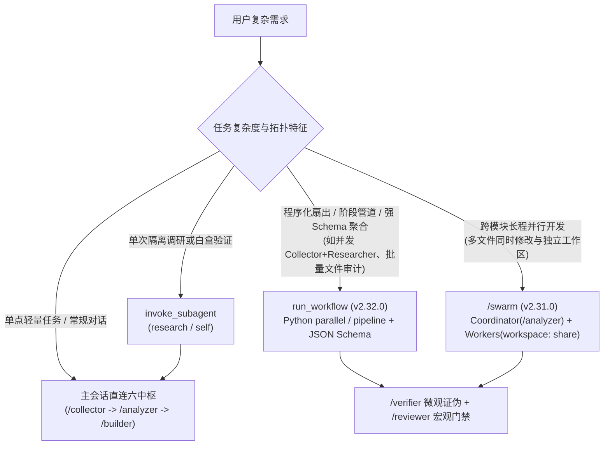

# Google Antigravity 近期更新（2026.11）对全局 SKILL 体系的影响与演进分析报告

## 文档元数据 (Metadata)

- **分析日期**：2026-11-22
- **对比基线**：[20261028-antigravity-update-analysis.md](file:///C:/Users/Reaticle/.gemini/config/docs/20261028-antigravity-update-analysis.md)（上期审计）与 [20261103_skills_governance_review_report.md](file:///C:/Users/Reaticle/.gemini/config/docs/20261103_skills_governance_review_report.md)（最新治理基线）
- **覆盖版本跨度**：Antigravity App `v2.29.0`（2026-11-03）→ `v2.34.0`（2026-11-20），含 Gemini 4 模型家族发布
- **执行角色**：System Analyst (`/analyzer`)（经 `/reviewer` 门禁复核并由 `/builder` 修订）
- **事实基准来源**：
  - **外部官方基准（Level A）**：`antigravity.google/docs/{changelog,skills,plugins,rules,hooks,sidecars,build-plugins}.md` 及内置 `run-workflow` / `mcp-app-development` 规范
  - **本地资产盘点**：`~/.gemini/GEMINI.md`、`~/.gemini/config/config.json`、6 个全局核心中枢 Skill 与 8 个已安装 Plugin（共 30 个 Skill）的脚本级静态扫描

---

## 摘要 (Executive Summary)

2026 年 11 月上中旬（`v2.29.0` ~ `v2.34.0`），Google Antigravity 完成了从“单会话工具增强”向**“多模型协同 + 可编程多 Agent 编排 + 远程/SSH 运行时 + 交互式 MCP Apps”**的范式跃迁。

对个人现有 SKILL 体系（6 大工程中枢 + 5 个自研业务插件 + 3 个官方插件，合计 30 个 Skill）的综合审计结论如下：

1. **架构兼容性总体稳健**：核心工程六中枢（`/collector`、`/researcher`、`/analyzer`、`/builder`、`/verifier`、`/reviewer`）职责边界与渐进式披露机制完全契合最新规范；`GEMINI.md` 体积为 `3,868 bytes`（仅占单文件 `24 KB` 上限的 16%），远离规则预算降级红线。
2. **存量刚性隐患（3 类，需优先治理）**：
   - **P0 工具契约残余漂移**：`verifier/SKILL.md` 第 65 行仍引用已退出当前原生工具集的 `read_url_content`；
   - **P1 YAML Frontmatter 首行污染**：`frontend-design` 插件下全部 3 个 Skill 首行存在 `<!-- path -->` HTML 注释，导致 `---` 未位于第 1 行，存在严格解析器与 `agy plugin validate` 校验失败风险；
   - **P1 硬编码 Windows 路径阻塞远程/SSH 场景**：13 个自研 Skill 内含 42 处本机绝对路径（含 `C:\Users\Reaticle\...` 与正斜杠 `C:/Users/Reaticle/...` 两种写法，其中 `devops-curator` 2 个 Skill 还指向已失效的 `antigravity-ide/builtin/skills/...` 路径），在 `v2.33.0` SSH 远程 Linux 主机与 `v2.30.0` Remote Agents 环境下将直接失效。
3. **高价值演进红利（4 大方向）**：
   - 借助 **`run_workflow` 动态工作流（v2.32.0）** 与 **`/swarm` 群体协作（v2.31.0）**，建立“单 Subagent / Python 编排 / Swarm 协作”三层并发调度契约；
   - 顺应 **Gemini 4（Carbon / Hydrogen / Neon）与 Orchestrator**，实现高推理规划与轻量执行/扫描的分层模型协同；
   - 依托 `v2.33.0` 修复的 Windows `hooks.json`（UTF-8 BOM 与引号路径修复），可将确定性校验脚本下沉为生命周期 Hook（`PreToolUse` / `PostInvocation` / `Stop`）；
   - 面向 `v2.34.0` **MCP Apps**，为 `frontend-design` / `document-publishing` 预留交互式侧边栏预览扩展口。
4. **平台边界实测发现（本次执行验证）**：
   - `C:\Users\Reaticle\.gemini\config\docs\` 已受 Antigravity 硬编码系统保护边界规则（`hardcoded system protection boundary rule`）拦截写入，直接调用 `write_file` / `edit_file` 落盘会触发 `Permission denied`。这意味着 `reviewer/SKILL.md` 中“审查报告强制持久化写入 `config/docs/`”的契约在当前运行时边界下会触发阻断，**需同步评估将持久化目录迁移至独立工作区或 Artifact 目录**。

---

## 1. Antigravity 近期核心更新全景（2026-11-03 ~ 2026-11-20）[Verified Fact]

| 版本 / 节点 | 发布日期 | 核心能力演进（官方事实） | 与定制体系（Skill / Plugin / Rule / Hook）的直接关联 |
| :--- | :--- | :--- | :--- |
| **v2.29.0 / v2.29.1** | 2026-11-03 / 11-07 | 推出 **Voice Mode**（Gemini Live）、**Remote Agents** 云端会话、重构 Automations（定时 Sidecar）与原生 Jupyter 视图。 | Skill 开始面临“本地 Windows”与“云端 Linux Remote Agent”双运行环境差异。 |
| **v2.30.0** | 2026-11-09 | 推出 **Knowledge Work** 简洁界面布局；Remote Agents 全量推送；内置 **迁移其他 Agent 配置为 Plugin**（`migrate-agent-settings`）；权限预设改为**单会话隔离**，`Auto` 权限转正；修复 Windows Python/PowerShell 非英文/Emoji 乱码。 | 写作与文档类插件（`creative-writing`、`document-publishing`）天然受益于 Knowledge Work 布局；Windows 脚本中文输出稳定性提升。 |
| **v2.31.0** | 2026-11-09 | 正式推出 **`/swarm`** 多 Agent 消息板协作；支持**分屏插件视图**；对话中通过插件卡片安装后自动恢复会话；修复 `plugin.json` 含额外字段时丢失 Context Providers 的缺陷；修复思考模型超 1 分钟超时。 | 多模块长程任务获得原生消息板协作能力（`config.json` 中已存在 `sidecars["swarm/swarm_board"]` 条目）。 |
| **Gemini 4 Carbon / Hydrogen** | 2026-11-10 / 11-12 | 发布 **Gemini 4 Carbon**（最强长程工程/科研模型）与 **Gemini 4 Hydrogen**（高速可靠编码模型），推出 **Orchestrator** 动态多模型规划-执行路由。 | 与个人 `/analyzer`（重规划）→ `/builder`（重落地）双阶段架构天然同构。 |
| **v2.32.0 / v2.32.2** | 2026-11-13 / 11-16 | 推出 **Dynamic Workflows (`run_workflow`)**（内置 Python 运行时，支持 `agent` / `parallel` / `pipeline` / `phase` / `trajectory` / `call_tool` 与 JSON Schema 强约束输出）；推出**多轮 `/btw` 侧栏只读支线问答**；插件卡片直接显示 MCP 启动错误。 | 彻底改变多 Skill 串行上下文膨胀痛点：调研/扫描/多维度审查可由 Python 脚本扇出并聚合结构化结果。 |
| **v2.33.0** | 2026-11-17 | 推出 **SSH Host 远程 Linux 连接**；GitHub PR 实时状态徽章与 Overview 面板；`/btw` 支持“插入主对话”；**修复 Windows 下规则/Agent/`hooks.json` 的 UTF-8 BOM 解析失效与引号路径 Hook 失败**；修复 `/learn` 追加规则突破文件体积上限；修复 Hook/通配符绕过强制审查；修复 5 分钟长思考超时。 | Windows 下 `hooks.json` 正式达到生产可用状态；SSH 远程 Linux 放大了 Skill 硬编码 `C:\Users\...` 路径的兼容问题。 |
| **Gemini 4 Neon & v2.34.0** | 2026-11-18 / 11-20 | 发布 **Gemini 4 Neon**（新默认模型，4 档思考深度）与 **Orchestrator (Neon)**；正式支持 **MCP Apps**（`ui://` 交互式 HTML 视图，支持对话内联 / 侧边栏 / 全局入口）；**点击对话中的 Skill 徽章可直接侧栏打开 `SKILL.md`**；修复 `plugin.json` UTF-8 BOM 导致加载失败；修复**无 `name` 字段的 Skill 发生命名冲突**；修复 Windows 下项目定制文件中网络路径被误探测。 | 定制体系进入“可视化交互（MCP Apps）+ 可点击溯源（Skill Pill）”阶段；对 `SKILL.md` Frontmatter 规范性提出更高要求。 |

---

## 2. 本地 SKILL 体系现状与静态审计事实 [Verified Fact]

经本地脚本对 `c:\Users\Reaticle\.gemini` 全量扫描（共 6 个全局中枢 Skill + 8 个 Plugin 下的 24 个 Skill = **30 个 Skill**，`GEMINI.md` 大小 **3,868 bytes**，无 UTF-8 BOM）：

### 2.1 资产拓扑概览
- **全局核心工程中枢（`config/skills/`，6 个）**：`collector`、`researcher`、`analyzer`、`builder`、`verifier`、`reviewer`
- **自研业务插件（`config/plugins/`，5 个，共 17 个 Skill）**：
  - `creative-writing`（5 个写作 Skill）
  - `devops-curator`（2 个发布/Wiki Skill）
  - `document-publishing`（5 个 Typst/Office/Docx Skill，含 Python 脚本）
  - `frontend-design`（3 个 SVG/主题设计 Skill，含校验脚本）
  - `media-processor`（2 个音频元数据/歌词对齐 Skill，含 Python 脚本）
- **外部/官方插件（`config/plugins/`，3 个，共 7 个 Skill）**：`chrome-devtools-plugin`（v1.10.1）、`google-antigravity-sdk`（v0.0.9）、`modern-web-guidance-plugin`（v1.0.4）
- **未启用高级原语**：5 个自研插件目前均未配置 `hooks.json`、`rules/AGENTS.md`、`agents/`（Custom Agents）、`$schema`（`plugin.json` 校验声明）或 `suggestedPrompts`。

### 2.2 静态扫描与实测暴露的具体缺陷清单

| 缺陷类别 | 命中文件（Verified Path） | 具体证据 | 触发风险与平台关联 |
| :--- | :--- | :--- | :--- |
| **系统保护边界冲突（本次实测）** | [reviewer/SKILL.md](file:///C:/Users/Reaticle/.gemini/config/skills/reviewer/SKILL.md#L75-L82) | 强制要求审查报告落盘至 `config/docs/`；本次实测 `write_file` / `edit_file` 写入 `C:\Users\Reaticle\.gemini\config\docs\` 触发 `Matches hardcoded system protection boundary rule`。 | 平台对 `~/.gemini/config/` 下的写入实施了硬编码边界保护，导致 `/reviewer` 的强制落盘契约在无人工搬运时必定报错阻断。 |
| **旧版工具名残留** | [verifier/SKILL.md](file:///C:/Users/Reaticle/.gemini/config/skills/verifier/SKILL.md#L65) | 第 65 行：`优先自动调用平台只读工具（read_url_content / web_fetch_exa）` | 当前 Antigravity 原生工具集中无 `read_url_content`（仅原生内置 `search_web` 与 `exa-search` MCP 工具 `web_fetch_exa`），易触发无效调用尝试或模型幻觉。（注：官方插件 `google-antigravity-sdk` 亦存在 `view_file`/`read_url_content`，属上游包维护范围。） |
| **Frontmatter 首行污染** | [svg-designer/SKILL.md](file:///C:/Users/Reaticle/.gemini/config/plugins/frontend-design/skills/svg-designer/SKILL.md#L1-L7) [svg-skill-curator/SKILL.md](file:///C:/Users/Reaticle/.gemini/config/plugins/frontend-design/skills/svg-skill-curator/SKILL.md#L1-L7) [web-theme-curator/SKILL.md](file:///C:/Users/Reaticle/.gemini/config/plugins/frontend-design/skills/web-theme-curator/SKILL.md#L1-L7) | 第 1 行均为 `<!-- config/plugins/frontend-design/skills/.../SKILL.md -->`，YAML Frontmatter `---` 被推迟至第 2 行。 | 官方规范要求 `SKILL.md` **必须以 `---` 开头**。虽当前运行时解析器容错放行，但严格 YAML 解析器与 `agy plugin validate` 会将其判为无 Frontmatter，且在 `v2.34.0` 修复前曾面临 Skill 命名冲突风险。 |
| **Windows 绝对路径硬编码** | `collector/SKILL.md`（5 处） `reviewer/SKILL.md`（1 处 `file:///C:/...` 模板） `office-parser/SKILL.md`（9 处） `audio-metadata-manager/SKILL.md`（6 处） `typst-archiver/SKILL.md`（3 处） `ai-lyrics-aligner/SKILL.md`（2 处） `docx-template-sync/SKILL.md`（1 处） `typst-publisher/SKILL.md`（1 处） `svg-designer/SKILL.md`（2 处 `C:/...`） `svg-skill-curator/SKILL.md`（4 处 `C:/...`） `web-theme-curator/SKILL.md`（6 处 `C:/...`） `release-curator/SKILL.md`（1 处 `file:///C:/.../antigravity-ide/...`） `wiki-curator/SKILL.md`（1 处 `file:///C:/.../antigravity-ide/...`） | 如 `python "C:\Users\Reaticle\.gemini\config\skills\collector\scripts\preview_tree.py"`、`python C:/Users/Reaticle/...` 及指向旧版 `antigravity-ide/builtin/skills/permissioned-github/SKILL.md` 的失效链接，共计 **13 个自研 Skill / 42 处**本机绝对路径。 | 在 `v2.33.0` **SSH 远程 Linux** 或 `v2.30.0` **Remote Agents** 云端容器环境中执行时必然因路径不存在而中断（`devops-curator` 的旧路径在本机亦已失效）。官方 `skills.md` 推荐相对路径链接（`./scripts/...`）或 `~/.gemini/config/...`。 |
| **插件清单缺少 Schema 与元信息** | 5 个自研插件的 `plugin.json` | 仅声明 `name`、`displayName`、`version`、`description`，缺少 `$schema` 与 `suggestedPrompts`。 | 无法享受 IDE Schema 自动补全与 `v2.31+` Marketplace/Installed 页面的 Starter Prompt Chips 快捷入口。 |

---

## 3. 架构影响矩阵与深度评估 [Judgment]

| 维度 | 平台新特性 | 对现有 SKILL 体系的影响评级 | 深度架构研判 |
| :--- | :--- | :--- | :--- |
| **1. 系统保护边界与持久化路径** | 硬编码系统保护边界禁止 `write_file` / `edit_file` 写入 `~/.gemini/config/docs/` | **P0（已触发阻断）** | `/reviewer` 在 2026-11-03 刚确立的“报告持久化至 `config/docs/`”协议与平台安全边界冲突。建议将文档/审查报告默认持久化目标改为**当前项目工作区的 `docs/reviews/`** 或 **Artifact 目录（`<ArtifactDir>`）**，若确需归档至 `~/.gemini/config/docs/`，由用户在外部手动同步。 |
| **2. 工具契约与解析合规** | 工具名统一（`read_file`/`write_file`/`edit_file`/`search_web`）、`v2.34.0` Skill Pill 点击溯源与 Frontmatter 校验收紧 | **P0（必须修复）** | 继上期（10-28）修复 `builder/SKILL.md` 后，本次发现 `verifier/SKILL.md` 仍残留 `read_url_content`，且 `frontend-design` 3 个 Skill 存在首行注释污染。需一次性清零，确保 `agy plugin validate` 全绿。 |
| **3. 跨环境可移植性** | `v2.33.0` SSH Host（Linux）+ `v2.30.0` Remote Agents | **P1（高优先改进）** | 个人 SKILL 体系此前默认单机 Windows 运行。若使用 SSH 远程 Linux 开发或云端 Remote Agent，硬编码 `C:\Users\Reaticle\...` 与 `C:/Users/Reaticle/...` 将直接阻断 `/collector` 等核心技能执行；需将脚本调用改为相对路径或基于 Skill 目录动态解析。 |
| **4. 编排范式跃迁（核心红利）** | `v2.32.0` **Dynamic Workflows (`run_workflow`)** + `v2.31.0` **`/swarm`** | **P1（架构级演进）** | 现有六中枢仍以“单会话串行切换”为主。新平台已提供**三层确定性编排原语**（详见第 4 节）： 1. 单次委托 → `invoke_subagent`； 2. 程序化扇出/管道/结构化聚合 → `run_workflow`（Python + JSON Schema）； 3. 长程多模块并行开发 → `/swarm`（共享消息板 + `workspace: "share"`）。 特别是 `/analyzer` 前置的 **`/collector` + `/researcher` 双向事实锚定**，天然适合用 `run_workflow` 并行扇出并输出强类型事实 JSON，大幅减少主会话 Token 污染。 |
| **5. 生命周期 Hooks 下沉** | `v2.33.0` 修复 Windows `hooks.json` BOM 与引号路径问题 + 强制审查防绕过 | **P2（按需引入）** | 过去 Windows 下 Hooks 存在隐蔽 Bug，因此校验全靠 Skill 提示词软约束。如今 `hooks.json` 在 Windows 已稳定：`frontend-design` 的 `validate_svg.py` / `validate_typography.py` 可考虑通过 **`PreToolUse`**（在 `write_file`/`edit_file` 执行前检查 `toolCall.args` 并返回 `decision: "deny"`）或 **`PostInvocation` / `Stop`**（写入后校验并注入修复指令）实现确定性门禁（注：`PostToolUse` 仅期望空 JSON 对象 `{}`，不支持阻断或向模型注入反馈）。 |
| **6. 模型分层与 Orchestrator 协同** | Gemini 4 Neon / Hydrogen / Carbon + Orchestrator | **P2（零改造成本红利）** | `/analyzer`（重逻辑与方案解构）与 `/builder`（重代码与文档落地）的职责切分与平台 **Orchestrator (Neon)** 完全吻合；在 `run_workflow` / `invoke_subagent` 中可将轻量级只读扫描显式指定 `model="flash"`，降低延迟与配额消耗。 |
| **7. 交互体验与支线隔离** | `v2.32.2` / `v2.33.0` 多轮 `/btw` 只读支线 + `Ctrl+E` 终端支线提问 | **P2（工作流提效）** | 在 `/builder` 或 `/verifier` 排障过程中，临时查证环境变量、单文件源码或终端报错时可改用 `/btw` 支线，结论确认后再“Insert into main conversation”，避免主对话上下文被临时探测污染。 |
| **8. 交互式可视化扩展** | `v2.34.0` **MCP Apps**（`ui://` HTML 视图） | **P3（远期探索）** | 现有 `frontend-design`（配色/SVG 预览）与 `document-publishing`（Typst 排版/大纲质检报告）目前均为纯文本/脚本输出。未来若封装本地 MCP Server，可直接利用 MCP Apps 在侧边栏呈现交互式配色看板与 SVG 质检视图。 |

---

## 4. 新版多 Agent 编排拓扑建议（与六中枢映射）[Judgment]

为避免 `invoke_subagent`、`run_workflow` 与 `/swarm` 在工程中枢体系内职责重叠，建议确立如下**三层编排决策边界**：

- **`/analyzer` 适配建议**：在 WBS 拆解阶段，允许根据任务形态显式标注推荐执行拓扑（`Single` / `Subagent` / `run_workflow` / `/swarm`），但严守平台规则——不主动未经用户触发调用 `/swarm`。
- **`/collector` + `/researcher` 协同建议**：面对同时缺乏本地与外部事实的大型需求，可在主流程中用一段轻量 `run_workflow` 脚本并行启动两个只读 `agent()` 分别遵循 `/collector` 与 `/researcher` 契约，最终以 JSON Schema 汇总事实基准回填给 `/analyzer`。

---

## 5. 分阶段整改与演进路线图 (Actionable WBS)

> [!NOTE]
> 依据 `/analyzer` 角色约束，本报告仅输出确定性方案与变更清单，不直接修改 `SKILL.md` 或配置源码。由于 `~/.gemini/config/` 受平台保护边界限制，后续落地编辑建议由您确认后在有写入权限的上下文/编辑方式下执行。

### Phase 1：P0/P1 兼容性与规范性清零（低风险、立即可执行）

| 任务 ID | 优先级 | 目标文件 | 具体变更动作 | 验收标准 |
| :--- | :--- | :--- | :--- | :--- |
| **T1.1** | **P0** | [reviewer/SKILL.md](file:///C:/Users/Reaticle/.gemini/config/skills/reviewer/SKILL.md#L75-L82) | 调整报告持久化路径契约：优先输出至当前业务项目的 `docs/reviews/` 或会话 Artifact 目录（`<ArtifactDir>`），避免触发 `~/.gemini/config/docs/` 的系统写入保护边界。 | `/reviewer` 在任意工作区均可无报错完成双轨落盘。 |
| **T1.2** | **P0** | [verifier/SKILL.md](file:///C:/Users/Reaticle/.gemini/config/skills/verifier/SKILL.md#L65) | 将第 65 行 `read_url_content` 替换为当前平台实际工具组合（原生内置工具 `search_web` / `exa-search` MCP 只读工具 `web_fetch_exa`），并明确区分工具归属。 | 全库自研 `SKILL.md` 中已弃用工具名引用为 0。 |
| **T1.3** | **P1** | `frontend-design` 插件下 3 个 `SKILL.md` | 移除第 1 行位于 YAML Frontmatter 之前的 `<!-- ... -->` 注释，确保 `---` 严格位于文件第 1 行。 | `^---` 正则检测 100% 通过；`agy plugin validate` 无 Frontmatter 报错。 |
| **T1.4** | **P1** | 13 个自研 `SKILL.md`（`collector`、`reviewer`、`document-publishing` 4 个、`media-processor` 2 个、`frontend-design` 3 个、`devops-curator` 2 个） | 将硬编码 `C:\Users\Reaticle\.gemini\config\...` 与正斜杠 `C:/Users/Reaticle/...` 统一抽象为相对于 Skill 目录的路径（如 `./scripts/...`、`./references/gotchas.md`）或跨平台 `~` 约定，并清理 `devops-curator` 指向旧版 `antigravity-ide/builtin/...` 的失效链接。 | 在本机 Windows 与 SSH Linux 环境下均能正确定位脚本与引用路径。 |

### Phase 2：P1/P2 新平台能力增量融合（按需启用）

| 任务 ID | 优先级 | 涉及范围 | 具体演进动作 | 预期收益 |
| :--- | :--- | :--- | :--- | :--- |
| **T2.1** | **P1** | `analyzer/SKILL.md` | 在 WBS 输出协议中补充“编排拓扑建议（`Single` / `Subagent` / `run_workflow` / `/swarm`）”轻量选型指引（遵循平台对 `/swarm` 的显式触发约束）。 | 让分析产物与 `v2.31`~`v2.32` 新编排引擎无缝衔接，减少人工二次拆解。 |
| **T2.2** | **P2** | 5 个自研插件 `plugin.json` | 补充 `"$schema": "https://antigravity.google/schemas/v1/plugin.json"` 与 `suggestedPrompts`；运行 `agy plugin validate` 建立自动化质检基线。 | 提升 App Customizations 面板交互体验并防范未来 Schema 破坏性变更。 |
| **T2.3** | **P2** | `frontend-design/hooks.json`（可选试点） | 基于 `v2.33.0` 修复后的 Windows Hooks，试点为 SVG/CSS 写入配置轻量 `PreToolUse`（`write_file` / `edit_file` 写入前拦截并返回 `decision: "deny"`）或 `PostInvocation` / `Stop` 钩子执行字阶/SVG 校验（严格控制 `timeout <= 10s`）。 | 将关键物理底线（`font-size >= 12px`）由提示词约束升级为确定性自动门禁。 |

### Phase 3：P3 长期架构探索（非紧急）

- **T3.1（MCP Apps 探索）**：评估将 `frontend-design`（配色与字阶预览）或 `document-publishing`（Typst 文档大纲与质检看板）升级为带 `ui://` 视图的本地 MCP App。
- **T3.2（历史归档清理）**：评估清理 `config/global_workflows/*.md.bak`（据 `2026-11-03` 治理基线记录为 14 个历史备份文件；当前受限于目录访问权限未能复核），降低目录噪音。

---

## 6. 验证计划 (Verification Plan)

1. **静态合规扫描（L0）**：Phase 1 实施后，重新运行 Python 审计脚本验证：
   - 自研 Skill 弃用工具名计数 = `0`；
   - 所有 23 个自研 `SKILL.md`（6 个全局中枢 + 17 个自研插件 Skill）首行均为 `---` 且无 UTF-8 BOM；
   - 自研 Skill 硬编码路径正则 `C:[\\/]Users[\\/]Reaticle`（同时覆盖反斜杠与正斜杠）匹配计数 = `0`。
2. **官方校验器门禁（L1）**：若已安装 `agy` CLI，对 5 个自研插件逐一执行 `agy plugin validate --strict <plugin_dir>`，确保零 Error。
3. **回归检查（L2）**：在 Antigravity App 中触发 `/verifier` 与 `frontend-design` Skill，点击对话中生成的 Skill Pill 验证侧栏可正常打开对应 `SKILL.md`。
