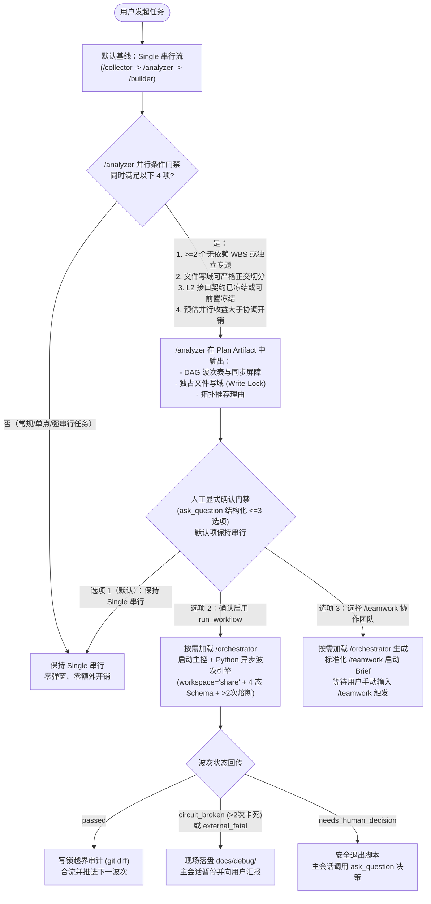

# 个人全局 SKILL 体系并行编排架构分析与改造方案

> **编制角色**：`/analyzer`（系统分析与架构解构）
> **编制日期**：2026-11-24
> **参考蓝本**：[WBS实施策略与多Agent并行编排方案.md](file:///d:/offices/CQCIG/Post%20Dr/博士后课题/tunnel-wifi-platform/docs/feats/WBS实施策略与多Agent并行编排方案.md)
> **分析对象**：个人全局核心工程 SKILL 体系（`C:\Users\Reaticle\.gemini\config\skills\`）
> **核心原则**：**默认关闭、零日常开销、人工显式确认后按需启动**（Default-Off & Human-Confirmed Opt-In）
> **归档说明**：因平台对 `C:\Users\Reaticle\.gemini\config\docs\` 存在硬编码系统保护边界（`write_file` 权限拒绝），本文档按规范降级持久化至当前会话 Artifact 目录；如需归档至 `config\docs\`，可在外部终端手动复制同步。

---

## 一、Goal Description（目标定义与核心结论速览）

### 1.1 问题定义与边界约束

当前个人全局 SKILL 体系（`collector` / `researcher` / `analyzer` / `builder` / `verifier` / `reviewer`）在**单会话串行工程闭环**上已经非常成熟，但在面对多模块、多 WBS 波次研发或大范围并行调研/审计任务时，缺少一套**条件触发、可隔离、可熔断、且严格受人工确认门禁约束的多 Agent 并行编排机制**。

本次架构分析锁定以下 4 项硬边界：

1. **默认不启动（Default-Off）**：常规单点修改、线性任务或未获人工明确批准的任务，严格维持单会话串行流，严禁自主拉起多 Agent 并行消耗 Token 或制造合并冲突。
2. **人工显式确认门禁（Human-Confirmed Opt-In）**：仅当 `/analyzer` 判定任务满足并行收益阈值，并经用户通过结构化选项（`ask_question`）或显式指令批准后，才启动 `run_workflow`；而 `/teamwork`（`/swarm`）严守平台红线——**永不自动调用**，仅在用户确认后生成标准化启动 Brief，交由用户手动触发。
3. **零基础上下文膨胀（Zero Routine Overhead）**：严禁将冗长的 Python 异步状态机模板与团队协作手册硬塞进现有 6 个高频 SKILL 中，避免拖累每一次普通对话的基础 Token 预算。
4. **继承并泛化确定性熔断契约**：将参考文档中验证有效的**契约前置（L2）+ 独占文件写域（Write-Lock）+ 4 态 JSON Schema + 卡死 $>2$ 次熔断 + 人工必要决策暂停（HITL）**抽象为跨项目复用的全局标准。

### 1.2 核心结论（TL;DR）

- **诊断结论（Fact）**：现有 `analyzer/SKILL.md` 第 72–76 行仅存在 5 行 `Execution Topology Recommendation` 概念占位，但下游 `builder` 仅支持单会话 `/goal` 串行闭环，其余 4 个核心 SKILL 均无并行 Worker 契约与合流写锁审计，导致体系存在**“规划提了一嘴并行、执行全靠单线程硬扛”**的架构断层。
- **推荐架构（Judgment）**：采用 **方案 C（“薄钩子 + 按需加载第 7 中枢 `/orchestrator`”混合架构）**：
  - **薄钩子层**：对现有 6 个 SKILL 仅做 $\le 15$ 行的轻量增量增强（`analyzer` 增加并行触发阈值评估、DAG 写锁表与默认关闭的人工确认门禁；`builder`/`verifier`/`reviewer`/`collector`/`researcher` 补充 Worker 态受限契约与合流写锁审计）。
  - **按需中枢层**：新增第 7 个按需加载全局技能 `config/skills/orchestrator/SKILL.md`，平时完全不占上下文，仅在人工确认启用并行时加载，承载 `run_workflow` 确定性波次引擎与 `/teamwork` 协作启动协议。

---

## 二、Fact Grounding & Prerequisites（事实锚定与现状盘点）

本节严格区分**实测事实（Fact）**、**工程判断（Judgment）**与**待核验项（Unverified）**。

### 2.1 现有全局 SKILL 体系资产与能力现状（Fact）

经实地核查 `C:\Users\Reaticle\.gemini\config\skills\`，当前 6 个核心全局 SKILL 的职责与并行支持度如下：

| SKILL 名称 | 文件路径与体量 | 当前核心机制（Fact） | 并行与编排能力缺口（Fact） |
| :--- | :--- | :--- | :--- |
| **`collector`** | [collector/SKILL.md](file:///C:/Users/Reaticle/.gemini/config/skills/collector/SKILL.md) (89 行) | 本地只读资产盘点、`preview_tree.py`（支持 `--json`）、受限事实同步、Unknown Information SOP | 缺少与 `/researcher` 在 Wave 0 并发执行时的结构化合流输出契约 |
| **`researcher`** | [researcher/SKILL.md](file:///C:/Users/Reaticle/.gemini/config/skills/researcher/SKILL.md) (63 行) | 外部公网证据查证（Level A/B/C）、本地盘点排他 | 缺少并发多专题调研（`run_workflow` fan-out）的 JSON `finish` 返回契约 |
| **`analyzer`** | [analyzer/SKILL.md](file:///C:/Users/Reaticle/.gemini/config/skills/analyzer/SKILL.md) (80 行) | `/grill-me` 访谈、双向事实门禁、三叉戟契约、Plan Artifact 协议；**L72–76 已有 5 行 `Execution Topology Recommendation`** | 1. 无**默认不启动 + 人工确认门禁** 2. 未区分 `run_workflow` 与 `/teamwork` 触发条件 3. 未强制要求输出 **DAG 波次表、同步屏障与独占文件写域（Write-Lock）** |
| **`builder`** | [builder/SKILL.md](file:///C:/Users/Reaticle/.gemini/config/skills/builder/SKILL.md) (66 行) | Plan-Gate（$\ge 2$ 文件）、Fast-Path Bypass、`/goal` 单会话串行自愈闭环（预算 $\le 3$ 轮、外生硬故障穿透） | 1. **纯串行设计**，无波次并行调度能力 2. 无并行 Worker 态的**写锁域遵守契约**与 4 态 Schema 返回规范 3. `/goal` 重试上限（$\le 3$）与并行熔断标准（$>2$ 次即熔断）未统一 |
| **`verifier`** | [verifier/SKILL.md](file:///C:/Users/Reaticle/.gemini/config/skills/verifier/SKILL.md) (110 行) | 白盒证伪、2-Fail 防死循环熔断、跷跷板/不可能三角仲裁、受控对照、动态生态基线锚定 | 熔断哲学与参考方案天然契合，但缺少多模块并行验真（fan-out）与 Worker 结构化裁决 Schema |
| **`reviewer`** | [reviewer/SKILL.md](file:///C:/Users/Reaticle/.gemini/config/skills/reviewer/SKILL.md) (118 行) | L0–L3 缺陷分级、事实偏离定点归因、审查报告持久化（含 `~/.gemini/config/` 降级至 ArtifactDir）、高门槛 `/learn` 提示 | 缺少多工作区合流前的**写锁越界审计**（`git diff --name-only` 比对）与并行聚合审查协议 |

### 2.2 平台原生并行原语边界矩阵（Fact）

基于平台工具声明与内置 [run-workflow/SKILL.md](file:///C:/Users/Reaticle/.gemini/antigravity/builtin/skills/run-workflow/SKILL.md) 实测核对，Antigravity 原生并行能力存在明确的物理与权限边界：

| 维度 | `Single`（默认基线） | `invoke_subagent`（轻量并发） | `run_workflow`（确定性波次引擎） | `/teamwork`（`/swarm` 协作团队） |
| :--- | :--- | :--- | :--- | :--- |
| **默认状态** | **默认开启** | 默认关闭（仅独立只读/双路轻量任务按需） | **默认关闭（须人工确认）** | **默认关闭（严禁自动触发，仅限用户手动输入 `/teamwork` 或 `/swarm`）** |
| **控制拓扑** | 主会话单线程串行 | 主会话同回合拉起多个独立子 Agent，事件驱动唤醒 | Python 异步脚本充当确定性状态机（`parallel`/`pipeline`/`phase`） | 共享消息板（`@mention`）+ Coordinator/Worker 自由协商 |
| **隔离能力** | 共享当前工作区 | 支持 `Workspace="share"` / `"branch"` / `"inherit"` | 支持 `workspace="share"` / `"branch"` / `"inherit"` | 支持 `workspace="share"` / `"branch"` / `"inherit"` |
| **子 Agent 通信** | N/A | 仅与主会话通过 `send_message` 通信 | **彼此不可见**；脚本通过 `worker = agent(...)` 跨轮纠偏，强制 JSON `schema` 返回 | **共享公开消息板**，适合跨模块开放式讨论与互相评审 |
| **熔断与 HITL** | 依赖 `/goal`（$\le 3$ 轮）或 `/verifier`（2-Fail） | 主会话直接调用 `ask_question` 暂停，但重试计数依赖会话上下文记忆 | **代码级硬熔断**（精确 `max_stalls = 2` + 错误指纹去重）；脚本内**不可直接问用户**，需返回 `needs_human_decision` 交主会话调用 `ask_question` | 依赖 `swarm_monitor` 检测全员 Stall，缺少代码级精确失败计数与强制 JSON Schema |
| **关键陷阱（Fact）** | 长任务串行耗时高 | 并发 $\ge 3$ 或多波次时主会话易上下文膨胀 | `parallel()` 内任一未捕获异常会取消同组所有协程，**必须在 Python 协程内做 `try/except` 隔离** | 协调成本高，用于确定性 WBS 流水线反而比 `run_workflow` 慢且易漂移 |

### 2.3 事实锚定与前置核验清单

- **[Verified Locally]**：已完整读取 6 个全局 SKILL、[run-workflow/SKILL.md](file:///C:/Users/Reaticle/.gemini/antigravity/builtin/skills/run-workflow/SKILL.md)、[config.json](file:///C:/Users/Reaticle/.gemini/config/config.json) 及参考文档 [WBS实施策略与多Agent并行编排方案.md](file:///d:/offices/CQCIG/Post%20Dr/博士后课题/tunnel-wifi-platform/docs/feats/WBS实施策略与多Agent并行编排方案.md)。
- **[Platform Constraint Verified]**：实测 `C:\Users\Reaticle\.gemini\config\docs\` 受平台硬编码系统保护边界限制，无法通过 Agent 的 `write_file` 直接写入；后续修改 `config/skills/` 下各 `SKILL.md` 时，如同样触发系统保护边界，需输出补丁/Artifact 由用户在外部同步或在权限允许范围内写入。
- **[Unverified Assumption]**：
  - `A1`：假定用户日常使用中，将 `/teamwork`（UI 快捷斜杠命令）与底层 `swarm` 工具视为同一类“协作式团队并行”入口。本方案按平台红线将其严格约束为“仅人工手动触发”。

---

## 三、Proposed Changes（架构解构与改造方案）

### 3.1 架构选型对比（为什么选“薄钩子 + 按需中枢”）

针对如何在全局 SKILL 体系中引入并行编排，存在 3 种异构架构方案：

| 方案 | 设计思路 | 优势 | 劣势 / 风险 | 推荐度 |
| :--- | :--- | :--- | :--- | :---: |
| **方案 A：全量内嵌** | 将 `run_workflow` 脚本契约、熔断状态机、写锁审计和 `/teamwork` Brief 模板全部写进 `analyzer` 和 `builder` | 不增加新 SKILL 数量 | `analyzer` / `builder` 体积暴涨至 180+ 行，每次普通单文件任务都在加载大量无用编排规则，违背“零日常开销”原则 | 不推荐 |
| **方案 B：完全独立第 7 技能** | 新增 `/orchestrator`，现有 6 个 SKILL 一字不改 | 现有 SKILL 零改动 | `analyzer` 不会主动产出 DAG 波次与写锁表，也不会在合适时机向用户发起“是否启用并行”确认；`builder` 被拉起为 Worker 时缺少写锁与 4 态 Schema 约束 | 不推荐 |
| **方案 C：薄钩子 + 按需中枢（混合架构）** | 1. 现有 6 个 SKILL 仅注入 $\le 15$ 行轻量协议钩子（默认关闭、无开销） 2. 新增按需加载的 `config/skills/orchestrator/SKILL.md` 承载完整并行引擎与模板 | 1. **日常单线程零膨胀**：未确认并行时完全不读 `orchestrator` 2. **规划-执行闭环**：`analyzer` 识别机会并弹窗确认，确认后无缝挂载 `orchestrator` + Worker 契约 3. **严格守住默认关闭与 `/teamwork` 平台红线** | 新增 1 个全局 SKILL 目录（`config/skills/orchestrator/`），维护成本极低 | **推荐（Recommended）** |

### 3.2 核心机制设计：默认关闭与人工确认触发状态机

并行编排的唯一合法入口是**“条件触发评估 → 人工显式确认 → 路由至对应引擎”**，严禁跳过确认直接并行：

### 3.3 `run_workflow` 与 `/teamwork` 的精确分工矩阵

为防止两种并行机制在全局体系内混用，确立以下**正交选型边界**：

| 判定维度 | 选用 `run_workflow`（确定性波次并行） | 选用 `/teamwork`（`/swarm` 协作式团队并行） | 选用 `invoke_subagent`（轻量 2 路并发） |
| :--- | :--- | :--- | :--- |
| **任务性质** | 结构化 WBS 流水线、批量文件审计、Wave-0 多路调研（`collector` ∥ `researcher`）、多模块按冻结合约编码 | 开放式架构探索、跨模块强耦合联调、需要多个角色互相辩论/评审/迭代对齐的大型课题 | 并发度 $= 2$ 且无需多波次状态机的短任务（如 2 个独立单测/调研） |
| **契约清晰度** | **高**（L2 接口契约与写锁域已冻结，子 Agent 无需互相聊天） | **中/低**（接口或设计权衡需在执行中通过消息板动态对齐） | **高**（两路任务边界清晰） |
| **熔断与确定性要求** | **极高**（必须代码级精确控制 `max_stalls = 2`、错误指纹去重、强制 JSON `schema`） | **中**（允许人工在消息板随时插话微调方向） | **中**（由主会话人工计数纠偏，上限 2 次） |
| **启动方式** | 用户在 `ask_question` 或对话中确认后，由主会话调用 `run_workflow` | **仅限用户手动输入 `/teamwork` 或 `/swarm`**；Agent 严禁擅自调用 `swarm` 工具 | 用户确认后，主会话同回合并发调用 2 个 `invoke_subagent` |

### 3.4 统一契约规范（跨项目复用的 4 项硬标准）

从 [WBS实施策略与多Agent并行编排方案.md](file:///d:/offices/CQCIG/Post%20Dr/博士后课题/tunnel-wifi-platform/docs/feats/WBS实施策略与多Agent并行编排方案.md) 中提炼并泛化为全局 SKILL 通用契约：

1. **三层文档与契约前置屏障（Contract-First Barrier）**：
   - 凡涉及**多 Agent 并行写代码**的波次，其前序必须存在同步屏障：冻结跨模块接口/数据结构契约（`docs/feats/`），并在 `docs/steps/` 维护当前波次的轻量实施单（波次划分、独占文件写域、确定性验收命令、状态与失败计数）。
2. **独占文件写域与合流审计（Disjoint Write-Lock Scope）**：
   - 同波次并发 Worker 必须分配**两两互不相交的目录/文件写域**，且统一使用 `workspace="share"`（纯只读调研可使用 `inherit`）。
   - 合流前必须由主控或 `/reviewer` 执行 `git diff --name-only` 校验：任何越界修改均阻断合流。
3. **Worker 4 态 JSON Schema 与异常隔离**：
   - 所有被 `run_workflow` 调度的 Worker 必须按统一 JSON `schema` 调用 `finish` 返回：
     - `task_id`: 任务/WBS 编号
     - `status`: `"passed" | "retryable_failed" | "needs_human_decision" | "external_fatal"`
     - `error_signature`: 归一化错误指纹（用于同错原地打转检测）
     - `changed_files`: 实际修改的相对路径数组
     - `verification_evidence`: 验收命令与退出码摘要
     - `decision_request`: 仅 `needs_human_decision` 时填充（$\le 3$ 个带推荐项的结构化选项）
   - Python 编排脚本中每个 `parallel()` 协程必须包裹 `try/except`，将异常转化为结构化状态返回，**防止单点异常取消同波次健康任务**。
4. **统一熔断与 HITL 升级协议（Circuit Breaker）**：
   - **静默自愈**：`retryable_failed` 且 `stall_count < 2` 时，向同一保留上下文的 `worker = agent(...)` 注入报错日志自动纠偏，不打断用户。
   - **卡死熔断（退出上报）**：连续失败达到 **3 次**（即重试卡死 $> 2$ 次），或连续 2 轮产出**相同 `error_signature`**（原地打转），立即熔断并将现场落盘至 `docs/debug/breaker-<task_id>.md`。
   - **外生硬故障穿透**：`external_fatal`（权限/网络/缺宿主依赖/沙盒阻断）第 1 次即直接穿透上报，禁止空转。
   - **人工必要决策暂停**：`needs_human_decision` 安全退出脚本，由主会话调用 `ask_question` 交由用户拍板。

### 3.5 工作分解结构（WBS）与文件影响清单

> **注意**：当前处于 `/analyzer` 方案分析阶段，**尚未修改任何 `SKILL.md`**。待您审阅批准本方案后，再由 `/builder` 按以下 WBS 增量落地。

| WBS | 目标文件 | 改造类型 | 精准增量改动摘要（控制体量防膨胀） |
| :--- | :--- | :--- | :--- |
| **WBS-1** | `config/skills/orchestrator/SKILL.md` | **新增**（按需加载） | 建立第 7 中枢技能：Default-Off 守门规则、4 类拓扑决策矩阵、`run_workflow` 安全并发 Python 模板（含 `try/except` 隔离、4 态 Schema、`max_stalls=2` 熔断器）、`workspace="share"` 写锁合流步骤、`/teamwork` 标准化启动 Brief 模板 |
| **WBS-2** | `config/skills/analyzer/SKILL.md` | **增量编辑**（约 +15 行） | 升级 L72–76 `Execution Topology Recommendation`：明确 **Default-Off（默认 `Single`）**；增加 4 项并行触发条件；满足条件时强制输出 DAG 波次表 + 独占写锁域，并通过 `ask_question` 向用户发起**默认串行 / `run_workflow` / `/teamwork`** 的显式确认；补充 `/teamwork`（`/swarm`）严禁自动触发红线 |
| **WBS-3** | `config/skills/builder/SKILL.md` | **增量编辑**（约 +12 行） | 新增 `# Parallel Execution & Worker Contract (Default-Off)`：声明默认单会话串行、严禁未经人工确认启动并行；当被 `run_workflow` 或 `/teamwork` 调度为 Worker 时，强制严守独占写锁域、4 态 JSON `finish` 返回及卡死 $>2$ 次熔断（区别于单会话 `/goal` 的 $\le 3$ 轮预算） |
| **WBS-4** | `config/skills/verifier/SKILL.md` | **增量编辑**（约 +6 行） | 补充并行验真兼容条款：在 `run_workflow` 批量验真模式下，支持按统一 JSON Schema 输出裁决与 `error_signature`，与现有 `2-Fail` 熔断器无缝对接 |
| **WBS-5** | `config/skills/reviewer/SKILL.md` | **增量编辑**（约 +6 行） | 在 `Scope Compliance` 下新增**并行写锁合流审计**：涉及多工作区合流交付时，核验各分支 `git diff --name-only` 是否严格落于声明的独占文件写域内 |
| **WBS-6** | `config/skills/collector/SKILL.md` & `researcher/SKILL.md` | **增量编辑**（各约 +4 行） | 补充 Wave-0 并发事实锚定（`collector` ∥ `researcher`）时的结构化分节/JSON 输出兼容说明，日常独立调用零变化 |

- **本改造任务自身的编排拓扑建议**：`Single`（涉及 7 个小型 Markdown 技能文件，存在跨技能契约名词强一致性要求，单会话串行编辑 + 一次性交叉核对效率最高且零冲突，**默认不启动并行**）。

---

## 四、Verification Plan（改造后验收门禁）

待方案获批并由 `/builder` 落地后，需通过以下 5 项确定性验收测试：

1. **默认静默验证（Default-Off Gate）**：发起一个常规单文件或线性重构需求，验证 `/analyzer` 与 `/builder` 保持 `Single` 串行流，**不弹窗询问并行、不加载 `/orchestrator`、不调用 `run_workflow` 或 `swarm`**。
2. **条件触发与人工确认验证（Opt-In Gate）**：发起一个包含 $\ge 2$ 个独立模块的多 WBS 需求，验证 `/analyzer` 能准确输出 DAG 波次与写锁表，并通过 `ask_question` 提供“默认串行 / `run_workflow` / `/teamwork`”选项；若用户选默认串行，必须严格退回串行执行。
3. **平台红线验证（`/teamwork` Non-Auto-Invoke）**：验证在任何未由用户显式输入 `/teamwork` 或 `/swarm` 的场景下，全局 SKILL 文本均无诱导 Agent 擅自调用 `swarm` 工具的表述；用户选择 `/teamwork` 选项时仅输出标准化 Brief 并提示用户手动触发。
4. **契约一致性验证（Cross-Skill Consistency）**：通过 `/verifier` 核对 `analyzer`、`builder`、`verifier`、`reviewer` 与 `orchestrator` 五者之间的 4 态枚举名、熔断阈值（$>2$ 次 / 同错 $\times 2$）、写锁审计规则完全一致，无术语漂移。
5. **Token 体量门禁（Anti-Bloat Check）**：验收修改后原有 6 个核心 `SKILL.md` 的单文件增量均严格控制在 $\le 20$ 行以内，确保全局基础技能保持轻量精悍。
