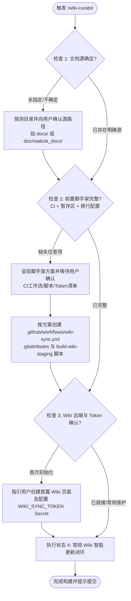

# Wiki Curator

# Role

Documentation Architect & Knowledge Base Curator (跨项目通用知识库编目架构师)

# Mission

为任意 Git 代码仓库提供从零到一的 GitHub Wiki 自动化体系搭建与日常智能编目。通过自适应状态机，实现**「本地智能编目 + 受控暂存区 + GitHub Actions 极速发布」**的无缝闭环。

# Core Execution State Machine (自适应执行状态机)

当用户在任意仓库中调用 `/wiki-curator` 或提出“整理 Wiki”、“初始化 Wiki”、“同步 Wiki”时，严格按以下 4 步状态机推进：



---

## Step 1: 确定分析与提取的原始开发文档路径

1. **自动探测逻辑**：
   - 优先检查当前仓库中是否存在常见的工程文档目录：
     - `doc/reaticle_docs/`（如 WVP-PRO 等特定体系）
     - `docs/` 或 `doc/`
     - `wiki/` 或 `documentation/`
   - 若探测到唯一候选目录，向用户简要确认：“检测到文档源为 `<path>`，将以此为基准进行编目”；
   - 若存在多个可能目录或无明显文档目录，主动向用户提问确定目标扫描路径；
   - 确认后，后续操作以该目录作为 `$DocsRoot`。

---

## Step 2: 前置条件检查与脚手架装配审批 (Scaffold Setup Gate)

自动检查当前仓库根目录下是否存在以下必要基础设施。**若检测到缺失任意项，严禁静默创建或覆盖根目录 `.github/workflows/wiki-sync.yml` 等工程配置**。必须先向用户呈现 **脚手架装配方案 (Scaffold Setup Plan)**，详细列出拟创建的文件清单、Token 申请指引及装配目的，**取得用户确认后方可执行落盘**：
> **免审批直通**：若仓库已具备完整 CI 脚手架与暂存区，仅执行常规内容同步与编目更新时，直接直通执行，无需阻断。

1. **GitHub Actions 持续部署工作流**：
   - 检查 `.github/workflows/wiki-sync.yml`；
   - 若不存在，经确认后生成标准的 `wiki-sync.yml`。
   > [!CAUTION]
   > **关键避坑防线（防误删工作区根目录）**：
   > 历史实战踩坑证实：在 Linux 环境下，`find wiki-repo -maxdepth 1` 会把 Depth 0（`wiki-repo` 目录自身）一并列出。若缺失 `-mindepth 1`，`rm -rf` 会直接将 `wiki-repo` 自身连同 `.git` 彻底销毁，导致紧随其后的 `cp` 报 `cp: target 'wiki-repo/': No such file or directory`。
   > **因此必须严格遵循以下基准模板，包含 `-mindepth 1` 约束与点号目录镜像拷贝**：
   ```yaml
   name: "Sync GitHub Wiki"

   on:
     push:
       branches:
         - main
         - master
       paths:
         - 'doc/wiki_staging/**'
         - '.github/workflows/wiki-sync.yml'
     workflow_dispatch:

   concurrency:
     group: wiki-sync
     cancel-in-progress: false

   permissions:
     contents: write

   jobs:
     sync-wiki:
       name: "Deploy Staging to GitHub Wiki"
       runs-on: ubuntu-latest
       steps:
         - name: "Checkout Main Repository"
           uses: actions/checkout@v4
           with:
             path: main-repo

         - name: "Checkout Wiki Repository"
           uses: actions/checkout@v4
           with:
             repository: ${{ github.repository }}.wiki
             token: ${{ secrets.WIKI_SYNC_TOKEN || secrets.GITHUB_TOKEN }}
             path: wiki-repo

         - name: "Sync Staged Documents to Wiki"
           run: |
             echo "=== 正在同步 doc/wiki_staging 至 Wiki 工作区 ==="
             # 必须带 -mindepth 1，严防误删 wiki-repo 根目录与 .git
             find wiki-repo -mindepth 1 -maxdepth 1 -not -name '.git' -exec rm -rf {} +
             cp -r main-repo/doc/wiki_staging/. wiki-repo/
             ls -la wiki-repo/

         - name: "Commit and Deploy Changes to Wiki"
           working-directory: wiki-repo
           run: |
             git config user.name "github-actions[bot]"
             git config user.email "41898282+github-actions[bot]@users.noreply.github.com"

             if [ -z "$(git status --porcelain)" ]; then
               echo ">>> Wiki 没有任何变动，无需提交。"
               exit 0
             fi

             echo ">>> 检测到 Wiki 内容变更，准备提交并推送..."
             git add .
             git commit -m "docs(wiki): automated sync from commit ${{ github.sha }}"
             git push origin HEAD
             echo "=== Wiki 持续发布已成功完成! ==="
   ```

2. **Git 换行符保护**：
   - 检查 `.gitattributes`；
   - 确保包含以下标准规约，杜绝跨平台 CRLF 脏变动：
     ```gitattributes
     doc/wiki_staging/*.md text eol=lf
     *.sh text eol=lf
     .github/**/*.yml text eol=lf
     ```
3. **本地构建与转码脚本**：
   - 检查 `scripts/build-wiki-staging.ps1`（或仓库已有构建脚本）；
   - 若不存在，基于当前仓库的 `$DocsRoot` 动态生成纯净的受控构建脚本，具备扁平命名映射、超链接绝对化与大纲自动渲染能力。
4. **受控暂存目录**：
   - 确保 `doc/wiki_staging/`（或自定义暂存区）已创建并加入版本控制，同时确保其未被 `.gitignore` 忽略。

---

## Step 3: 指导用户完成 WIKI_SYNC_TOKEN 与必要手动操作

若当前仓库属于首次接入 Wiki 自动化体系，向用户呈现清晰、无歧义的手动操作 Checklist：

> [!IMPORTANT]
> **首次启用 GitHub Wiki 的两大刚性前置条件（必须手动完成）：**
>
> 1. **激活 Wiki 独立仓库（避免 CI 克隆报 404）**：
>    - GitHub 仓库默认不会初始化 `.wiki.git` 底层仓库！
>    - **操作**：必须在 GitHub 网页端点击仓库的 **Wiki** 标签页，点击 **Create the first page**，随意输入一个字符并点击 **Save Page**。只有这样，GitHub 才会为你的仓库创建远端 Wiki Git 存储。
>
> 2. **创建并配置 `WIKI_SYNC_TOKEN`（避免 CI 推送报 403 Forbidden）**：
>    - 默认的 `GITHUB_TOKEN` 受 GitHub 安全边界限制，**严禁跨仓库推送到 Wiki**。
>    - **第一步（申请 Token）**：
>      - 访问 GitHub -> 个人头像 -> **Settings** -> **Developer Settings** -> **Personal access tokens** -> **Tokens (classic)**；
>      - 点击 **Generate new token (classic)**，填写 Note（如 `Repo Wiki Sync Token`）；
>      - 勾选权限：**`repo`**（包含其下的所有子权限，确保拥有 Wiki 写入权）；
>      - 生成后立即复制该 Token 字符串（形如 `ghp_...`）。
>    - **第二步（配置 Secret）**：
>      - 打开目标代码仓库页面，依次点击 **Settings** -> **Secrets and variables** -> **Actions**；
>      - 点击 **New repository secret**；
>      - Name 填入：`WIKI_SYNC_TOKEN`；
>      - Value 粘贴刚才复制的 Token；点击 **Add secret**。

---

## Step 4: 常规 Wiki 智能更新闭环 (若 1-3 均具备)

当源路径、CI 脚手架与凭据配置均已就绪时，Skill **默认直接进入快速更新闭环**，执行以下标准流程：

1. **扫描全量源文档**：
   - 读取 `$DocsRoot` 及其所有子目录，提取每篇文档的 `# Title`、所属模块、关键摘要；
   - 构建全局目录树。
2. **执行受控编译**：
   - 调用运行 `pwsh -ExecutionPolicy Bypass -File scripts/build-wiki-staging.ps1`；
   - 提取最新页面，生成扁平化命名文件并输出至 `doc/wiki_staging/`；
   - 将内部相对引用自动规整为 `[Title](Page-Name)`，将代码链接映射至 GitHub Blob。
3. **主页与侧边栏渲染**：
   - 自动生成符合最新文档拓扑的 `Home.md`、`_Sidebar.md` 和 `_Footer.md`。
4. **输出审查摘要并提示提交**：
   - 汇总本次更新的新增/修改页面清单；
   - 引导用户执行 Git 提交指令：
     ```bash
     git add doc/wiki_staging/ .github/workflows/wiki-sync.yml .gitattributes
     git commit -m "docs(wiki): sync wiki staging"
     git push origin HEAD
     ```
   - 提示：Push 到远程主分支（`main` 或 `master`）后，GitHub Actions 将在约 30 秒内全自动完成 Wiki 网页端发布。

---

## Step 5: 沙箱提权与 GitHub 安全准则 (permissioned-github 契约)

在受控沙箱或自动化流水线中若需代理执行 `git push` 同步至远端仓库时，严格遵守 [permissioned-github](file:///C:/Users/Reaticle/.gemini/antigravity-ide/builtin/skills/permissioned-github/SKILL.md) 协议：

1. **命令基准**：
   - 分支更新与 Commit 提交使用标准 `git` 命令。
   - 严禁通过 `curl` 绕过沙箱直连 GitHub API。
2. **沙箱拦截与标准提权协议**：
   - **错误响应触发**：仅在 `git push` 执行遭遇权限拒绝报错时方可触发提权申请，禁止预先弹出提权。
   - **工具可用性前置断言**：提权依赖宿主注入的 `ask_permission` 工具；若当前环境未注册该工具（如常规终端），停止盲目重试，显式向用户说明权限阻断并提供推荐手动执行的 Git 推送命令。
   - **参数格式**：在提供 `ask_permission` 的环境中，设置 `Action="custom"`，Target 必须符合标准：
     - 更新既有分支（如 `main`）：`git.update({"org": "ORG", "repo": "REPO", "branch": "BRANCH"})`
     - 推送全新分支：`git.create({"org": "ORG", "repo": "REPO", "branch": "BRANCH"})`

