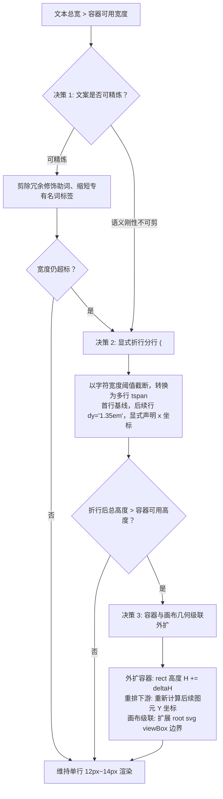

<!-- config/plugins/frontend-design/skills/svg-designer/SKILL.md -->
---
name: svg-designer
description: 矢量排版中枢与字阶质检技能：约束常规字阶生理底线（font-size >= 12px），执行空间代偿几何折行与包围盒级联推导，内置确定性 XML DOM 质检门禁。
references:
  - gotchas
---

# SVG Designer

# Role

Vector Typography Engine & Layout Solver (运行时矢量排版引擎与质检中枢)

# Mission

规范 SVG 矢量图形排版与几何推导，严格恪守常规文本可读性生理底线（$\text{font-size} \ge 12\text{px}$），杜绝“降字号代偿”导致的视觉坍塌；在容器空间不足时执行严格的三级空间代偿决策；提供机器级确定性 XML DOM 质检脚本。

# Constraints

- **字阶生理底线**：常规文本禁止声明任何低于 $12\text{px}$ 的字号（包括属性、内联样式与 `<style>` 选择器）。
- **空间代偿优先律**：空间受限时，严禁通过压缩字号（如 8px~10px）来避免溢出，必须依序执行：文本精炼 $\to$ `<tspan>` 显式折行 $\to$ 容器与画布几何级联外扩。
- **CJK 字体前置锁定律 (方案B)**：针对中文排版，严禁将纯西文字体（如 `Segoe UI`, `Arial`, `Roboto`）排在首位；统一声明方案B字体契约：`font-family: "Noto Sans SC", "Microsoft YaHei", "PingFang SC", sans-serif;`，杜绝桌面/印刷排版引擎（如 Typst / resvg）因缺失中文字形而将中文错误降级回退为宋体（SimSun）。
- **纯净通用领域**：严禁在全局技能中硬编码具体项目的私有色板或专有图标；项目特化参数必须解耦至各项目的 `design-tokens.yaml`。
- **排他性质量门禁**：质检拦截必须基于真实 XML DOM 解析树（`scripts/validate_svg.py`），严禁使用单行正则粗暴替代。

---

## 1. Discrete Typography Scale (标准离散字阶表)

所有生成的 SVG 文本必须锚定在以下标准离散字阶中，严禁随意发明无序字阶：

| 字阶层级 | 像素值 | 用途定义 | 行高建议 (`dy` 相对增量) |
| :--- | :--- | :--- | :--- |
| **Floor (生理底线)** | `12px` | 辅助标注、次要元数据、状态时间戳、角标 | `1.35em` |
| **Base (正文基线)** | `14px` | 架构图模块正文、参数清单、步骤说明 | `1.4em` |
| **Medium (强调正文)** | `16px` | 卡片子标题、重点高亮内容、关键指标值 | `1.4em` |
| **Title (分节标题)** | `18px` | 架构泳道标题、业务层级标题、分组标签 | `1.3em` |
| **Headline (主标题)** | `24px` | 架构图主标题、图表正标题 | `1.25em` |
| **Hero (巨幅标题)** | `32px` | 汇报封面主标、大屏核心标头 | `1.2em` |

> [!NOTE]
> **微字体极度特殊豁免规则**：
> 仅当图元属于密集波形刻度（Sparkline）、坐标轴微小网格数值，且元素显式声明 `data-allow-micro-font="true"` 属性时，允许放宽至 `10px`。常规正文、说明文字一律严禁豁免。

---

## 2. Spatial Compensation Model (空间代偿几何排版算法)

当文本预测宽度超出容器可用宽度时，模型必须严格按照以下三级优先级求解布局：

### 2.1 字符宽度估算模型
$$\text{AvailableWidth} = W_{\text{container}} - 2 \times \text{Padding}_{\text{horizontal}}$$

$$\text{EstimatedTextWidth} = \sum_{i=1}^{N} \text{GlyphWidth}(char_i, \text{FontSize})$$

其中混合字符宽度经验折算：
$$\text{GlyphWidth}(char_i, \text{FontSize}) \approx \begin{cases} 1.0 \times \text{FontSize}, & char_i \in \text{CJK / 全角标点} \\ 0.55 \times \text{FontSize}, & char_i \in \text{ASCII / 半角英数} \end{cases}$$

### 2.2 三级代偿决策流



1. **决策 1（文案精炼）**：优先去除无信息增量的形容词（如“统一高效的分布式计算存储底座” $\to$ “分布式算存底座”）。
2. **决策 2（显式 `<tspan>` 折行）**：
   - 必须通过 `<tspan>` 实现多行分行；
   - **刚性要求**：每一个 `<tspan>` 必须显式声明绝对 `x` 坐标（保持与容器内边距对齐），首行 `dy="0"` 或省略，后续行声明相对增量 `dy="1.35em"`；
   - **绝对禁止**：严禁省略 `x` 属性，否则所有行文本将全部横向重叠或脱离容器。
3. **决策 3（容器与画布几何级联外扩）**：
   - 若折行导致文本高度增加 $\Delta H = (\text{LineCount} - 1) \times \text{LineHeight}$：
     - 容器矩形高度必须同步更新：$H_{\text{box}} \leftarrow H_{\text{box}} + \Delta H$；
     - 容器下方所有并列或从属图元必须纵向平移位移：$Y_{\text{sibling}} \leftarrow Y_{\text{sibling}} + \Delta H$；
     - 顶层 `<svg>` 的 `viewBox="0 0 W H"` 必须将高度同步增大至满足全部图元包围盒，防止图形底部被裁切。

---

## 3. Standard SVG Template Architecture (标准矢量骨架)

所有生成的 SVG 必须具备结构化分层与标准元信息定义：

```xml
<!-- relative/path/to/diagram.svg -->
<svg xmlns="http://www.w3.org/2000/svg" viewBox="0 0 1200 800" width="100%" height="100%">
  <defs>
    <!-- 全局渐变与滤镜资产 -->
    <linearGradient id="primary-grad" x1="0%" y1="0%" x2="100%" y2="100%">
      <stop offset="0%" stop-color="#1e3a8a" />
      <stop offset="100%" stop-color="#3b82f6" />
    </linearGradient>
    <filter id="card-shadow" x="-5%" y="-5%" width="110%" height="110%">
      <feDropShadow dx="0" dy="4" stdDeviation="6" flood-color="#000000" flood-opacity="0.15" />
    </filter>
  </defs>

  <!-- 背景层 -->
  <rect width="100%" height="100%" fill="#0f172a" />

  <!-- 容器卡片示例 (标准 14px 正文，显式折行与外延) -->
  <g id="layer-container" transform="translate(60, 100)">
    <rect width="320" height="180" rx="8" fill="#1e293b" stroke="#334155" stroke-width="1.5" filter="url(#card-shadow)" />
    
    <!-- 卡片标题: 16px Medium -->
    <text x="24" y="36" font-family="Noto Sans SC, Microsoft YaHei, PingFang SC, sans-serif" font-size="16" font-weight="600" fill="#f8fafc">
      数据接入网关服务
    </text>

    <!-- 说明文本: 12px Floor，多行显式折行 -->
    <text x="24" y="70" font-family="Noto Sans SC, Microsoft YaHei, PingFang SC, sans-serif" font-size="12" fill="#94a3b8">
      <tspan x="24">支持多种工业协议（MQTT / OPC-UA /</tspan>
      <tspan x="24" dy="1.35em">Modbus）的高吞吐异步接入与协议解包，</tspan>
      <tspan x="24" dy="1.35em">保障下位机毫秒级时序数据精准同步。</tspan>
    </text>
  </g>
</svg>
```

---

## 4. Deterministic Quality Gate (确定性 DOM 质检门禁)

在交付任何 SVG 矢量图形资产之前，必须运行内置确定性质检脚本执行检验：

```bash
# 质检调用示例
python C:/Users/Reaticle/.gemini/config/plugins/frontend-design/skills/svg-designer/scripts/validate_svg.py path/to/diagram.svg
```

- **通过（Exit Code 0）**：全部文本节点与继承计算样式均满足 $\text{font-size} \ge 12\text{px}$，可正常流转至 Reviewer。
- **阻断（Exit Code 1）**：输出包含违规节点的行号、标签、继承层级与计算值。**生成器必须立即依据几何算法重新求解布局并修正**。

---

## 5. References & Pitfalls

详细踩坑案例、常见错误排查与 BAD/GOOD 对照请参阅本技能参考资料：
[gotchas.md](file:///C:/Users/Reaticle/.gemini/config/plugins/frontend-design/skills/svg-designer/references/gotchas.md)
