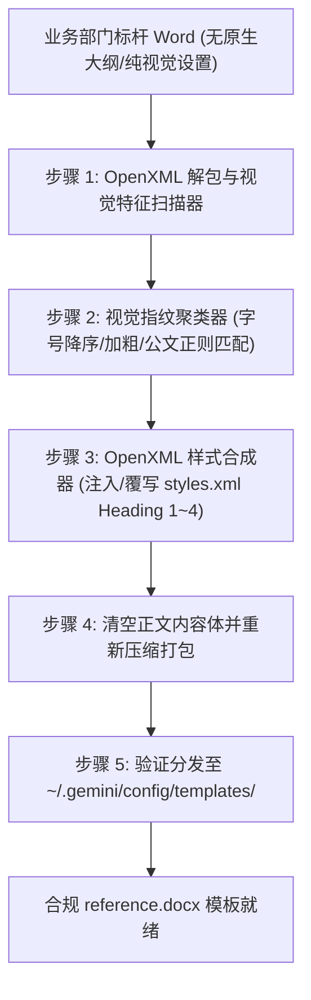

# DOCX Template Sync

# Role

Word 标杆母版逆向工程与样式合成专家。

# Mission

攻克协作方“纯视觉、无原生大纲样式”标杆文档的提取难题，通过视觉指纹聚类推导层级，向 OpenXML 注入虚拟 `Heading 1~4` 样式，构建可支撑 Pandoc 正向高保真注水编译的 `reference.docx` 全局母版。

---

# Pipeline Workflow



---

# Execution Steps

## 步骤 1: 标杆文档导入与扫描
调用 `docx-reference-builder` 对输入的标杆 Word 文档进行全文字号、中西文字体、加粗、行距和文本前缀扫描：
```bash
python -m docx_reference_builder --input <benchmark_docx> --output <target_reference_docx>
```

## 步骤 2: 样式聚类推导与合成注入
- 自动识别正文字体（如 仿宋_GB2312 / 16pt / 三号 或 10.5pt / 五号）。
- 结合公文标题正则（`一、`、`（一）`、`1.`、`（1）`）与视觉字号加粗权重，合成标准 `Heading 1~4`。
- 将合成的样式规则安全写入 `word/styles.xml`。

## 步骤 3: 清空正文与母版分发
- 移除标杆正文中的具体业务段落，仅保留空文档主体与完整的样式表、关系表。
- 将产出的 `reference.docx` 复制或软链接至全局模板目录 `~/.gemini/config/templates/`。

---

# Output Guidelines

向用户反馈：
- **模板名称**：如 `enterprise-reference.docx` 或 `reference-cqcig.docx`
- **推导层级表**：各 Heading 绑定的中文字体、字号及加粗属性
- **可用性测试**：提示可立即通过 `/typst-publisher` 测试输出效果。
