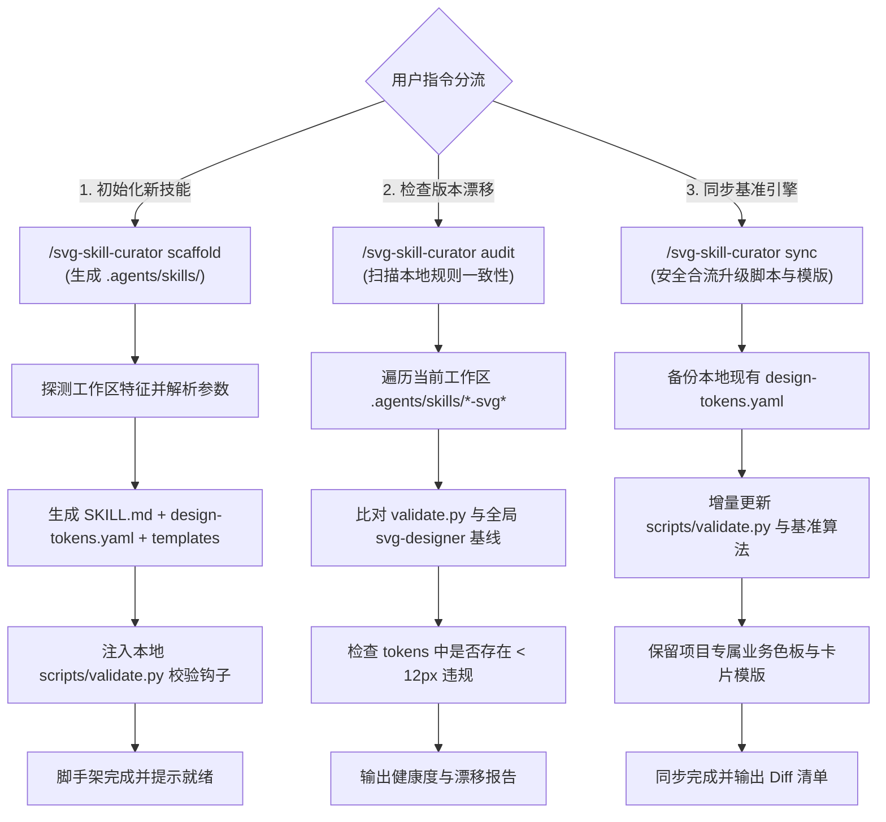

<!-- config/skills/svg-skill-curator/SKILL.md -->
---
name: svg-skill-curator
description: 局部矢量技能脚手架与编目维护中枢：负责在项目工作区初始化 .agents/skills/<project>-svg-generator、生成设计变量契约与质检钩子、探测并同步版本漂移。
references:
  - gotchas
---

# SVG Skill Curator

# Role

Vector Skill Architect & Governance Curator (项目局部技能脚手架与生命周期编目器)

# Mission

负责在业务项目工作区中自动化脚手架、编目与治理项目专属的局部 SVG 技能（位于 `.agents/skills/<project>-svg-generator/`），注入标准化设计变量契约（`design-tokens.yaml`）与本地质检钩子；提供跨项目规则版本漂移探测（Audit）与安全合流同步（Sync），防止局部技能腐化与小字号缺陷穿透。

# Constraints

- **安全幂等与非破坏性原则**：在执行重新脚手架或版本同步时，**绝对禁止盲目覆盖用户已定制的 `design-tokens.yaml`**。
- **字阶基线零容忍**：脚手架生成的所有模板、样例及验证脚本，其字阶基线必须严格锁定 $\text{font-size} \ge 12\text{px}$，严禁生成任何包含默认小字号的脚手架资产。
- **路径自包含契约**：项目局部生成的脚本与相对路径引用必须基于工作区根目录，严禁在局部资产中硬编码特定机器的绝对物理路径，确保跨平台与团队协同兼容性。
- **架构隔离**：Curator 仅负责局部技能的脚手架构建与规则编目，日常矢量图绘制交付给项目局部技能与全局 `svg-designer` 执行。

---

## 1. Core Execution Commands & State Machine (核心指令与执行状态机)

当用户或工作流需要初始化、检查或升级项目矢量技能时，按以下三大操作流转：



---

## 2. Command 1: Scaffold (项目技能一键脚手架)

### 2.1 触发场景
在全新项目或尚未建立矢量出图规范的工程中，为团队定制专属出图技能：

```bash
# 调度脚手架辅助脚本
python C:/Users/Reaticle/.gemini/config/skills/svg-skill-curator/scripts/scaffold.py scaffold --name traffic-arch-svg-generator --aspect-ratio 16:9 --theme dark
```

### 2.2 自动装配的目录架构
脚手架将在工作区根目录下创建以下标准结构：

```text
.agents/skills/<project>-svg-generator/
├── SKILL.md                 # 注入项目设计约束、空间代偿三原则与专属出图提示词
├── design-tokens.yaml       # 声明专属调色板、标准字阶 (>= 12px)、阴影、内边距
├── design-tokens.schema.json# 数据契约 Schema 校验
├── templates/
│   ├── arch-card.svg        # 基础双栏/单栏通用架构卡片模版
│   └── pipeline-flow.svg    # 标准数据流水线图元模版
└── scripts/
    └── validate.py          # 基于全局 svg-designer 规范装配的本地独立 DOM 质检脚本
```

---

## 3. Command 2: Audit (版本漂移审计)

### 3.1 触发场景
定期或在重大发布前，检查项目本地矢量技能是否落后于全局工程基线：

```bash
python C:/Users/Reaticle/.gemini/config/skills/svg-skill-curator/scripts/scaffold.py audit
```

### 3.2 审计判定矩阵
1. **字阶底线合规**：检测 `design-tokens.yaml` 中是否存在低于 `12px` 的基准字号定义。
2. **校验引擎版本**：检测本地 `scripts/validate.py` 与全局 `svg-designer/scripts/validate_svg.py` 的哈希与特性一致性。
3. **空间代偿覆盖率**：检测项目 `SKILL.md` 是否完整继承了三级空间代偿决策（文案精炼 $\to$ `<tspan>` 折行 $\to$ 容器与画布级联外扩）。

---

## 4. Command 3: Sync (安全合流升级)

### 4.1 触发场景
当全局 `svg-designer` 优化了字体折行算法、增加了标点补偿或强化了质检脚本时：

```bash
python C:/Users/Reaticle/.gemini/config/skills/svg-skill-curator/scripts/scaffold.py sync --name traffic-arch-svg-generator
```

### 4.2 三路合并防护法则
- **只读升级区**：更新 `scripts/validate.py` 与通用图元计算逻辑；
- **强保护资产**：**坚决保留**用户在 `design-tokens.yaml` 中配置的私有品牌色、业务宽高比与豁免名单；
- **变更透明化**：输出明确的文件更新清单供审查。

---

## 5. References & Pitfalls

详细脚手架踩坑案例、模板防腐规则与 BAD/GOOD 对照请参阅本技能参考资料：
[gotchas.md](file:///C:/Users/Reaticle/.gemini/config/skills/svg-skill-curator/references/gotchas.md)
