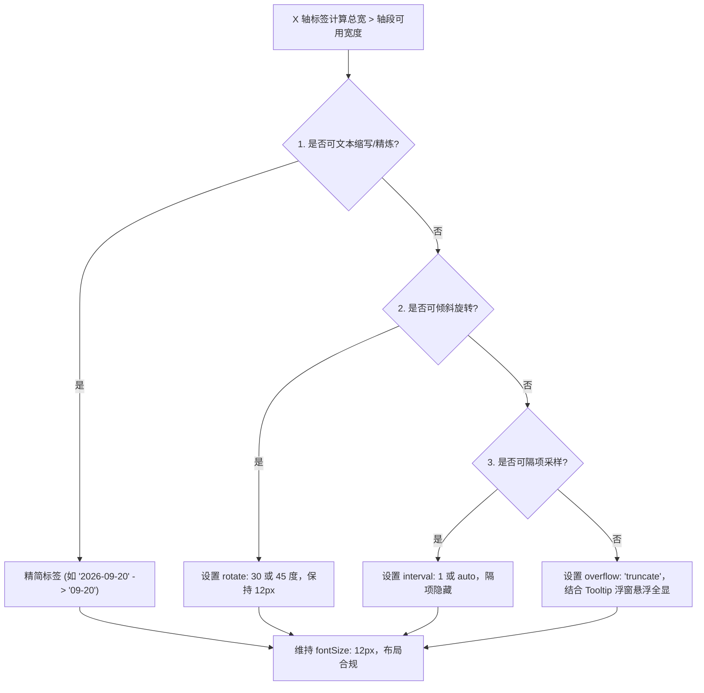
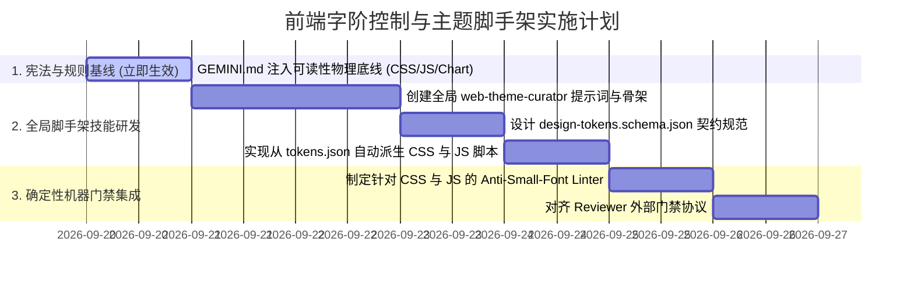

<!-- 2026-09-20-CSS-Typography-Control-and-Theme-Scaffolding-Architecture -->
# 前端字阶控制与主题脚手架技能架构方案
# (Frontend Typography Scale Control & Theme Scaffolding Architecture Specification)

- **文档状态**：PROPOSED / ARCHITECTURAL BASELINE
- **编制日期**：2026-09-20
- **分析主体**：`/analyzer` (System Analyst)
- **关联基线**：[20260920_typography_scale_control_and_skills_boundary_specification.md](2026-09-20-Typography-Scale-Control-and-Skills-Boundary-Specification)
- **目标目录**：`C:\Users\Reaticle\.gemini\config\docs\`

---

## 1. Objectives (目标解构)

### 1.1 业务与研发痛点解构
在前端工程与数据可视化开发实践中，模型在调用 `/builder` 编写页面或图表代码时，频繁出现可读性缺陷：
1. **CSS 散落微小字号**：模型在处理辅助标签、角标（Badge）、表格脚注时，习惯性生成 `font-size: 9px`、`10px` 等失真字号；
2. **JavaScript 图表配置深层硬编码**：在 ECharts、D3、Canvas、Three.js 或动态 DOM 脚本中，嵌套对象内部硬编码 `fontSize: 9`、`10`（如 `axisLabel.fontSize`、`legend.textStyle.fontSize`、`ctx.font = '10px sans-serif'`），模型以此来避免坐标轴标签重叠或图例溢出；
3. **全局 Skill 的被动性与失效**：日常调用 `/builder` 属于通用代码构建任务，如果仅创建一个独立的排版 Skill，由于其“按需触发”特性，根本不会在日常构建中被自动唤醒；
4. **人工风格输入缺乏标准映射**：用户给出自然语言风格诉求（如“深色科技感大屏，主色深蓝青色”或“浅色敏捷管理 SaaS”）时，缺乏确定性的转换通道将风格提示词翻译为工程级代码资产。

### 1.2 方案核心目标
1. **建立全局主题脚手架中枢（`web-theme-curator`）**：支持依据人工给出的项目风格提示词，一键初始化并注入标准前端设计资产与字阶安全基线（$\text{font-size} \ge 12\text{px}$）。
2. **确立单一真相源（SSOT）派生架构**：明确 `tokens.css` 与 `chartTheme.js` 的解耦协同机制——**物理分离、契约同源**，既保障 CSS 与 JS 的原生运行性能与类型安全，又杜绝色彩与字阶漂移。
3. **构建三位一体防御拦截网**：
   - **宪法层**：全局规则（Rule）常驻约束代码生成行为；
   - **资产层**：提供预制主题常量，消除裸写魔法数字；
   - **门禁层**：静态 Linter 规则结合 `/reviewer` 实现机器级确定性拦截。

---

## 2. Constraints (边界契约矩阵)

为确保系统各层级权责分明，防止元架构退化与资产腐化，建立如下四层边界契约矩阵：

| 层级维度 | 归属主体 | 核心职责 | 绝对禁止（Negative Constraints） | 准入交付物 |
| :--- | :--- | :--- | :--- | :--- |
| **Tier 0<br>全局元工作流** | `builder`<br>`reviewer`<br>`verifier` | - 全语言通用构建与审查<br>- 宏观质量验收与防腐 | - **严禁硬编码**特定前端框架语法与特定色板常数<br>- **严禁 Reviewer 阶段擅自重写业务样式** | 通用代码、标准工程文档、宏观门禁报告 |
| **Tier 0.5<br>全局工程宪法** | `GEMINI.md`<br>*(全局 Rule)* | - 声明跨语言、常驻上下文的不可逾越红线 | - 严禁写入项目私有业务逻辑<br>- 仅限通用工程标准（如可读性物理底线） | 全局工程规则声明 |
| **Tier 1<br>全局主题中枢** | `web-theme-curator`<br>*(全局脚手架 Skill)* | - 接收人工风格提示词，推导设计变量<br>- 自动化脚手架生成 `tokens.json` 并派生 `tokens.css` 与 `chartTheme.js`<br>- 注入确定性 Linter 门禁配置 | - **严禁直接承接日常通用代码编写**（日常写页面仍交由 `/builder`）<br>- **严禁生成 `< 12px` 的字阶常量** | `tokens.json`、`tokens.css`、`chartTheme.js`、Linter 校验配置 |
| **Tier 2<br>项目级实现** | `src/styles/`<br>`src/utils/` | - 业务组件消费 CSS 变量<br>- 图表与 Canvas 消费 JS 主题常量 | - **严禁在组件与图表代码中裸写像素魔法数字**<br>- 严禁图表与 CSS 脱离中间契约各自独立演进 | 业务页面、交互组件、数据大屏看板 |

### 2.1 tokens.css 与 chartTheme.js 的解耦与协同契约
针对“放在一起还是分开”的问题，确立如下**物理隔离、数据同源**契约：

```mermaid
graph TD
    Prompt["人工风格提示词<br>(例如: 智慧交通深色科技大屏, 1080P)"] --> Curator["web-theme-curator<br>(全局脚手架技能)"]
    
    subgraph SSOT[单一真相源: 单一契约文件]
        TokensJSON["design-tokens.json / tokens.yaml<br>(定义 Palette, Scale >= 12px, Radius)"]
    end
    
    Curator -->|推导演绎并输出| TokensJSON
    
    subgraph OutputAssets[项目物理交付物 (解耦输出)]
        CSS["src/styles/tokens.css<br>(原生 CSSOM 消费: Flex/Grid/HTML)"]
        JS["src/utils/chartTheme.js<br>(V8 引擎消费: ECharts/Canvas/D3)"]
        Lint["stylelint.config.js / eslint-rule<br>(静态拦截: 禁止 < 12px)"]
    end
    
    TokensJSON -->|静态编译派生| CSS
    TokensJSON -->|静态编译派生| JS
    TokensJSON -->|配置生成| Lint
```

- **必须物理分离的根本原因**：
  1. **运行时解析环境不同**：`tokens.css` 属于纯 CSSOM 规范，由浏览器样式渲染引擎在渲染流水线首阶段加载；`chartTheme.js` 运行于 V8 引擎，被 ECharts / Canvas 脚本在运行时动态同步消费。
  2. **避免跨媒介运行时开销与 SSR 崩溃**：若合并为单文件，JS 必须通过 `getComputedStyle` 异步嗅探 DOM 样式，在无 DOM 环境（Node.js 服务端渲染 SSR、离线出图、Web Worker）下会直接报错；若使用 CSS-in-JS 强行打包，又会破坏纯 CSS 项目的轻量性。
  3. **职责专注与 Tree-Shaking**：纯 UI 组件只引入 CSS，图表模块只引入 JS 主题对象，互不增加额外运行时包体积。
- **必须契约同源的根本原因**：
  - 由 `design-tokens.json` 充当中间契约（SSOT），一处修改，由脚本同步重新派生 `tokens.css` 与 `chartTheme.js`，确保大屏背景色、坐标轴颜色、图例字阶与卡片正文完全同调，杜绝视觉割裂。

---

## 3. Architecture (系统架构与数据流模型)

### 3.1 总体架构拓扑

```mermaid
graph TD
    User["开发者 / 架构师"] -->|1. 输入风格提示词与业务诉求| WTC["/web-theme-curator (全局脚手架)"]
    
    subgraph Scaffolding[脚手架推导阶段 (Scaffolding Phase)]
        WTC -->|推导生成| SSOT["design-tokens.json (项目根目录/配置)"]
        SSOT --> GenCSS["生成 tokens.css (CSS Variables)"]
        SSOT --> GenJS["生成 chartTheme.js (ECharts/Canvas Theme)"]
        SSOT --> GenLinter["注入 Anti-Small-Font Linter 规则"]
    end
    
    subgraph Production[日常构建阶段 (Production Phase)]
        UserReq["用户日常开发: /builder 实现数据大屏"] --> Builder["/builder"]
        RuleHook["GEMINI.md (常驻宪法: 可读性物理底线)"] -.->|隐式强制约束| Builder
        
        Builder -->|样式引用| GenCSS
        Builder -->|图表引用| GenJS
        Builder --> Comp["输出业务组件与图表代码"]
    end
    
    subgraph Verification[门禁拦截阶段 (Gate Phase)]
        Comp --> Linter["Stylelint / AST Scanner 静态质检"]
        Linter -->|若检测到字号 < 12px| Fail["阻断报错: 输出违规行号并打回 /builder 重写"]
        Linter -->|全部字号 >= 12px| Pass["质检通过"]
        Pass --> Reviewer["/reviewer (宏观门禁准入)"]
        Reviewer --> Ready["正式交付"]
    end
```

### 3.2 字体字阶与图表代偿数学模型 (Typography Scale & Chart Layout)

为彻底解决 ECharts/Canvas 场景下的“小字号代偿”，确立如下数学模型：

#### 1. 标准离散字阶表 (Discrete Typography Scale)
$$S_{\text{typography}} = \{ 12\text{px (Floor)}, 14\text{px (Base)}, 16\text{px (SubTitle)}, 18\text{px (Title)}, 24\text{px (Headline)}, 32\text{px (Hero/Display)} \}$$
- 严禁出现 $12\text{px}$ 以下的任何中间值；
- 相对单位严格映射：$1\text{rem} = 16\text{px}$，则 $12\text{px} = 0.75\text{rem}$。

#### 2. 图表空间不足代偿决策模型 (Chart Congestion Compensation)
当图表 X 轴分类过多导致标签宽度超过物理间距（$W_{\text{label}} > \Delta X_{\text{tick}}$）时，**严禁通过将 `fontSize` 从 12 缩至 9 来防挤压**，必须严格按照如下代偿算法流转：



---

## 4. Work Breakdown Structure (工作分解结构与落地路径)



### 4.1 核心任务清单与执行要点

- **Task 1.1：全局工程规则锁定（GEMINI.md 补丁）**
  - 在 `C:\Users\Reaticle\.gemini\GEMINI.md` 的 `## Code-Specific Rules` 中增设 `## UI & Typography Readability Floor` 章节；
  - 显式列明：禁止在 CSS、JS/TS、ECharts option、Canvas `ctx.font` 中硬编码 `< 12px` 的字号数值。
- **Task 2.1：创建全局技能 `web-theme-curator`**
  - 目录：`C:\Users\Reaticle\.gemini\config\skills\web-theme-curator/`；
  - 提供核心指令：`/web-theme-curator scaffold` 与 `/web-theme-curator sync`；
  - 接收用户风格输入，智能匹配中性色、主色、功能色、阴影与标准字阶，生成标准化 `design-tokens.json`。
- **Task 2.2：构建静态派生引擎（Generator Script）**
  - 内置轻量派生逻辑：
    - 将 JSON 中的字阶与色板自动导出为 `src/styles/tokens.css`；
    - 将 JSON 中的配置自动导出为开箱即用的 ECharts / Canvas 通用配置对象 `src/utils/chartTheme.js`。
- **Task 3.1：配置确定性质检门禁**
  - 为脚手架项目预置正则或 Stylelint 检查规则，在交付审查阶段（`/reviewer`）自动扫描代码；
  - 只要探测到 `font-size: 10px`、`fontSize: 10` 等特征，直接判定 `FAIL` 并阻断交付。

---

## 5. Acceptance Criteria (验收指标体系)

| 验收维度 | 指标项 | 验证方式 | 合格阈值 | 违规动作 |
| :--- | :--- | :--- | :--- | :--- |
| **字阶生理保底** | CSS 最小字号 | 静态文本扫描 / Stylelint | 任何 CSS 文件中 $\text{font-size} \ge 12\text{px}$ (非豁免) | 门禁阻断，打回 `/builder` 重构 |
| **图表字阶保底** | JS 图表配置字号 | AST 扫描或正则检测 `fontSize:\s*([0-9]|1[0-1])\b` | 任何图表配置对象中 $\text{fontSize} \ge 12$ | 门禁阻断，强制引入 `chartTheme.js` |
| **架构解耦性** | 资产存在形式 | 文件系统检查 | `tokens.css` 与 `chartTheme.js` 独立存在，各司其职 | 禁止在 CSS 中硬塞 JS，禁止在 JS 中强行嗅探 DOM 样式 |
| **契约一致性** | 色板与字阶同步率 | 比对 `tokens.json`、`tokens.css` 与 `chartTheme.js` | 派生变量映射覆盖率 $= 100\%$，数值偏差 $= 0$ | 判定为版本漂移，触发 `sync` 重新派生 |
| **元工作流纯净度** | 全局元技能无污染 | 检查 `builder`、`reviewer`、`verifier` 源码 | 不包含针对特定前端类名或私有色值的硬编码 | 判定为元架构退化，撤销变更 |

---

## 6. Implementation Artifacts Reference (参考实现代码原型)

### 6.1 单一真相源：`design-tokens.json` 原型

```json
// design-tokens.json
{
  "name": "traffic-tech-dark",
  "palette": {
    "primary": "#00d2ff",
    "primaryHover": "#33dcff",
    "bgBase": "#0a1526",
    "bgCard": "rgba(16, 35, 63, 0.85)",
    "textMain": "#f0f4f8",
    "textSecondary": "#8fa2b8"
  },
  "typography": {
    "fontFamilyBase": "-apple-system, BlinkMacSystemFont, 'Segoe UI', Roboto, 'PingFang SC', sans-serif",
    "scale": {
      "floor": "12px",
      "sm": "14px",
      "base": "16px",
      "lg": "18px",
      "xl": "24px"
    },
    "leading": {
      "tight": 1.25,
      "normal": 1.5,
      "relaxed": 1.75
    }
  }
}
```

### 6.2 派生输出 1：`src/styles/tokens.css` 原型

```css
/* src/styles/tokens.css */
:root {
  /* Colors */
  --color-primary: #00d2ff;
  --color-primary-hover: #33dcff;
  --color-bg-base: #0a1526;
  --color-bg-card: rgba(16, 35, 63, 0.85);
  --color-text-main: #f0f4f8;
  --color-text-secondary: #8fa2b8;

  /* Typography (Floor >= 12px) */
  --font-family-base: -apple-system, BlinkMacSystemFont, 'Segoe UI', Roboto, 'PingFang SC', sans-serif;
  --text-xs: 0.75rem;    /* 12px 物理底线 */
  --text-sm: 0.875rem;   /* 14px 次级正文 */
  --text-base: 1rem;      /* 16px 标准正文 */
  --text-lg: 1.125rem;   /* 18px 标题 */
  --text-xl: 1.5rem;      /* 24px 大标题 */

  /* Leading */
  --leading-tight: 1.25;
  --leading-normal: 1.5;
  --leading-relaxed: 1.75;
}
```

### 6.3 派生输出 2：`src/utils/chartTheme.js` 原型

```javascript
// src/utils/chartTheme.js
// 自动由 design-tokens.json 编译生成，严禁手工篡改字阶数字

export const CHART_TOKENS = Object.freeze({
  colors: ['#00d2ff', '#00e599', '#ffb020', '#ff5252', '#9d65ff'],
  bgCard: 'rgba(16, 35, 63, 0.85)',
  textMain: '#f0f4f8',
  textSecondary: '#8fa2b8',
  fontSizeFloor: 12,      // 生理底线：严格锁定 12px
  fontSizeBase: 14,
  fontSizeTitle: 16,
  fontFamily: "-apple-system, BlinkMacSystemFont, 'Segoe UI', Roboto, sans-serif"
});

/**
 * 通用合规 ECharts 主题配置预设
 */
export const defaultEChartsTheme = Object.freeze({
  backgroundColor: 'transparent',
  textStyle: {
    fontFamily: CHART_TOKENS.fontFamily,
    fontSize: CHART_TOKENS.fontSizeFloor,
    color: CHART_TOKENS.textSecondary
  },
  title: {
    textStyle: {
      color: CHART_TOKENS.textMain,
      fontSize: CHART_TOKENS.fontSizeTitle,
      fontWeight: 600
    }
  },
  legend: {
    textStyle: {
      color: CHART_TOKENS.textSecondary,
      fontSize: CHART_TOKENS.fontSizeFloor // 12px 保底
    }
  },
  xAxis: {
    axisLine: { lineStyle: { color: 'rgba(255, 255, 255, 0.15)' } },
    axisLabel: {
      color: CHART_TOKENS.textSecondary,
      fontSize: CHART_TOKENS.fontSizeFloor, // 12px 保底
      margin: 12,
      interval: 'auto',
      rotate: 0 // 空间不足由 rotate 解决，严禁改写字号
    }
  },
  yAxis: {
    axisLine: { lineStyle: { color: 'rgba(255, 255, 255, 0.15)' } },
    splitLine: { lineStyle: { color: 'rgba(255, 255, 255, 0.08)' } },
    axisLabel: {
      color: CHART_TOKENS.textSecondary,
      fontSize: CHART_TOKENS.fontSizeFloor // 12px 保底
    }
  },
  tooltip: {
    backgroundColor: 'rgba(10, 21, 38, 0.95)',
    borderColor: CHART_TOKENS.colors[0],
    textStyle: {
      color: '#ffffff',
      fontSize: CHART_TOKENS.fontSizeFloor
    }
  }
});
