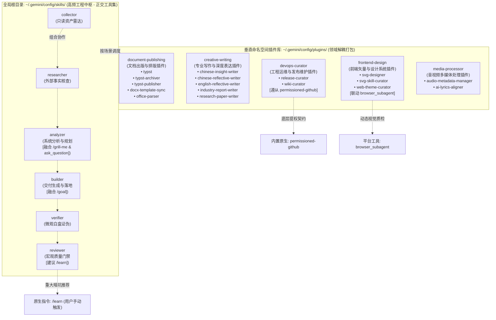
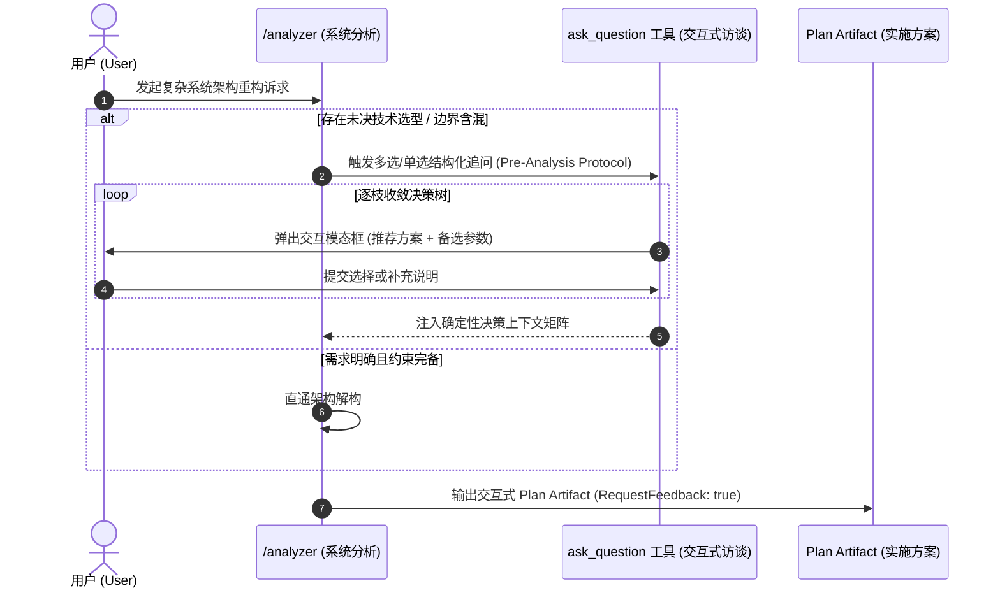
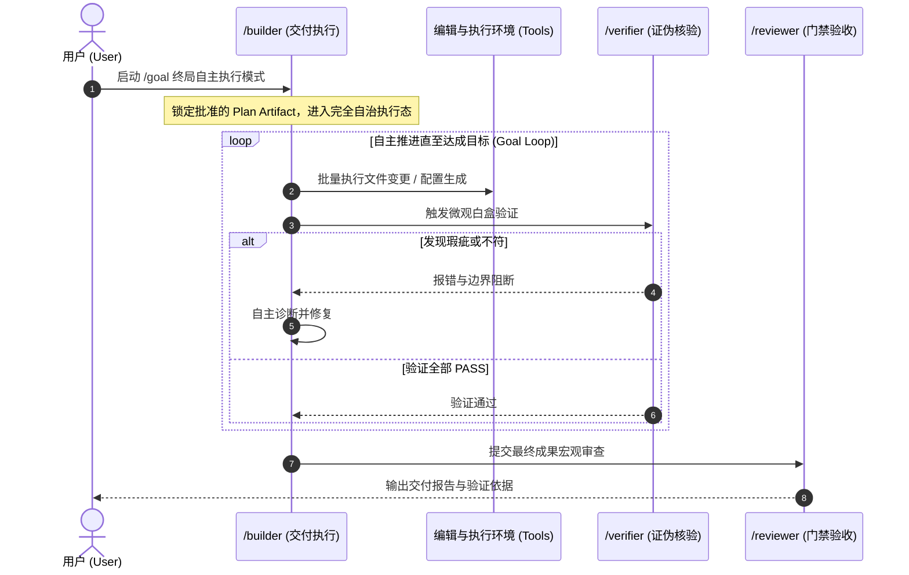
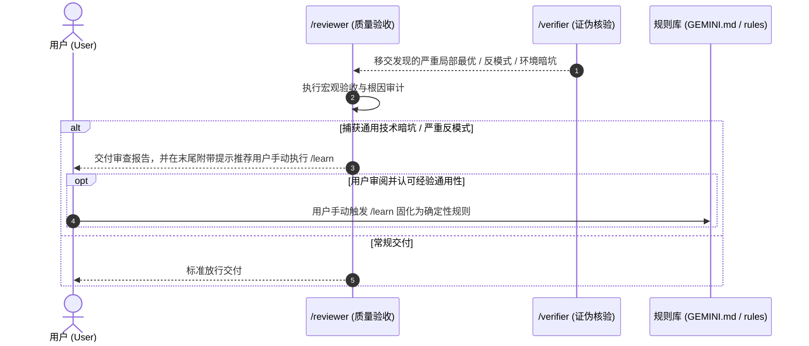
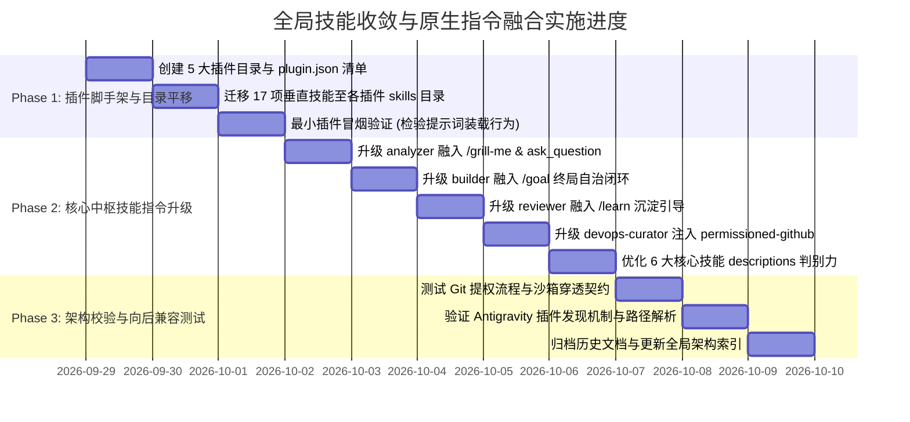

<!-- 2026-09-28-Global-Skills-Asset-Convergence-and-Command-Integration-Architecture -->
# 全局技能资产打包收敛与原生指令融合架构方案 (Global Skills Asset Convergence & Native Commands Integration Architecture)

- **文档状态**：EXECUTED / COMPLETED (2026-09-29 执行落地完成)
- **制定日期**：2026-09-28
- **分析主体**：`/analyzer` (System Analyst)
- **输入依据**：`/researcher` 全局技能审计与 Antigravity 2.0 / Gemini 3.8 原生契约分析
- **目标对象**：`config/skills/` 23 项自研全局技能体系及 `config/plugins/` 架构
- **归属目录**：`config/docs/`

---

## 1. 背景与问题定义 (Context & Diagnostic)

### 1.1 资产分布现状与调用频度断层
当前在 `~/.gemini/config/skills/` 目录下共平铺维护了 23 项自研全局技能。在实际高频研发与辅助交互中，技能的调用频次呈现出极端的分化断层：

1. **核心研发链路（Core Hexagon Pipeline）的高频吞吐**：
   - `collector`（本地资产扫描） $\rightarrow$ `researcher`（外部事实查证） $\rightarrow$ `analyzer`（系统解构与规划） $\rightarrow$ `builder`（交付实现） $\rightarrow$ `verifier`（独立证伪） $\rightarrow$ `reviewer`（质量验收）。
   - 这 6 项通用工程中枢技能几乎覆盖了 85% 以上的核心编程、方案重构与质量验收生命周期，属于最高优先级的基础设施。
2. **垂直领域工具的平铺冗余与路由漂移风险**：
   - 剩余 17 项技能属于高度特化、垂直场景的专用工具（如 Word 模板逆向提取、音频元数据标签注入、特定文体创作、Wiki 同步等）。
   - **加载机制现实与核查证伪**：在 Antigravity 的发现逻辑中，全局发现根路径（`~/.gemini/config/`）下无论是平铺 skills 还是 plugins 内部的 skills，其 `name` 与 `description` 元数据在插件被发现并启用时均会被注入会话上下文（参考 `science` 插件现实验证）。
   - 单纯将技能物理挪入 `plugins/` 目录并不能直接阻断元数据加载；但平铺在根目录下会导致核心中枢与垂直工具职责混杂，过长或相似的 `description` 极易引发模型在意图路由时的语义漂移与误唤醒。
   - **治理收益聚焦点**：收敛至垂直插件包的核心价值在于**目录与语义正交化**、**精简核心技能描述判别力**，并为未来基于 `plugins.json` 实现显式按需启用提供标准化单元基座。

### 1.2 原生高阶命令与平台底层契约的断层
Antigravity 平台深度演化并标准化了一套原生高阶能力与安全准则：
- **`/grill-me`**：交互式多轮访谈（Interview），用于在复杂方案确定前穷尽分支决策树。
- **`/goal`**：免人工值守的终局自主迭代模式，要求代理自主闭环直到目标彻底达成。
- **`/learn`**：经验反思与知识沉淀命令，用于将用户纠偏或避坑准则固化为持久化规则。
- **`permissioned-github`**：平台官方内置的原生权限控制技能（[permissioned-github](https://github.com/TREYWANGCQU/.gemini/blob/main/antigravity-ide/builtin/skills/permissioned-github/SKILL.md)），严格规范了在沙箱拦截下通过 `ask_permission` 工具进行标准提权的协议格式。
- **`browser_subagent`**：内置真实浏览器动态交互、DOM 探测与录屏验证机制。

目前自研技能体系虽然在 2026-09-24 成功融合了 `/plan` 门禁，但在面对模糊需求、长周期自治交付、DevOps 远程提权及质量反思沉淀时，尚未与上述原生能力形成确定性契约联动，存在链路断层与沙箱阻断风险。

---

## 2. 核心治理架构与收敛矩阵 (Convergence Architecture)

### 2.1 拓扑设计：核心高频中枢保留 + 垂直插件化收敛

采用 **“1个核心中枢基线 (Global Core Hub) + 5大垂直命名空间插件 (Domain Plugin Bundles) + 原生底层基座对齐”** 的解耦架构：

> [!NOTE]
> **中枢调度哲学说明**：
> 核心中枢的 6 项技能本质为**高度解耦的正交工具集**，支持在研发各环节按需单点触发（例如单独调用 `/verifier` 证伪局部逻辑、直接调用 `/builder` 执行代码修复），亦可在大型复杂交付中串联编排，严禁将其中枢关系僵化理解为强制单向的六步瀑布流水线。

### 2.2 打包收敛映射清单 (17 项垂直技能归属与原生能力支撑)

| 目标插件目录 (`config/plugins/`) | 包含技能 (`skills/`) | 插件职能定位与核心边界 | 支撑之原生能力 / 底层契约 |
| :--- | :--- | :--- | :--- |
| **`document-publishing`** | `docx-template-sync` `office-parser` `typst` `typst-archiver` `typst-publisher` | 专注于 Word/Docx 逆向指纹提取、结构化切片解析、Typst 高保真排版、编译出版与差分合流归档。 | 纯本地无损处理，依赖 `office-parser` 守卫与 AST 合流门禁。 |
| **`creative-writing`** | `chinese-insight-writer` `chinese-reflective-writer` `english-reflective-writer` `industry-report-writer` `research-paper-writer` | 专注于深度中文/英文随笔、商业洞察评论、行业研报与学术论文的框架构建与正文创作。 | 遵循非营销、工程化表达原则。 |
| **`frontend-design`** | `svg-designer` `svg-skill-curator` `web-theme-curator` | 专注于矢量 SVG 绘制、设计变量契约（`design-tokens.json`）、前端字阶生理底线（$\ge 12\text{px}$）质检与脚手架搭建。 | **`browser_subagent`**：在交付复杂 Web UI 时，可调度浏览器子代理抓取真实渲染 DOM 与截图进行动态质检。 |
| **`devops-curator`** | `release-curator` `wiki-curator` | 专注于 Git 版本跃迁、Changelog 增量生成、Release 发布文案编目及 GitHub Wiki CI 流水线部署。 | **`permissioned-github`**：远程分支更新、PR 提交、tag 推送时，严格遵守原生提权协议。 |
| **`media-processor`** | `ai-lyrics-aligner` `audio-metadata-manager` | 专注于音频无损元数据标签读写、封面嵌入及 AI 歌词毫秒级时间轴对齐。 | 本地音视频元数据无损编解码。 |

---

## 3. 原生高级命令与自研体系深度融合 (Native Commands & Capabilities Integration)

### 3.1 `/grill-me` 融入：需求澄清与方案访谈门禁 (`analyzer` 增强)

**契约注入规则**：
- 在 [`config/skills/analyzer/SKILL.md`](https://github.com/TREYWANGCQU/.gemini/blob/main/config/skills/analyzer/SKILL.md) 中增加 **Pre-Analysis Clarification Protocol**：
  若检测到需求涉及 2 种以上异构方案选型或关键架构参数缺失，主动调用平台原生 `ask_question` 工具推进单点聚焦提问；同时若用户显式输入 `/grill-me`，`analyzer` 自动进入多轮递归访谈模式，逐枝锁定设计决策，避免基于推测生成虚假架构。

### 3.2 `/goal` 融入：终局自主交付闭环 (`builder` 增强)

**契约注入规则**：
- 在 [`config/skills/builder/SKILL.md`](https://github.com/TREYWANGCQU/.gemini/blob/main/config/skills/builder/SKILL.md) 中增加 **Goal-Mode Autonomous Contract**：
  当上下文标记有 `/goal` 时：
  1. 必须以已批准的 Plan Artifact 为唯一基准，严禁偏离目标；
  2. 遇到测试或验证失败时，自主执行“定位-修复-复验”循环，严禁在未穷尽排查手段前中断并向用户抛出半成品；
  3. 交付完成且经由 `verifier` 及 `reviewer` 验收后，显式在最终响应中输出结构化交付总览与验证依据。

### 3.3 `permissioned-github` 融入：DevOps 沙箱提权与远程操作准则 (`devops-curator` 基座)

Antigravity 运行在受控安全沙箱中，直接运行 `git push` 或通过脚本直连 GitHub API 会被拦截。
`devops-curator` 插件（`release-curator`, `wiki-curator`）必须严格遵守 [permissioned-github](https://github.com/TREYWANGCQU/.gemini/blob/main/antigravity-ide/builtin/skills/permissioned-github/SKILL.md) 规范：

1. **工具基准**：
   - 远程仓库管理与 Issue/PR/Release 操作仅允许使用官方 **`gh`** CLI（必须指定 `-R ORG/REPO` 参数）。
   - 分支更新、Commit 提交与 Tag 推送仅允许使用标准 **`git`** 命令。
   - 严禁使用 `curl` 绕过或编写临时脚本直连 GitHub API。
2. **沙箱拦截与标准提权协议**：
   - 仅在命令执行遭遇权限拒绝报错时，方可触发提权申请，禁止预先无故弹出权限确认。
   - **工具可用性前置断言**：提权申请依赖宿主注入的 `ask_permission` 工具；若当前环境未注册该工具（如本地开放环境或特定终端），则停止继续盲目重试，显式向用户说明权限阻断原因并提供推荐手动执行的 Git/gh 命令。
   - 在提供 `ask_permission` 的沙箱环境中，调用参数设为 `Action="custom"`，Target 必须符合精确标准格式：
     - 推送已存在分支：`git.update({"org": "ORG", "repo": "REPO", "branch": "BRANCH"})`
     - 推送全新分支：`git.create({"org": "ORG", "repo": "REPO", "branch": "BRANCH"})`
     - 创建 Release/PR：`gh.create({"org": "ORG", "repo": "REPO", "issue": "*"})` 或相应资源键。

### 3.4 `/learn` 融入：门禁验收后的经验沉淀机制 (`reviewer` 增强)

**契约注入规则**：
- 在 [`config/skills/reviewer/SKILL.md`](https://github.com/TREYWANGCQU/.gemini/blob/main/config/skills/reviewer/SKILL.md) 中增加 **Post-Review Learning Recommendation**：
  - **平台契约边界**：Slash Commands 属于用户界面快捷指令，Agent 无权也无法自动代执行 `/learn`；
  - **高阈值防泛化约束**：严禁在常规交付后无差别触发推荐，避免导致规则库膨胀（Rule Bloat）、过拟合及会话基础 Token 持续消耗；
  - **建议机制**：仅当在审查或微观验证过程中捕获到了重大技术反模式、底层环境不兼容暗坑或用户明确给出的关键纠偏指令，且经评估具有跨会话通用价值时，方可在最终评审报告末尾附带轻量建议（“💡 提示：本次捕获了具备通用性的暗坑约束，如有需要可手动执行 `/learn` 固化为规则”），交由用户决策是否持久化。

---

## 4. 实施工作分解结构 (Work Breakdown Structure - WBS)

### Phase 1: 插件体系构建与资产无损迁移
- [x] **Task 1.1**：在 `~/.gemini/config/plugins/` 下创建 5 个插件目录并写入规范 `plugin.json`：
  - `document-publishing/plugin.json`
  - `creative-writing/plugin.json`
  - `frontend-design/plugin.json`
  - `devops-curator/plugin.json`
  - `media-processor/plugin.json`
- [x] **Task 1.2**：将对应的 17 项技能目录安全平移至各插件的 `skills/` 下，确保各技能内部的 `references/`, `scripts/` 等资源完整迁移。
- [x] **Task 1.2.1**：全量扫描并批量重构被迁移垂直技能（重点为 `frontend-design` 插件旗下的 `web-theme-curator`, `svg-designer`, `svg-skill-curator`）内部硬编码的绝对脚本执行路径（`C:/Users/Reaticle/.gemini/config/skills/...`）及 markdown 链接，同步纠偏为新插件路径，杜绝脚本运行时 `FileNotFoundError`。
- [x] **Task 1.3**：进行最小插件单技能迁移冒烟测试，实测并记录全新对话中 System Prompt 的元数据装载行为。

### Phase 2: 核心中枢技能升级与指令深度绑定
- [x] **Task 2.1**：改造 [`config/skills/analyzer/SKILL.md`](https://github.com/TREYWANGCQU/.gemini/blob/main/config/skills/analyzer/SKILL.md)：注入 Pre-Analysis Clarification 规范，与 `/grill-me` 及 `ask_question` 建立显式映射。
- [x] **Task 2.2**：改造 [`config/skills/builder/SKILL.md`](https://github.com/TREYWANGCQU/.gemini/blob/main/config/skills/builder/SKILL.md)：注入 Goal-Mode Autonomous 契约，支持闭环自愈与结构化验收交付。
- [x] **Task 2.3**：改造 [`config/skills/reviewer/SKILL.md`](https://github.com/TREYWANGCQU/.gemini/blob/main/config/skills/reviewer/SKILL.md)：注入 Post-Review Learning Recommendation，建立高门槛推荐 `/learn` 经验沉淀机制。
- [x] **Task 2.4**：改造 `devops-curator` 相关技能（`release-curator`, `wiki-curator`）：注入 `permissioned-github` 沙箱安全与 `ask_permission` 提权协议（附带工具存在性断言）。
- [x] **Task 2.5**：精修保留的 6 项核心技能（`collector`, `researcher`, `analyzer`, `builder`, `verifier`, `reviewer`）的 YAML Frontmatter Description，确保中枢路由高度正交。

### Phase 3: 架构校验与系统验证
- [x] **Task 3.1**：在全新对话窗口中验证插件内技能是否能被正常发现并激活（例如调用 `@typst` 或 `@chinese-insight-writer`）。
- [x] **Task 3.2**：执行一次含远程分支操作的模拟发布，验证 `permissioned-github` 提权链路无阻断。
- [x] **Task 3.3**：更新全局架构设计文档与索引。

---

## 5. 验收门禁与验证方案 (Verification & Acceptance Criteria)

### 5.1 刚性验收指标 (Hard Criteria)
1. **工程根目录高度聚焦（Core Hub Purity）**：
   - `config/skills/` 根目录下严格仅保留 6 个高频工程技能目录，垂直工具彻底解耦归入领域插件包。
2. **能力资产零损耗（Zero Asset Loss）**：
   - 迁移至各插件的 17 项技能，其内部实现、模板文件、测试用例 100% 保持可用，YAML 元数据规范完全符合 Antigravity 插件发现规范；内部硬编码脚本路径与引用 100% 同步更新。
3. **平台原生契约全对齐（Platform Contracts Alignment）**：
   - `/grill-me` 通过 `ask_question` 顺畅承接为决策上下文；
   - `/goal` 被 `builder` 严格约束为闭环自检交付，严禁盲目中途抛出异常；
   - `devops-curator` 遵守 `permissioned-github`，包含 `ask_permission` 工具可用性前置校验；
   - 质检严重缺陷能够顺畅触发人工审阅级的 `/learn` 建议。

### 5.2 质量门禁检查表 (Reviewer Gate Checklist)
- [x] 每个 `plugin.json` 包含标准 `name`, `version`, `description` 字段。
- [x] 核心技能不存在指向已移动路径的硬编码相对路径失效问题。
- [x] 被迁移垂直技能内部硬编码的脚本绝对路径与 references 链接 100% 同步重定向完成。
- [x] DevOps 技能包含 `ask_permission` 工具存在性断言，提供沙箱受限与常规本地环境的双轨适配。
- [x] 文档沉淀于 `config/docs/` 规范目录，版本号与演进脉络连续。
