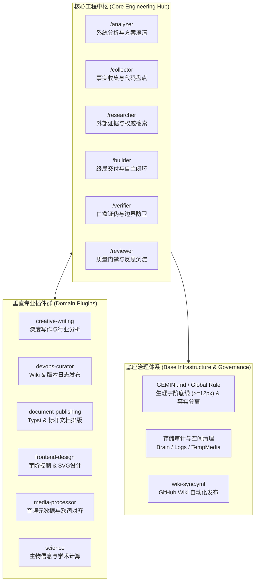

# 知识库主页 (Antigravity Global Architecture Knowledge Base)

欢迎访问 **.gemini** 全局架构、技能体系与环境治理的官方技术知识库。

本项目作为个人高阶 AI 辅助工程与多智能体系统（MAS）的全局基础设施，沉淀了从全局工作流演进、技能拓扑收敛、工程中枢防御到通信协议抗脆弱性优化的全量架构方案。

---

## 架构拓扑全景 (Architecture Panorama)

---

## 架构演进与技术规范专栏 (Architecture Roadmap)

### 1. 交互协议与工程中枢赋能 (Interaction Protocol & Engineering Hub)
| 制定日期 | 方案标题 | 核心突破 |
| :--- | :--- | :--- |
| 2026-10-08 | [全局技能抗脆弱性与通信协议优化演进架构方案](2026-10-08-Global-Skills-Antifragility-and-Protocol-Optimization-Architecture) | 引入“替代成本壁垒”、“交集垄断”、“主动打破局部最优”与“向上通信协议优化”，消除代理交互心智带宽磨损。 |
| 2026-09-24 | [全局技能集成 /plan 交互门禁机制架构方案](2026-09-24-Global-Skills-Plan-Mechanism-Integration-Architecture) | 确立高危操作交互式审批门禁，阻断非受控执行。 |

### 2. 技能架构与资产分类 (Skills Architecture & Convergence)
| 制定日期 | 方案标题 | 核心突破 |
| :--- | :--- | :--- |
| 2026-09-28 | [全局技能资产打包收敛与原生指令融合架构方案](2026-09-28-Global-Skills-Asset-Convergence-and-Command-Integration-Architecture) | 构建“6 大核心中枢 + 5 大垂直插件”拓扑，无缝融合 slash commands 原生指令体系。 |
| 2026-09-17 | [全局技能边界调和与架构演进方案](2026-09-17-Skills-Boundary-Reconciliation-and-Evolution-Proposal) | 解决技能重叠与职责冲突，规范能力边界划分。 |
| 2026-09-07 | [Skills 资产全景分布与脚本准入判定评估报告](2026-09-07-Skills-Assets-Taxonomy-and-Scripts-Evaluation) | 全量资产盘点，设立脚本引入硬性准入基线。 |

### 3. 工作流与治理演进 (Workflows & Lifecycle Evolution)
| 制定日期 | 方案标题 | 核心突破 |
| :--- | :--- | :--- |
| 2026-09-07 | [全局工作流废弃与技能架构演进更新报告](2026-09-07-Global-Workflows-Deprecation-and-Skills-Migration) | 全面废弃旧版静态 global_workflows，升级为动态声明式技能架构。 |
| 2026-09-03 | [全局工作流架构增强方案：版本锚定、分层防御与熔断协议](2026-09-03-Global-Workflows-Upgrade-Proposal) | 建立版本锚定防御与异常熔断机制。 |

### 4. 字阶控制与排版治理 (Typography & Frontend Governance)
| 制定日期 | 方案标题 | 核心突破 |
| :--- | :--- | :--- |
| 2026-09-20 | [字体大小控制与矢量排版技能边界架构规范](2026-09-20-Typography-Scale-Control-and-Skills-Boundary-Specification) | 确立绝对生理字阶底线（`font-size >= 12px`），禁止任何缩放或伪缩小绕过。 |
| 2026-09-20 | [前端字阶控制与主题脚手架技能架构方案](2026-09-20-CSS-Typography-Control-and-Theme-Scaffolding-Architecture) | 提供 CSS/JS 主题自动化衍生脚手架与质检钩子。 |

### 5. 环境治理与存储安全 (Storage Audit & Safety)
| 制定日期 | 方案标题 | 核心突破 |
| :--- | :--- | :--- |
| 2026-09-18 | [.gemini 目录存储深度审计与安全清理专项调研报告](2026-09-18-Gemini-Directory-Storage-Audit-and-Safe-Cleanup-Guide) | 审计 Brain、Logs 与临时存储，制定零误删安全清理标准流程。 |

### 6. 版本发布历史 (Release History)
| 发布日期 | 版本号 | 核心突破与发版概述 | 发布说明 |
| :--- | :--- | :--- | :--- |
| 2026-10-08 | **v2.0.1** | 核心工程中枢抗脆弱性与通信协议升级，上线 Wiki Staging 与 GitHub Actions 自动化发布流水线 | [v2.0.1 Release Notes](Release-Notes-v2.0.1) |
| 2026-09-29 | **v2.0.0** | Antigravity 2.0 全局技能资产收敛，构建“6 核心中枢 + 5 垂直插件”拓扑与原生指令融合 | [v2.0.0 架构方案](2026-09-28-Global-Skills-Asset-Convergence-and-Command-Integration-Architecture) |

---

## 自动化持续部署 (Continuous Delivery)

本项目 Wiki 依托 **wiki-curator** 架构与 GitHub Actions 实现自动化部署：
1. **源文件编辑**：在主仓库 `config/docs/` 下编写或更新 Markdown 文档。
2. **本地受控编译**：运行 `pwsh scripts/build-wiki-staging.ps1`，自动完成链接规整与暂存区构建。
3. **极速发布**：推送到 `main` 分支后，GitHub Actions 工作流将在 30 秒内无缝镜像同步至 GitHub Wiki 网页端。